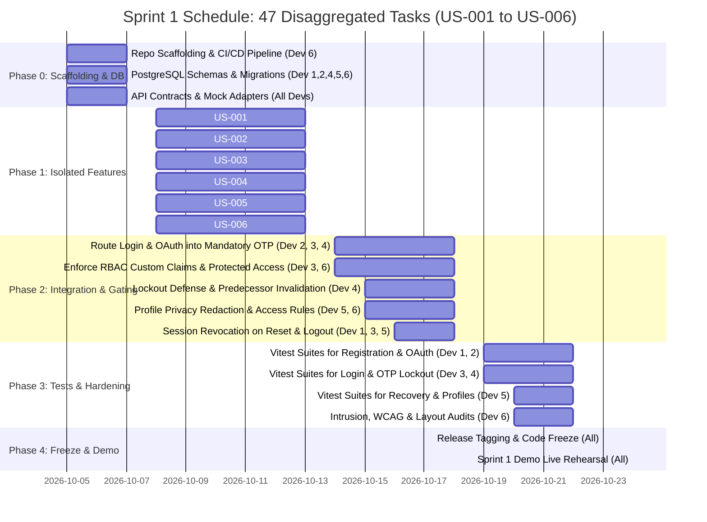

# Sprint 1 Detailed Implementation Schedule (Narrowed Scope: Auth & Profiles)

**Sprint Duration:** October 5, 2026 – October 24, 2026 (Freeze: October 24 EOD; Course Demo: October 25, 2026)  
**Team Size:** 6 Developers  
**Sprint 1 Focus:** Identity, Authentication, Mandatory 2FA, Password Recovery, Profiles, and Security Hardening  
**Scope Baseline (6 User Stories / 47 Disaggregated Tasks):**  
- **Feature Area 1 (Identity & Profiles):** [US-001](../02_user_stories/user_stories.md#us-001), [US-002](../02_user_stories/user_stories.md#us-002), [US-003](../02_user_stories/user_stories.md#us-003), [US-004](../02_user_stories/user_stories.md#us-004), [US-005](../02_user_stories/user_stories.md#us-005), [US-006](../02_user_stories/user_stories.md#us-006)  
**Source Baseline:** Every task title, scope, and verification criteria in this schedule is directly mapped from [Task Disaggregation](task_disaggregation.md).  
**Deferred Scope (14 User Stories):**  
- [US-008](../02_user_stories/user_stories.md#us-008), [US-009](../02_user_stories/user_stories.md#us-009), [US-010](../02_user_stories/user_stories.md#us-010) (Event Directory, Submission, and Admin Verification) deferred to Sprint 2 by team agreement.  
- [US-011](../02_user_stories/user_stories.md#us-011)–[US-013](../02_user_stories/user_stories.md#us-013), [US-015](../02_user_stories/user_stories.md#us-015), [US-017](../02_user_stories/user_stories.md#us-017)–[US-020](../02_user_stories/user_stories.md#us-020), [US-022](../02_user_stories/user_stories.md#us-022), [US-026](../02_user_stories/user_stories.md#us-026), [US-027](../02_user_stories/user_stories.md#us-027) deferred to Sprint 2 per [MVP Definition](../03_mvp/mvp_definition.md#official-course-milestones--mvp-work-only).

---

## 1. Team Allocation Matrix

The 47 disaggregated tasks from [Task Disaggregation](task_disaggregation.md) for `US-001` through `US-006` are distributed as follows:

| Dev ID | Assigned Member | Primary Focus Area | Owned Stories | Task Count | Key Ownership |
|---|---|---|---|---|---|
| **Dev 1** | TBD (Assignee 1) | Credentials & Registration | [US-001](../02_user_stories/user_stories.md#us-001) | 8 tasks | Registration form, password policy enforcement, and verification link workflow. |
| **Dev 2** | TBD (Assignee 2) | Federated Identity | [US-002](../02_user_stories/user_stories.md#us-002) | 8 tasks | Firebase Google & GitHub OAuth client/server flows and provider identity linking. |
| **Dev 3** | TBD (Assignee 3) | Primary Authentication & Session | [US-003](../02_user_stories/user_stories.md#us-003) | 8 tasks | Login interface, credential validation, failure throttling, and JWT token rotation. |
| **Dev 4** | TBD (Assignee 4) | Mandatory 2FA Engine | [US-004](../02_user_stories/user_stories.md#us-004) | 8 tasks | Cryptographically secure 6-digit email OTP issuance (10-min TTL), verification, and 5-attempt lockout (15-min lock). |
| **Dev 5** | TBD (Assignee 5) | Recovery & Participant Profiles | [US-005](../02_user_stories/user_stories.md#us-005), [US-006](../02_user_stories/user_stories.md#us-006) | 15 tasks | Password reset email workflow, session revocation, profile editor, and visitor PII redaction. |
| **Dev 6** | TBD (Assignee 6) | Core Infrastructure & QA Lead | Cross-cutting Foundation | Supporting Infra | Repo scaffolding (Vite/React/Express), Supabase PostgreSQL migrations, RBAC middleware, and Vitest orchestration. |

---

## 2. Phase-by-Phase Timeline (October 5 – October 24)

---

## 3. Granular Phase Breakdown (Mapped from task_disaggregation.md)

### Phase 0: Scaffolding, Schemas & Infrastructure (Oct 5 – Oct 7)
> *Goal: Establish database tables, schema models, and API contracts directly from [Task Disaggregation](task_disaggregation.md) so all 6 developers can build Phase 1 tasks in parallel using mock adapters.*

| Task ID | Story | Exact Task Name (from task_disaggregation.md) | Assignee | Est. | Target |
|---|---|---|---|---:|---|
| **S1-P0-01** | Cross-cutting | Initialize React (Vite) + Tailwind CSS client and Node.js/Express server; configure CI/CD pipeline | Dev 6 | 8h | Oct 6 |
| **S1-P0-02** | [US-001](../02_user_stories/user_stories.md#us-001) | Create PostgreSQL participant profile record with PART role and Unverified state | Dev 1, Dev 6 | 6h | Oct 7 |
| **S1-P0-03** | [US-002](../02_user_stories/user_stories.md#us-002) | Configure Firebase Google and GitHub OAuth providers | Dev 2 | 6h | Oct 6 |
| **S1-P0-04** | [US-002](../02_user_stories/user_stories.md#us-002) | Create provider identity link records for PART accounts | Dev 2, Dev 6 | 6h | Oct 7 |
| **S1-P0-05** | [US-004](../02_user_stories/user_stories.md#us-004) | Create PostgreSQL MFA challenge and attempt records | Dev 4, Dev 6 | 6h | Oct 7 |
| **S1-P0-06** | [US-006](../02_user_stories/user_stories.md#us-006) | Create Supabase PostgreSQL participant profile, skill, and portfolio tables | Dev 5, Dev 6 | 6h | Oct 7 |

---

### Phase 1: Isolated Feature Development (Oct 8 – Oct 13)
> *Goal: Build core UI components, input forms, API endpoints, and business validation defined in [Task Disaggregation](task_disaggregation.md).*

| Task ID | Story | Exact Task Name (from task_disaggregation.md) | Assignee | Est. | Target |
|---|---|---|---|---:|---|
| **S1-P1-01** | [US-001](../02_user_stories/user_stories.md#us-001) | Create Firebase Auth registration form for full name, email, and password | Dev 1 | 8h | Oct 10 |
| **S1-P1-02** | [US-001](../02_user_stories/user_stories.md#us-001) | Connect Firebase Auth email/password registration and password-policy validation | Dev 1 | 8h | Oct 11 |
| **S1-P1-03** | [US-001](../02_user_stories/user_stories.md#us-001) | Send and process Firebase email verification links | Dev 1 | 7h | Oct 13 |
| **S1-P1-04** | [US-002](../02_user_stories/user_stories.md#us-002) | Add React provider sign-in buttons and callback handling | Dev 2 | 8h | Oct 10 |
| **S1-P1-05** | [US-002](../02_user_stories/user_stories.md#us-002) | Require verified provider email before provisioning a PART profile | Dev 2 | 7h | Oct 12 |
| **S1-P1-06** | [US-003](../02_user_stories/user_stories.md#us-003) | Build Firebase email/password login form | Dev 3 | 7h | Oct 10 |
| **S1-P1-07** | [US-003](../02_user_stories/user_stories.md#us-003) | Add Firebase ID-token verification middleware in Express | Dev 3 | 8h | Oct 12 |
| **S1-P1-08** | [US-003](../02_user_stories/user_stories.md#us-003) | Add token refresh, expiry, HTTPS, and cookie security configuration | Dev 3 | 7h | Oct 13 |
| **S1-P1-09** | [US-004](../02_user_stories/user_stories.md#us-004) | Generate and email cryptographically random six-digit OTPs | Dev 4 | 8h | Oct 10 |
| **S1-P1-10** | [US-004](../02_user_stories/user_stories.md#us-004) | Add React OTP entry, resend, expiry, and error states | Dev 4 | 7h | Oct 12 |
| **S1-P1-11** | [US-004](../02_user_stories/user_stories.md#us-004) | Validate and atomically consume the current OTP | Dev 4 | 8h | Oct 13 |
| **S1-P1-12** | [US-005](../02_user_stories/user_stories.md#us-005) | Add password-recovery request page with generic confirmation | Dev 5 | 7h | Oct 10 |
| **S1-P1-13** | [US-005](../02_user_stories/user_stories.md#us-005) | Connect Firebase password-reset email service | Dev 5 | 7h | Oct 11 |
| **S1-P1-14** | [US-005](../02_user_stories/user_stories.md#us-005) | Add reset-link validation and password-policy form | Dev 5 | 7h | Oct 13 |
| **S1-P1-15** | [US-006](../02_user_stories/user_stories.md#us-006) | Create Express profile read and update endpoints | Dev 5 | 7h | Oct 10 |
| **S1-P1-16** | [US-006](../02_user_stories/user_stories.md#us-006) | Add validation for roles, skills, institution, and HTTPS portfolio URLs | Dev 5 | 6h | Oct 11 |
| **S1-P1-17** | [US-006](../02_user_stories/user_stories.md#us-006) | Build React profile edit and candidate-card components | Dev 5 | 8h | Oct 13 |

---

### Phase 2: Pipeline Integration, Security Gating & Error States (Oct 14 – Oct 18)
> *Goal: Connect authentication pipelines, enforce RBAC custom claims, apply privacy boundaries, and handle error/lockout states.*

| Task ID | Story | Exact Task Name (from task_disaggregation.md) | Assignee | Est. | Target |
|---|---|---|---|---:|---|
| **S1-P2-01** | [US-001](../02_user_stories/user_stories.md#us-001) | Block unverified team, availability, application, and invitation actions | Dev 1 | 6h | Oct 15 |
| **S1-P2-02** | [US-001](../02_user_stories/user_stories.md#us-001) | Protect ADMIN provisioning from public registration | Dev 1, Dev 6 | 6h | Oct 16 |
| **S1-P2-03** | [US-001](../02_user_stories/user_stories.md#us-001) | Add React verification, replacement-link, and invalid-link states | Dev 1 | 6h | Oct 17 |
| **S1-P2-04** | [US-002](../02_user_stories/user_stories.md#us-002) | Add reauthentication before linking a provider to an existing account | Dev 2 | 7h | Oct 15 |
| **S1-P2-05** | [US-002](../02_user_stories/user_stories.md#us-002) | Route every provider sign-in into the email OTP flow | Dev 2 | 8h | Oct 16 |
| **S1-P2-06** | [US-002](../02_user_stories/user_stories.md#us-002) | Add provider cancellation, failure, and unverified-email states | Dev 2 | 6h | Oct 17 |
| **S1-P2-07** | [US-003](../02_user_stories/user_stories.md#us-003) | Enforce PART and ADMIN custom-claim authorization | Dev 3, Dev 6 | 8h | Oct 15 |
| **S1-P2-08** | [US-003](../02_user_stories/user_stories.md#us-003) | Require the US-004 MFA claim before protected access | Dev 3 | 7h | Oct 16 |
| **S1-P2-09** | [US-003](../02_user_stories/user_stories.md#us-003) | Add logout with Firebase refresh-token revocation | Dev 3 | 7h | Oct 17 |
| **S1-P2-10** | [US-003](../02_user_stories/user_stories.md#us-003) | Add suspended-account checks and generic login errors | Dev 3 | 6h | Oct 18 |
| **S1-P2-11** | [US-004](../02_user_stories/user_stories.md#us-004) | Implement five-attempt counter and 15-minute account lock | Dev 4 | 8h | Oct 15 |
| **S1-P2-12** | [US-004](../02_user_stories/user_stories.md#us-004) | Invalidate predecessor challenges on resend and lock | Dev 4 | 7h | Oct 16 |
| **S1-P2-13** | [US-004](../02_user_stories/user_stories.md#us-004) | Add email delivery failure and retry handling | Dev 4 | 6h | Oct 17 |
| **S1-P2-14** | [US-005](../02_user_stories/user_stories.md#us-005) | Revoke Firebase refresh tokens after a successful reset | Dev 5 | 7h | Oct 15 |
| **S1-P2-15** | [US-005](../02_user_stories/user_stories.md#us-005) | Route the next login through MFA without auto-login | Dev 5 | 6h | Oct 16 |
| **S1-P2-16** | [US-005](../02_user_stories/user_stories.md#us-005) | Add expired, invalid, used-link, and OAuth recovery states | Dev 5 | 6h | Oct 17 |
| **S1-P2-17** | [US-006](../02_user_stories/user_stories.md#us-006) | Apply profile privacy rules for visitors, PART users, and confirmed teammates | Dev 5, Dev 6 | 8h | Oct 15 |
| **S1-P2-18** | [US-006](../02_user_stories/user_stories.md#us-006) | Show self-declared portfolio labels and field-specific errors | Dev 5 | 6h | Oct 16 |
| **S1-P2-19** | [US-006](../02_user_stories/user_stories.md#us-006) | Revoke shared contact visibility after team removal | Dev 5 | 6h | Oct 17 |

---

### Phase 3: Vitest Test Suites, Acceptance Verification & Rubric Evidence (Oct 19 – Oct 22)
> *Goal: Execute the 6 disaggregated Vitest test tasks directly from [Task Disaggregation](task_disaggregation.md) and satisfy course rubric requirements.*

| Task ID | Story | Exact Task Name (from task_disaggregation.md) | Assignee | Est. | Target |
|---|---|---|---|---:|---|
| **S1-P3-01** | [US-001](../02_user_stories/user_stories.md#us-001) | Add Vitest unit tests and integration tests for registration and verification | Dev 1 | 8h | Oct 20 |
| **S1-P3-02** | [US-002](../02_user_stories/user_stories.md#us-002) | Add Vitest and integration tests for OAuth registration and linking | Dev 2 | 8h | Oct 20 |
| **S1-P3-03** | [US-003](../02_user_stories/user_stories.md#us-003) | Add Vitest middleware tests and login integration tests | Dev 3 | 8h | Oct 20 |
| **S1-P3-04** | [US-004](../02_user_stories/user_stories.md#us-004) | Add Vitest and integration tests for OTP lifecycle and locking | Dev 4 | 8h | Oct 21 |
| **S1-P3-05** | [US-005](../02_user_stories/user_stories.md#us-005) | Add Vitest and integration tests for password recovery | Dev 5 | 8h | Oct 21 |
| **S1-P3-06** | [US-006](../02_user_stories/user_stories.md#us-006) | Add Vitest and integration tests for profile permissions and validation | Dev 5 | 8h | Oct 21 |
| **S1-P3-07** | Rubric QA | Perform WCAG 2.1 AA accessibility audit, responsive checks, and compile execution reports | Dev 6 | 8h | Oct 22 |

---

### Phase 4: Code Freeze & Demo Rehearsal (Oct 23 – Oct 24)

| Task ID | Task Description | Assignee | Duration | Target Date |
|---|---|---|---|---|
| **S1-P4-01** | **Feature Freeze:** Merge `develop` into `release/sprint-1`. Fix blocking defects only. | All Devs | 1 day | Oct 23 |
| **S1-P4-02** | **Demo Rehearsal 1 (Registration & OAuth):** Dry run of full registration, OAuth linking, OTP challenge, and lockout demonstration. | All Devs | Half day | Oct 24 (Morning) |
| **S1-P4-03** | **Demo Rehearsal 2 (Profiles & Recovery):** Dry run of profile editing, visitor privacy inspection, and password recovery session revocation. | All Devs | Half day | Oct 24 (Afternoon) |
| **S1-P4-04** | **Artifact Sign-Off:** Confirm Git commit history, pull requests, test logs, and diagrams are submitted to course portal. | All Devs | Half day | Oct 24 EOD |

---

## 4. User Acceptance Test (UAT) Traceability Matrix

Every live demonstration step maps directly to the test scenarios defined in [Task Disaggregation](task_disaggregation.md):

| Test ID | Origin Story | Scenario Tested in Demo | Expected Outcome in Demo |
|---|---|---|---|
| **US-001-T1** | [US-001](../02_user_stories/user_stories.md#us-001) | Visitor submits valid registration form | Account created in `Unverified` state; verification email dispatched. |
| **US-001-T2** | [US-001](../02_user_stories/user_stories.md#us-001) | Visitor submits non-compliant password | Password policy errors rendered; form values preserved. |
| **US-001-T3** | [US-001](../02_user_stories/user_stories.md#us-001) | User opens valid email verification link | Account state transitions to `Verified`; directed to sign in. |
| **US-002-T1** | [US-002](../02_user_stories/user_stories.md#us-002) | User clicks Google or GitHub OAuth | Identity authenticated with provider, but routed to email OTP before session issuance. |
| **US-003-T1** | [US-003](../02_user_stories/user_stories.md#us-003) | User enters valid primary credentials | Credentials accepted; redirected to MFA challenge screen. |
| **US-004-T1** | [US-004](../02_user_stories/user_stories.md#us-004) | User enters valid 6-digit OTP code | OTP consumed atomically; JWT session issued; user dashboard loads. |
| **US-004-T3** | [US-004](../02_user_stories/user_stories.md#us-004) | User inputs 5 consecutive incorrect OTPs | Account is locked for 15 minutes; challenges invalidated. |
| **US-005-T4** | [US-005](../02_user_stories/user_stories.md#us-005) | User resets password and logs in | All previous sessions terminated; requires fresh primary login and OTP. |
| **US-006-T1** | [US-006](../02_user_stories/user_stories.md#us-006) | Participant edits role, skills, institution, and links | Data persisted; portfolio URLs labeled self-declared. |
| **US-006-T3** | [US-006](../02_user_stories/user_stories.md#us-006) | Unauthenticated visitor inspects profile endpoint | Private participant contact and email are redacted. |
