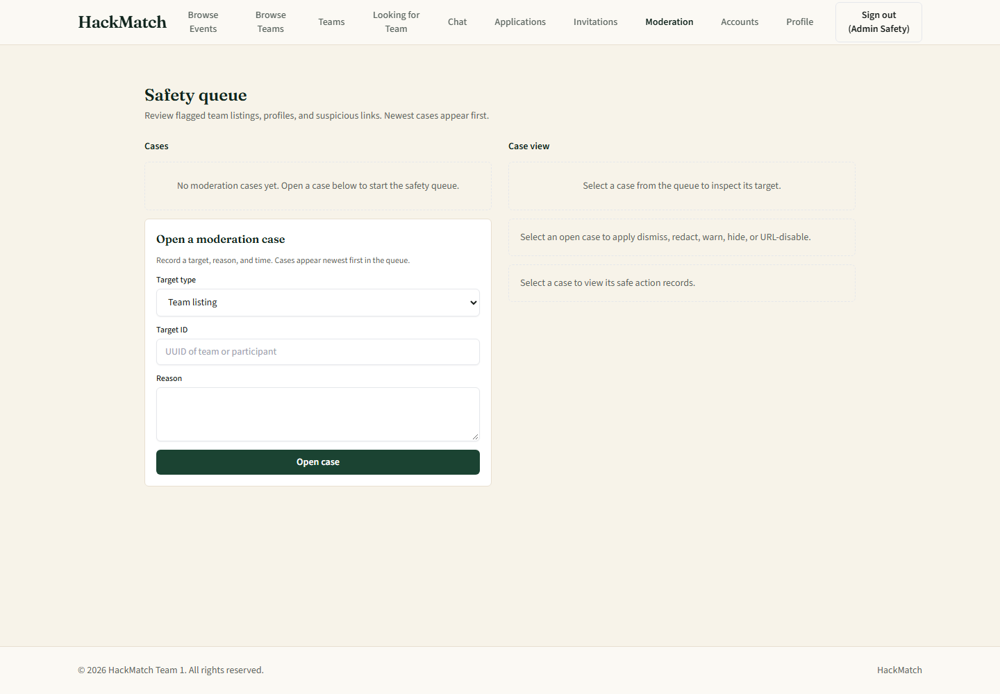
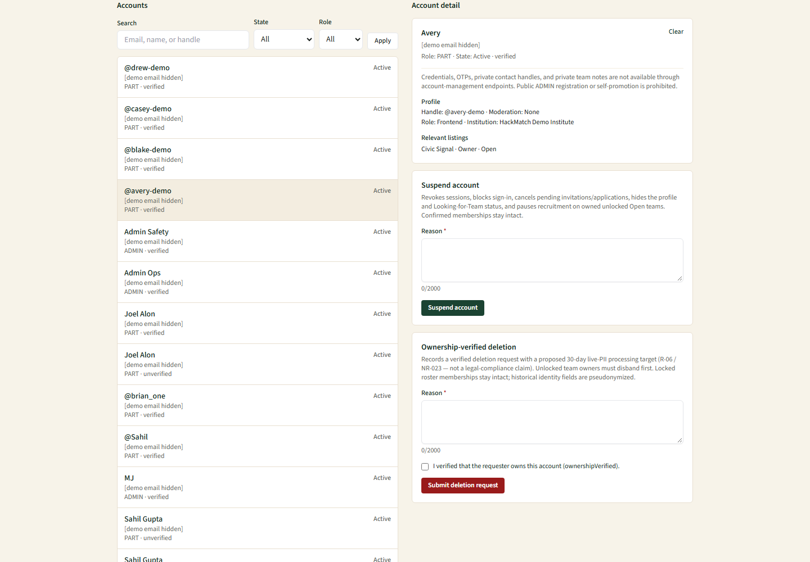
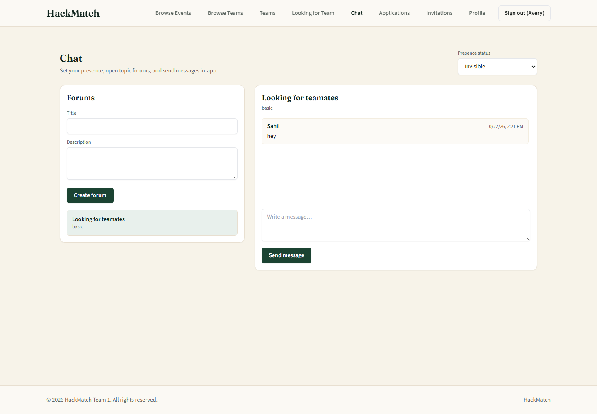

# HackMatch Admin Technical Manual

**Audience:** project administrators, maintainers, developers, and technical reviewers

**Repository baseline:** `US-029/authenticator-enrollment-design` branch (migrations through `0067`, Issue #446 update)

**Last reviewed:** November 12, 2026

This manual describes how the current HackMatch implementation is configured, operated, secured, tested, and maintained. It complements the end-user [User Manual](./user_manual.md), the [engineering diagram index](../diagrams/README.md), and the detailed [demo seed guide](../../db-seed/README.md).

## Contents

1. [System overview](#1-system-overview)
2. [Architecture](#2-architecture)
3. [Technology stack](#3-technology-stack)
4. [Repository structure](#4-repository-structure)
5. [Environment configuration](#5-environment-configuration)
6. [Local development setup](#6-local-development-setup)
7. [Authentication and Firebase integration](#7-authentication-and-firebase-integration)
8. [Roles and authorization](#8-roles-and-authorization)
9. [Email OTP and MFA](#9-email-otp-and-mfa)
10. [Supabase and PostgreSQL](#10-supabase-and-postgresql)
11. [Team formation and recruitment](#11-team-formation-and-recruitment)
12. [ADMIN content moderation](#12-admin-content-moderation)
13. [ADMIN account enforcement](#13-admin-account-enforcement)
14. [Participant chat](#14-participant-chat)
15. [Demo seed tooling](#15-demo-seed-tooling)
16. [Testing and continuous integration](#16-testing-and-continuous-integration)
17. [Security and privacy](#17-security-and-privacy)
18. [Operational procedures](#18-operational-procedures)
19. [Troubleshooting](#19-troubleshooting)
20. [Known implementation constraints](#20-known-implementation-constraints)
21. [Technical references](#21-technical-references)

## 1. System overview

HackMatch is a web application for participant profiles, platform-wide teammate discovery, team recruitment, invitations, applications, roster management, notifications, a private team workspace and manifest export, abuse reporting, owner-only authenticator enrollment/management, administration (including chat moderation, account enforcement, and audit review), participant forums chat, a private team chat, and one-to-one direct messages.

The current user-facing architecture is **Event-Free**:

- users do not choose a hackathon before using team-formation features;
- Looking-for-Team (LFT), recruitment-board discovery, and candidate recommendations are platform-wide;
- a participant may belong to multiple distinct teams;
- membership uniqueness is scoped to a team; and
- US-008, US-009, and US-010—the former event-directory and event-management stories—are deprecated.

The physical PostgreSQL model still contains `events` and `event_id` references. Team creation generates or binds an internal published **shadow event** because existing constraints and database functions still depend on that relationship. A shadow event is a backend compatibility record, not a user-selected or user-managed hackathon.

## 2. Architecture

HackMatch uses a three-tier web architecture with two external managed services.

| Layer | Responsibility |
|---|---|
| React/Vite client | Browser UI, Firebase client sign-in, route-level experience, form validation, and calls to `/api` |
| Express/Node server | Authentication verification, MFA, authorization, validation, privacy projection, domain services, administration, and database access |
| Firebase Authentication | Primary identity, email/password and federated providers, verified-email state, ID tokens, custom role/MFA claims, password reset, and refresh-token revocation |
| Supabase/PostgreSQL | Application accounts, profiles, team/recruitment data, MFA challenge records, encrypted authenticator enrollment state, recovery-code verifiers, notifications, moderation/enforcement records, and chat data |
| SMTP provider | Delivery of verification and six-digit MFA messages; a development-only Ethereal transport is available when production SMTP is not configured |

The browser authenticates through Firebase and ordinarily sends a Firebase ID token to the Express API. The server verifies the token with Firebase Admin, then resolves the corresponding PostgreSQL `participants` row and applies role, verification, active-account, MFA, and resource-ownership checks. Database service-role credentials remain server-side.

Cookie-session endpoints also exist under `/api/auth/session`. Session cookies are HTTP-only and use strict same-site settings; state-changing cookie-authenticated requests are protected by origin and double-submit CSRF checks. The current React API helper primarily uses Firebase bearer tokens.

See the [diagram index](../diagrams/README.md) for focused authentication, profile, recruitment, administration, chat, and data-flow diagrams. The retained [Supabase schema ERD](<../diagrams/shared/HackMatch Supabase Schema ERD.png>) shows the wider physical schema, including compatibility structures.

## 3. Technology stack

Versions below are taken from the current package manifests; caret-prefixed packages may resolve to a newer compatible release in the lockfile.

| Area | Current technology |
|---|---|
| Runtime | Node.js 22 or later (`.nvmrc` specifies `22`) |
| Client | React 18.3, React Router 7, Vite 6, TypeScript 5.7, Tailwind CSS 3.4 |
| Server | Express 4.21, TypeScript 5.7, `tsx`, Helmet 8, CORS, cookie-parser |
| Identity | Firebase JavaScript SDK 13 and Firebase Admin SDK 14.5 |
| Database | Supabase JavaScript SDK 2.117, PostgreSQL, Supabase CLI 2.120 |
| Email | Nodemailer 10.1 with SMTP or development Ethereal transport |
| Testing | Vitest 3, Testing Library, jsdom, Supertest 7, V8 coverage |
| Quality/CI | ESLint 9, TypeScript compiler, Husky, lint-staged, commitlint, GitHub Actions |

## 4. Repository structure

```text
HackMatch/
├── client/                    React/Vite application
├── server/                    Express API, Firebase Admin, repositories, and services
├── supabase/migrations/       Ordered PostgreSQL migrations and RPC definitions
├── db-seed/                   Deterministic Firebase/PostgreSQL demo seed
├── json-file-management/      Safe, human-readable demo scenario references
├── docs/
│   ├── manuals/               Canonical user and technical manuals
│   ├── diagrams/              Mermaid sources, PNG renders, index, and shared ERD
│   ├── assets/wireframes/     Current UI screenshots and coverage index
│   ├── 02_user_stories/       Product stories and Event-Free alignment sources
│   └── 04_requirements/       Functional and non-functional requirements
├── package.json               Root orchestration scripts
└── .github/workflows/         Continuous-integration workflow
```

The server is the trusted integration boundary for Firebase Admin and Supabase service-role operations. The client must never import or receive either privileged credential.

## 5. Environment configuration

Start from `client/.env.example` and `server/.env.example`. Keep real environment files out of version control.

### Client variables

| Variable | Purpose |
|---|---|
| `VITE_API_URL` | Express API base URL, normally `http://localhost:3001/api` |
| `VITE_FIREBASE_API_KEY` | Firebase Web API key used by the browser SDK |
| `VITE_FIREBASE_AUTH_DOMAIN` | Firebase browser authentication domain |
| `VITE_FIREBASE_PROJECT_ID` | Firebase project selected by the client |
| `VITE_FIREBASE_APP_ID` | Firebase web application identifier retained in the example configuration |
| `VITE_AUDIT_RETENTION_DAYS` | Optional whole number of days (1–3650). Empty means no retention period is approved yet; records older than the value are labelled "Past retention" in the audit log (display only, nothing is deleted) |

Variables prefixed with `VITE_` are compiled into browser code. They must not contain private keys, service-role keys, passwords, SMTP credentials, or server session secrets.

### Server variables

| Category | Variables | Notes |
|---|---|---|
| Runtime | `PORT`, `NODE_ENV`, `CLIENT_URL` | Default development ports are 3001 and 5173 |
| Session/transport | `SESSION_SECRET`, `ENFORCE_HTTPS`, `COOKIE_SECURE`, `TRUST_PROXY`, `SESSION_COOKIE_MAX_AGE_SECONDS` | Production validates the session secret and should enforce HTTPS/secure cookies |
| Supabase | `SUPABASE_URL`, `SUPABASE_ANON_KEY`, `SUPABASE_SERVICE_ROLE_KEY` | The service-role key is server-only and bypasses RLS |
| Firebase Admin | `FIREBASE_PROJECT_ID`, `FIREBASE_CLIENT_EMAIL`, `FIREBASE_PRIVATE_KEY` | `FIREBASE_PRIVATE_KEY` may contain escaped newlines; never expose these values to the client |
| Firebase REST | `FIREBASE_WEB_API_KEY` | Used by server-side Firebase Identity Toolkit flows |
| SMTP | `SMTP_HOST`, `SMTP_PORT`, `SMTP_SECURE`, `SMTP_USER`, `SMTP_PASS`, `SMTP_FROM` | Production MFA delivery fails closed if SMTP is unavailable |
| OTP controls | `OTP_RATE_LIMIT_COOLDOWN_MS`, `OTP_RATE_LIMIT_MAX_PER_HOUR`, `OTP_RATE_LIMIT_STRICT` | Optional overrides for challenge issuance limits |
| Authenticator secrets | `TOTP_ENCRYPTION_KEY_BASE64`, `TOTP_ENCRYPTION_KEY_VERSION` | Server-only 32-byte Base64 key and version for AES-256-GCM TOTP protection; the same master key is domain-separated with HKDF for recovery-code HMAC verifiers |

Production startup rejects missing core Supabase and Firebase Admin settings. Use a randomly generated, high-entropy `SESSION_SECRET` of at least the length described in the example file.

### Demo seed variables

The seed additionally requires:

- `HACKMATCH_DEMO_NAMESPACE=hm-demo-v1`
- `HACKMATCH_DEMO_EXPECTED_FIREBASE_PROJECT_ID`
- `HACKMATCH_DEMO_EXPECTED_SUPABASE_HOST`
- `HACKMATCH_DEMO_ALLOW_REMOTE`
- `HACKMATCH_DEMO_ADMIN_OPS_EMAIL`
- `HACKMATCH_DEMO_ADMIN_SAFETY_EMAIL`
- `HACKMATCH_DEMO_AVERY_EMAIL`
- `HACKMATCH_DEMO_BLAKE_EMAIL`
- `HACKMATCH_DEMO_CASEY_EMAIL`
- `HACKMATCH_DEMO_DREW_EMAIL`
- `HACKMATCH_DEMO_PASSWORD`

Do not put resolved demo emails or the shared password in committed manifests or documentation.

## 6. Local development setup

### Prerequisites

- Node.js 22 or later and npm;
- a Firebase project with Email/Password and any intended OAuth providers configured;
- a Supabase project, or Docker for the local Supabase stack;
- valid server-side Firebase Admin and Supabase credentials; and
- SMTP credentials for realistic mail delivery, or the development-only Ethereal fallback.

### Install and configure

1. Install root, client, and server dependencies:

   ```bash
   npm ci
   ```

   The root `postinstall` script runs `npm ci` in both applications.

2. Create local environment files from the checked-in examples:

   ```text
   client/.env.example  -> client/.env
   server/.env.example  -> server/.env
   ```

3. Fill the local files with values for the same Firebase/Supabase targets. Keep privileged values in `server/.env` only.

4. If using local Supabase, start it and apply migrations:

   ```bash
   npm run db:start
   npm run db:status
   npm run db:push
   ```

5. Start the client and server together:

   ```bash
   npm run dev
   ```

The Vite development server listens on port 5173 and proxies `/api` to the Express server on port 3001. The API also accepts the configured `CLIENT_URL` through CORS.

### Build and quality commands

```bash
npm run lint
npm run typecheck
npm run build
npm run test
npm run test:coverage
```

Component-specific commands can be run with `--prefix client` or `--prefix server`, for example `npm run test --prefix server`.

## 7. Authentication and Firebase integration

### Identity and application data

Firebase is the identity authority. PostgreSQL is the application-data authority. The `participants.firebase_uid` value binds the two records; the PostgreSQL account also stores the normalized email, full name, stored role, verification state, and suspension/deactivation state.

Registration creates a Firebase Email/Password identity and a PostgreSQL `participants` row. If PostgreSQL persistence fails after a new Firebase identity is created, the registration path attempts compensating deletion of only that new identity.

Public registration is restricted to `PART`. Client-supplied role, custom-claim, or administrator fields are rejected. Public sign-in supports:

- Firebase email/password;
- Google OAuth; and
- GitHub OAuth.

OAuth provider identities are tracked in `provider_identities`. Automatic account linking is not based on email alone; explicit provider/account-linking rules protect against account takeover. Successful password or OAuth primary authentication still proceeds through HackMatch email OTP before protected application access.

### Email verification, password recovery, and sign-out

- Verification uses Firebase action codes and synchronizes verified state into PostgreSQL.
- Password-reset requests use an anti-enumeration response so callers cannot determine whether an email is registered.
- Password confirmation uses Firebase password-policy enforcement, invalidates pending MFA challenges, clears the current MFA claim, and revokes refresh tokens.
- Sign-out revokes refresh tokens server-side and clears HackMatch session/CSRF cookies.

### Server-side token checks

Protected routes verify Firebase tokens with revocation checking and reject disabled Firebase identities. Middleware then confirms that the participant exists and is not suspended or deactivated. Route families layer additional checks for MFA, stored role, verified participant status, team ownership, or request ownership.

## 8. Roles and authorization

| Identity/state | Meaning | Typical access |
|---|---|---|
| `VISITOR` | Unauthenticated browser state; not stored as a role | Public landing and privacy-filtered recruitment discovery |
| `PART` | Stored participant account role | Profile, LFT, teams, recruitment, and chat after required verification/MFA checks |
| `ADMIN` | Stored privileged account role | Moderation and account-enforcement APIs/UI after authentication, MFA, and active-account checks |
| Team Lead | Contextual permission held by the `PART` who owns a team | Owner-only team edits, invitations, application decisions, member management, and roster lock |

Team Lead is not a global role and has no ADMIN authority. ADMIN authorization is enforced on the server, not merely by hiding navigation.

The Firebase custom `role` claim is checked alongside PostgreSQL role data. An account with a missing claim may be reconciled to `PART`; it is never elevated to `ADMIN` by default. ADMIN claims are cross-checked against the database.

### Provisioning an ADMIN

Use the server-side provisioning command from an environment with valid Firebase Admin and Supabase service-role credentials:

```bash
npm run admin:provision -- --email <administrator-email> --name <display-name>
```

An optional `--uid` targets an existing exact Firebase UID, and `--demote` changes the account back to `PART`. Do not run this command from a client machine that cannot safely hold administrator credentials. The current provisioning implementation replaces the custom-claim object with the selected role and does not itself revoke existing refresh tokens; require the affected user to sign out and sign in again after a role change.

## 9. Email OTP and MFA

Firebase remains the primary identity provider. HackMatch owns the application MFA/session state around that identity: email OTP is the current sign-in factor, while US-029 adds owner-only TOTP enrollment and management. TOTP and recovery-code **redemption at sign-in are not implemented**; every interactive login still completes email OTP.

### Email OTP and lock policy

1. The server confirms the Firebase identity and active account.
2. A cryptographically random six-digit code is created. Only its SHA-256 hash is stored in `mfa_challenges`; verification records use `mfa_attempts`.
3. SMTP delivers the code, which expires after 10 minutes. A newly issued challenge invalidates previous pending challenges for that participant.
4. Migration `0066_serialize_mfa_verification_attempts.sql` adds `reserve_mfa_verification_attempt`. It takes a participant-scoped advisory transaction lock, reserves the comparison attempt, and assigns a strictly ordered timestamp before the hash comparison.
5. Consecutive incorrect comparisons 1–4 return the safe validation response. The fifth locks verification for 15 minutes; later attempts during the lock are rejected before any OTP comparison. The lock survives resend.
6. Missing, expired, consumed, or foreign challenges and infrastructure failures are discarded rather than counted as wrong-code attempts. A successful comparison changes the reserved attempt to successful and resets the consecutive-failure count.
7. After an expired lock, a Firebase `auth_time` older than the lock end receives `FRESH_AUTH_REQUIRED`; the user must complete primary authentication again. The same policy applies when email OTP is used for a sensitive US-029 reauthentication.
8. Successful verification writes an `mfa_auth_time` custom claim tied to the current Firebase primary `auth_time`; the client refreshes its ID token before protected requests.

A new primary login changes `auth_time`, so an old MFA claim cannot satisfy the new session. Resend and issuance are rate limited. In non-production, Nodemailer may use an Ethereal transport and log a preview location, but never the OTP. Production delivery fails closed when SMTP is unavailable. Demo provisioning never writes `mfa_auth_time`.

### Authenticator architecture and authorization (US-029 / #266)

US-029 uses an application-owned, standards-compatible TOTP factor around Firebase—not Firebase MFA as a second source of truth. Both `PART` and `ADMIN` accounts have canonical rows in `participants`; `participants.firebase_uid` resolves the authenticated owner, and all authenticator/recovery rows reference `participants.id`. There is no route accepting an arbitrary target participant. An ADMIN has no cross-account support bypass.

All `/api/auth/mfa/authenticator/*` routes apply `requireFirebaseAuth`, `requireActiveAccount`, `requireMfa`, `requireRole('PART', 'ADMIN')`, and `requireRecentAuthentication`. The final guard requires a valid Firebase `auth_time` within 10 minutes and adds `Cache-Control: no-store`. Suspended, deactivated, unsupported-role, stale-auth, and incomplete-current-MFA callers fail before owner data is returned.

The safe lifecycle states are `Pending`, `Active`, `Canceled`, `Expired`, and `Retired`. A generated secret is only `Pending`; activation requires a valid current six-digit TOTP. The standard is SHA-1, six digits, a 30-second period, and an accepted verification window of the current step plus one adjacent step on either side. A pending enrollment expires after 10 minutes.

| Operation | Endpoint | Authoritative behavior |
|---|---|---|
| Status | `GET /api/auth/mfa/authenticator/enrollment` | Returns only owner-safe status/timestamps and available-method metadata; never setup or storage material |
| Begin | `POST /api/auth/mfa/authenticator/enrollment` | Creates one encrypted `Pending` enrollment and returns the QR/manual setup material once to the authenticated owner |
| Restart | `POST /api/auth/mfa/authenticator/enrollment/restart` | Atomically cancels the existing pending row and creates fresh pending material |
| Confirm | `POST /api/auth/mfa/authenticator/enrollment/confirm` | Verifies the pending owner, expiry, and TOTP before atomic activation; refuses to complete a replacement |
| Replace | `POST /api/auth/mfa/authenticator/replacement` and `/replacement/confirm` | Keeps the old factor active while pending, then atomically rotates the factor and recovery set after successful verification |
| Disable | `POST /api/auth/mfa/authenticator/disable` | Retires the active factor, cancels pending replacement, and revokes recovery codes without changing email OTP |
| Recovery codes | `GET`/`POST /api/auth/mfa/authenticator/recovery-codes` | Returns an owner-safe summary or atomically generates/regenerates a set after stale-batch validation |

### Protected storage and transaction model (#267)

Migration `0063_create_authenticator_enrollments.sql` creates `authenticator_enrollments` with owner FK `participant_id`, opaque UUID `id`, AES fields (`secret_ciphertext`, `secret_iv`, `secret_auth_tag`, `encryption_key_version`), lifecycle timestamps, and status/lifecycle checks. Partial unique indexes `uq_authenticator_enrollments_pending_participant` and `uq_authenticator_enrollments_active_participant` enforce at most one `Pending` and one `Active` row per participant; `idx_authenticator_enrollments_pending_expiry` supports pending-expiry work.

The Node service encrypts each TOTP secret before persistence using AES-256-GCM, a random 12-byte IV, and a 16-byte authentication tag. Additional authenticated data binds the participant ID, enrollment ID, key version, and `hackmatch:totp:v1` domain. The 32-byte key comes only from `TOTP_ENCRYPTION_KEY_BASE64`; `TOTP_ENCRYPTION_KEY_VERSION` defaults to `v1`. PostgreSQL never stores plaintext TOTP secrets, the key is not stored in a row, and decryption is limited to setup/confirmation service calls that require it.

`begin_authenticator_enrollment` and `activate_authenticator_enrollment` use participant-scoped advisory transaction locks. They recheck ownership/status/expiry under lock, terminalize expired rows, and preserve the one-pending/one-active constraints. Migration `0064_restart_pending_authenticator_enrollment.sql` adds `restart_authenticator_enrollment`: under the same lock it marks the old pending row `Canceled`, creates a fresh encrypted pending row, and makes the old enrollment ID permanently stale. Restart and activation therefore cannot race to reactivate replaced material.

The table has RLS enabled, no browser policies, revoked `PUBLIC`/`anon`/`authenticated` access, and service-role-only table/RPC privileges. Privileged functions use a fixed `search_path`.

### QR, confirmation, and ephemeral client state (#268)

`AuthenticatorEnrollmentCard` is shared by `PART` and `ADMIN` on the signed-in Profile view. It renders the server-provided `otpauthUri` locally as an SVG through `qrcode.react`; no external QR service receives it. The response also supplies the manual Base32 setup key, safe issuer/account label, algorithm, digits, period, enrollment ID, and expiry.

The QR URI, manual key, and confirmation code remain component-local and are cleared on completion, cancellation, unmount, sign-out, or account identity change. They are not written to local storage, session storage, URLs, analytics, or logs. The status endpoint is deliberately secret-free. After a refresh it can report `Pending` without setup material, and the UI offers **Restart authenticator setup** rather than recovering the old secret.

Confirmation accepts exactly six decimal digits client-side and server-side. A wrong code does not mutate pending or active state; stale/expired enrollment returns a safe restart path. Activation occurs only after server verification and the database transition succeeds.

### Reauthentication and management controls (#269)

Sensitive actions follow this server-authoritative sequence:

1. The original request returns `REAUTHENTICATION_REQUIRED` when Firebase `auth_time` is stale.
2. The client reauthenticates through the account's current Firebase password or linked Google/GitHub provider. It does not set timestamps itself.
3. The retried action can return `MFA_REQUIRED`; the existing email OTP challenge is completed and the refreshed token aligns `mfa_auth_time` with the new `auth_time`.
4. The account-bound queued operation retries once. Cancellation, sign-out, or account change clears the queued operation and sensitive client state.

Migration `0065_add_authenticator_recovery_controls.sql` creates `authenticator_recovery_codes` and the atomic replacement/disable/regeneration RPCs. Each set contains 10 `XXXX-XXXX-XXXX` codes generated with Node `crypto.randomInt` from a 32-symbol alphabet (60 bits per code). Raw values are returned once only. PostgreSQL stores owner-bound HMAC-SHA256 verifiers, not plaintext codes; the verifier key is derived from the configured master key by HKDF-SHA256 with domain `hackmatch:recovery-code-verifier:v1`. Rows carry `batch_id`, `verifier_key_version`, `created_at`, `used_at`, and `revoked_at`; `uq_authenticator_recovery_codes_participant_verifier` prevents a verifier from duplicating for one owner, while `idx_authenticator_recovery_codes_current` supports owner-scoped current-set summaries. Stale-batch checks prevent an older client from replacing a newer set.

During replacement the old authenticator and recovery set remain valid while the new row is `Pending`. The replacement code is verified before mutation. A single `activate_authenticator_replacement` transaction then marks the old authenticator `Retired`, makes the new one `Active`, revokes the old batch, persists a fresh batch, and returns the new raw codes once. Wrong code, cancel, expiry, or storage failure leaves the old factor and batch unchanged. The normal first-enrollment confirmation route rejects replacement rows so rotation cannot be bypassed.

Disable requires the same owner/recent-auth/current-MFA chain. `disable_authenticator` retires the active row, cancels a pending replacement, and revokes active recovery codes atomically. Email OTP remains unchanged.

Recovery-code generation and lifecycle management are implemented, but recovery-code redemption at sign-in is not. Likewise, an active authenticator is represented in method metadata but the current login screen does not redeem TOTP. Email OTP remains the actual sign-in factor and fallback.

### Privacy and operational hardening (#270)

Authenticator responses are owner-projected and `no-store`. Setup material appears only in successful begin/restart/replacement responses; raw recovery codes appear only on successful generation or replacement. Status and confirmation responses omit TOTP secrets, QR URIs, manual keys, ciphertext, IVs, tags, verifiers, key versions, email, Firebase UID, and internal participant IDs.

Request logging redacts password, OTP/TOTP, setup, recovery, ciphertext, IV/tag, token, and secret-like keys; any `otpauth:` value is redacted regardless of field name. Logged paths omit query strings, queries/bodies are sanitized, raw request bodies are never logged, malformed-body errors never include raw input, bearer tokens are omitted, and operational errors expose only safe correlatable summaries. Browser roles cannot read the authenticator/recovery tables or execute the privileged functions. Setup/recovery material is never persisted in browser storage or URLs.

Architecture diagrams: [management use case](../diagrams/US-029/US-029-authenticator-management-use-case.png), [enrollment and activation](../diagrams/US-029/US-029-authenticator-enrollment-sequence.png), [reauthentication](../diagrams/US-029/US-029-reauthentication-sequence.png), [lifecycle](../diagrams/US-029/US-029-authenticator-lifecycle-state.png), [authorization/privacy](../diagrams/US-029/US-029-authenticator-access-flow.png), and [persistence model](../diagrams/US-029/US-029-authenticator-data-model.png). The earlier [email-MFA login sequence](../diagrams/US-004/US-004-mfa-login-sequence.png) and [challenge state](../diagrams/US-004/US-004-mfa-challenge-state.png) remain applicable.

## 10. Supabase and PostgreSQL

### Access model

The Express server initializes Supabase with `SUPABASE_SERVICE_ROLE_KEY` and disabled client-session persistence. Protected application tables enable Row Level Security without granting direct browser policies; authorization and privacy projection occur in the API. The browser must not query these tables with privileged credentials.

### Migrations

Ordered migrations are stored in `supabase/migrations/`. Apply them through the Supabase CLI rather than manually editing a deployed schema:

```bash
npm run db:start
npm run db:status
npm run db:push
```

Review migration diffs and the selected Supabase target before applying any change. Never edit an already-applied migration to repair a shared database; add a new ordered migration instead.

### Principal entities

| Area | Tables |
|---|---|
| Accounts/authentication | `participants`, `provider_identities`, `mfa_challenges`, `mfa_attempts`, `authenticator_enrollments` (0063–0064), `authenticator_recovery_codes` (0065), and serialized MFA-attempt reservation (0066) |
| Profiles | `participant_profiles`, `participant_skills`, `participant_portfolios`, `participant_hackathon_history` (0043) |
| Team compatibility/availability | `events`, `event_availability` |
| Recruitment | `teams`, `team_memberships`, `team_vacancies`, `team_requests` |
| Notifications | `participant_notifications` (extended in 0044; published to Supabase Realtime in 0045) |
| Team workspace and manifest | workspace links, shared note and revision tables (0046); roster manifest snapshots (0047) |
| Administration | `moderation_cases`, `moderation_reports` (0048), `event_action_records` (the append-only audit records; query model 0049, least privilege 0050), `account_deletion_requests` |
| Chat | `chat_channels` (public forums and, since 0051, private team channels via `channel_type` and `team_id`), `chat_messages`; presence is stored on `participants` |
| Chat activity (US-034) | `chat_channel_read_cursors`, `direct_message_read_cursors`, `chat_message_mentions`, and `direct_message_mentions` (migrations 0058–0061); separate from `participant_notifications` |
| Direct messages | `direct_message_threads` (0053, activity column added in 0055), `direct_messages` (0055), `participant_blocks` (0054) |
| Legacy compatibility | `pending_event_submissions` and event-oriented columns retained by the physical schema |

`moderation_cases.target_id`, `moderation_reports.target_id`, and `event_action_records.target_id` are polymorphic identifiers interpreted with their target type. Migration `0056` adds the `chat_channel` and `chat_message` case types, and migration `0057` adds `chat_message` participant reports. These identifiers intentionally are not physical foreign keys to the chat tables; the application and report-validation trigger resolve the correct table from `target_type`.

### Transactional operations

Recruitment operations use PostgreSQL functions/RPCs and advisory locking where necessary to protect membership, vacancy, capacity, and request-state invariants. Application code maps expected database outcomes to explicit conflict/authorization responses. Refer to the focused [engineering diagrams](../diagrams/README.md) and migration SQL for the exact current transaction contract.

## 11. Team formation and recruitment

The React workflow is platform-wide and does not ask the user to select an event.

- **Availability:** a verified active `PART` can enable LFT with role, commitment, and goal preferences. The database stores this against a deterministic compatibility pool event, but the API presents it as platform-wide.
- **Team creation:** the creator becomes owner/Team Lead and the first confirmed member. The service creates an internal shadow event when needed, then creates the team and owner membership.
- **Recruitment board:** visitors receive an anonymized projection; authenticated participants receive only fields allowed by profile privacy rules.
- **Vacancies:** the owner defines role/skill requirements and may edit or remove vacancies while the roster is unlocked.
- **Candidate recommendations (US-015):** owner-only scoring considers skills, primary role, goal, and commitment for an open vacancy. The intended pool is platform-wide.
- **Recommended teams (US-016):** the authenticated Participant receives scored eligible open vacancies derived from that Participant's own profile and Looking-for-Team inputs.
- **Invitations:** owner-issued invitations target a specific open vacancy, start pending, and use a 48-hour expiry.
- **Applications:** a participant applies to a specific open vacancy with an optional message limited to 250 characters and may withdraw a pending application.
- **Placement:** invitation acceptance and application approval revalidate the target team, vacancy, membership, and capacity before creating membership and filling a slot.
- **Roster lock:** the owner may lock an eligible active roster. Locking freezes ordinary membership and vacancy mutation and cancels remaining recruitment requests.

### Related participant features (US-007, US-014, US-021, US-023, US-024)

- **Hackathon history (US-007):** `participant_hackathon_history` stores self-reported records (event name, date, team role, project title, HTTPS URL). Routes live under `/api/profiles/me/history` (create, update, delete) and `/api/profiles/:participantId/history` (permitted read). The Beginner (0), Competitor (1–3), and Veteran (4+) badge is computed from the record count and labelled self-reported; it is not verified.
- **Candidate directory (US-014):** the team owner of an active unlocked team can query `GET /api/teams/:teamId/candidates` with skill AND/OR matching, primary role, commitment hours, and experience tier filters. Confirmed members are excluded and cards use the same privacy projection as profiles.
- **Notifications (US-021):** `GET /api/notifications` (newest first, unread count, cursor paging), `GET /api/notifications/stream` (live stream using fetch streaming because `EventSource` cannot send the Firebase bearer token), `POST /api/notifications/read-all`, and `PATCH /api/notifications/:id/read`. A foreign or unknown id returns `404 NOTIFICATION_NOT_FOUND`, so existence is not revealed. The React bell polls every 30 seconds (`NOTIFICATION_POLL_MS`) and also uses the live stream when available.
- **Private workspace (US-023):** only confirmed members of a **locked** team can call `GET /api/teams/:teamId/workspace`; the owner alone can `PUT .../workspace/links` (HTTPS only); any member can `PUT .../workspace/note` and `GET .../workspace/revisions`. Notes use revision versions, so a stale save is rejected rather than overwriting a newer edit. Visitors, unrelated participants, and ADMIN without membership are denied. Account email is never exposed.
- **Manifest export (US-024):** `GET /api/teams/:teamId/manifest` (HTML, PDF, or JSON) and `POST /api/teams/:teamId/manifest/verify` are limited to confirmed members of a locked team. The export is built from a stored roster snapshot (0047) and a documented canonical serialization with a SHA-256 checksum. Account emails and private contact handles are excluded. The checksum is an integrity check, not proof of time or organizer approval.

The product default capacity is four. The physical model currently derives several boundaries from the team's shadow event, and current validators also retain a configurable `maxTeamSize` range. Treat the shadow-event relation as compatibility plumbing, not a public workflow.

### Participant team recommendations (US-016)

US-016 is the reverse of the owner-facing US-015 flow: it starts with one authenticated Participant and finds eligible open team vacancies. The browser calls `GET /api/recommendations/teams`; it does not send a participant or event selector. The live path is `teamRecommendationsRouter` → `getMyTeamRecommendationsHandler` → `getEligibleTeamRecommendations` → `teamRecommendationsRepository.listEligibleTeamVacanciesForParticipant` → PostgreSQL/Supabase.

#### Reverse-matching inputs and eligibility (#153)

`buildReverseMatchInputs` builds `ReverseMatchInputs` from the current `participants` row, `participant_profiles.primary_role` and moderation state, `participant_skills.skill_name` rows, and `PlatformAvailabilityRecord` (`isLooking`, `desiredRole`, `commitmentHours`, and `goal`). Skill tags are trimmed, internal whitespace is collapsed, and duplicates are removed case-insensitively while retaining the first display spelling. Hours outside 0–168 or non-finite values become unstated (`null`).

A Participant can receive recommendations only when the account exists, has role `PART`, is verified, is neither suspended nor deactivated, has a profile that is not moderation-hidden, has Looking for Team enabled, and has at least one normalized skill. `evaluateTeamVacancyEligibility` then requires all of the following:

- the Participant is neither the team owner nor a `Confirmed` member;
- the team is not moderation-hidden and remains `Open`, unlocked, and not disbanded;
- the vacancy belongs to that team, remains `Open`, and has no `removed_at`; and
- the Participant has no `Pending` `Application` or `Invitation` for that team.

Role or goal differences affect scoring rather than eligibility. The participant's current count of pending applications is also not a recommendation exclusion; the US-018 submission path enforces the three-pending-application limit. The reverse matcher has no separate capacity predicate: it relies on the current open team/vacancy state for candidate selection, while US-018 revalidates capacity when an application is submitted.

#### Candidate query and safe projection (#154)

The repository performs participant-scoped membership and pending-request lookups concurrently, builds the excluded-team set, and issues one set-based `team_vacancies` query with an inner `teams` projection. The query applies open-vacancy, open/unlocked/non-disbanded team, moderation visibility, ownership, and excluded-team predicates before returning candidates. Existing recruitment indexes support these access patterns, including `idx_team_memberships_participant_status`, participant/request indexes, and `idx_team_vacancies_team_open`; #154 adds no schema migration or parallel recommendation store.

`getEligibleTeamRecommendations` loads the participant, profile, skills, and availability concurrently, calls the repository only after participant eligibility succeeds, and reapplies `partitionTeamVacancies` as a stale-state/contract backstop. Missing or newly unavailable candidates produce a successful empty result rather than a not-found error. Repository failures propagate to the standard safe server-error path; they are not converted into a misleading empty list.

The participant-facing DTO allowlists rank, team ID/name/pitch/goal/hours/recruiting state, vacancy ID/role/desired skills, match percentage, matched/missing skills, role-match flag, and plain score explanations. It excludes account email, Firebase identity, owner/member records, request details, internal event data, raw score components, and unrelated profile fields. The response uses `Cache-Control: no-store`.

#### Match calculation and ordering (#155)

`rankTeamVacancies` calls `scoreTeamVacancy`, which reuses `computeCompatibilityScore`. The bounded compatibility score is:

`score = 100 × (S + G + H) / 3`

- `S` is the share of normalized vacancy skills present on the Participant profile. A match between the vacancy role and the desired role (falling back to primary role) multiplies this component by 1.2, capped at 1. A vacancy with no required skills receives `S = 1`.
- `G` is 1 for the same goal, 0.5 for adjacent goals, and 0 otherwise. Missing goal input scores 0.
- `H` is `min(participant hours / team hours, 1)`. A team request of zero hours receives 1; missing input scores 0.

The displayed `matchPercent` is the bounded score rounded to a whole number from 0 through 100. Matched and missing tags retain the vacancy's normalized spelling and order. Final ordering is unrounded score descending, matched-skill count descending, team name ascending case-insensitively, then vacancy ID ascending. The service assigns one-based ranks after sorting.

#### React states and US-018 integration (#156–#157)

`RecommendedTeamsPage` requests the self-only endpoint when opened, ignores superseded/unmounted responses through a monotonically increasing request token, and does not calculate scores in React. It renders `Finding teams for you…`, validated recommendation cards, reason-specific empty guidance, signed-out guidance, or a retryable error. Manual **Refresh** is disabled while active; a failed refresh preserves the last successful list. `RecommendedTeamCard` presents the percentage as text and an accessible progress bar, matched/missing tags, plain-text contribution explanations, and the open role/team context.

The **Apply to _team name_** action passes stable `teamId` and `vacancyId` values into the existing US-018 `ApplicationFormPanel`; it does not copy percentage or skill tags into an application. The form target is fixed, the optional message remains limited to 250 characters, and validation/API failures retain the target and draft. Changing from one recommendation to another resets target-specific form state. Success uses the existing US-018 notice and increments `recommendedTeamsRefreshToken`, which reloads the recommendation set.

Recommendation eligibility is advisory and can become stale. The US-018 backend remains authoritative for current account, vacancy, membership, recruiting state, duplicate request, and quota validation. A score never authorizes or guarantees an application.

#### Authorization, Event-Free compatibility, and validation (#158–#159)

`teamRecommendationsRouter` applies `requireFirebaseAuth`, `requireMfa`, `requireActiveAccount`, `requireParticipantRole`, `requireVerifiedParticipant`, and `requireOwnProfileScope` before the controller. The service always uses `req.participant.id`. `requireOwnProfileScope` permits no identity or the caller's own identity, rejects malformed named identities with `400 VALIDATION_ERROR`, and rejects another identity with `403 FORBIDDEN_NOT_OWN_PROFILE` without repeating it or confirming that it exists. Visitors, ADMIN accounts, incomplete-MFA sessions, unverified accounts, and suspended/deactivated accounts are denied by their existing earlier guards.

The recommendation query is platform-wide. `availabilityRepository` reads `event_availability` using the fixed `PLATFORM_AVAILABILITY_EVENT_ID`, and legacy `event_id` values remain on recruitment records as internal schema plumbing. No event ID is accepted as recommendation scope, selected in React, or returned in the DTO.

The #159 suites cover participant and team inclusion/exclusion, database-prefiltered candidates, stale-state backstops, score boundaries and normalization, matched/missing skill spelling, deterministic ties and large pools, empty/ineligible states, safe failures, privacy projections, visitor/ADMIN/MFA/verification/account-state denial, arbitrary-profile probes, client contract validation, loading/refresh/error states, application draft retention and stale-team rejection, state isolation, and server-to-React fixtures. These are contract and integration tests over the existing feature; they do not create a separate recommendation subsystem.

See the [recommendation query and authorization sequence](../diagrams/US-016/US-016-recommendation-query-sequence.png), [eligibility flow](../diagrams/US-016/US-016-eligibility-filter-flow.png), [scoring flow](../diagrams/US-016/US-016-match-scoring-flow.png), and [US-018 application integration flow](../diagrams/US-016/US-016-application-integration-flow.png).

## 12. ADMIN content moderation

ADMIN moderation routes are mounted under `/api/admin/moderation` and require valid Firebase authentication, current MFA, an active account, and server-confirmed `ADMIN` role.

The current module supports:

- listing and inspecting moderation cases;
- creating cases for `team`, `profile`, `url`, `chat_channel`, or `chat_message` targets through the current ADMIN form;
- resolving privacy-safe chat evidence without returning raw chat rows;
- viewing action records;
- dismissing a case; and
- applying supported decisions such as redact, warn, hide, or disable URL, subject to target type.

Cases use `Open`, `Dismissed`, and `Resolved` states. Reasons are validated, URL targets require HTTPS, and stale or missing targets fail safely. Target resolution is application logic over the polymorphic `target_type`/`target_id` pair.

Depending on target and action, the service can redact a team pitch or profile handle, record a warning and notification, hide a team/profile, or disable a communication URL. It does not delete team memberships as a side effect of content hiding. Action records retain safe actor, target, outcome, and timestamp metadata; credentials and authentication artifacts are excluded.

### Chat moderation targets and ADMIN workflow (US-033)

US-033 extends the US-026 queue; it does not create a second moderation subsystem. Every queue, detail, creation, decision, and action-record route remains behind Firebase authentication, current MFA, active-account enforcement, and the stored `ADMIN` role. A `PART` or visitor cannot retrieve chat evidence or invoke ADMIN decisions.

The supported case targets are:

| Target type | Logical resolution | Physical target FK? |
|---|---|---|
| `chat_channel` | `moderation_cases.target_id` is resolved against `chat_channels.id` | No |
| `chat_message` | `moderation_cases.target_id` is resolved against `chat_messages.id` | No |

The polymorphic `target_type`/`target_id` pair permits existing moderation targets and chat targets to share one table. A single PostgreSQL foreign key cannot safely point to different target tables, so Express validates a UUID against the table selected by the target type before inserting a case. Unsupported types, malformed UUIDs, mismatched types, and targets that do not exist fail with safe validation/not-found responses. Existing case records remain usable if a target later disappears: case detail returns an `Unavailable` channel/message marker instead of querying an unrelated record or exposing a database error.

To open a chat case in **Admin ▾ → Moderation**, the ADMIN selects **Chat channel** or **Chat message**, supplies the target UUID, and enters a nonblank **Reason** (database limit: 2,000 characters). A successful `POST /api/admin/moderation/cases` inserts an `Open` `moderation_cases` row. Invalid input remains in the form so it can be corrected.

Case detail is built from explicit evidence projections:

| Chat target | Allowlisted evidence |
|---|---|
| Channel | Target id and availability; `public`/`team` channel type; redacted title and description; creator handle when available; UTC creation time; content-redacted flag |
| Message | Target id and availability; author handle when available; UTC send time; a redacted/truncated message excerpt of at most 500 characters |

The evidence repository selects only the columns needed for those projections. Text redaction covers account emails, common credential/token forms, OTP-like six-digit codes, PEM material, and long secret-like values. Evidence never includes passwords or hashes, raw OTPs or OTP hashes, authentication/session tokens, Firebase or Supabase credentials, account emails, unrelated profile fields, membership details, or neighboring conversation messages. An ADMIN reviews only the target supplied through the moderation case; ADMIN role is not a general private-chat browser.

The React safety queue labels chat rows as **Chat channel** or **Chat message** and uses the existing loading, empty, retry, selection, validation, success, and error states. When the target is stale, **Case view** shows the unavailable-target state while retaining the case reason, status, report count, and safe action history. Chat targets currently expose **Dismiss** only; `redact`, `warn`, `hide`, and `disable_url` are rejected for chat targets and remain available only where the legacy target/action contract supports them.

A chat dismissal requires a decision reason. The service writes an append-only `event_action_records` row containing `actor_id`, a `moderation_<chat target>` target type, the target UUID, `moderation_dismiss`, reason, outcome, a scrubbed `safe_state_summary`, and UTC `created_at`, then marks the case `Dismissed`. The safe summary carries `caseId` for application-level history lookup; there is no physical action-record-to-case foreign key. As with the existing US-026 flow, the action-record insert and case-state update are sequential writes rather than one database transaction.

### Participant reports (US-025)

Participants submit reports with `POST /api/reports` (verified active `PART` only). A report captures the target, a category (Harassment, Spam, Phishing Link, Fake Account), and an optional explanation of up to 1,000 characters. URL targets must be HTTPS. Each account may submit at most **5 reports per rolling hour**; further attempts return a rate-limit response. A successful report is stored in `moderation_reports`, links to the existing open case for the same target or creates one, and returns a participant-safe receipt. `GET /api/reports` and `GET /api/reports/:reportId` always refuse participants, so other reports, ADMIN notes, evidence, and action history remain confidential.

Migration `0057` and the reporting service extend this pipeline to `chat_message`. The service resolves the submitted ID to `chat_messages` and its persisted `chat_channels` row before applying normal visibility rules: public forum messages are eligible, while team-channel messages require a current `Confirmed` membership in the linked team. Missing, inaccessible, unrelated-team, and unsupported direct-message identifiers return the same unavailable result without message content or a private-existence signal. US-032 stores messages in `direct_messages`, which the current `chat_message` target deliberately does not resolve.

The participant-report response contains the receipt/case identifiers, category, received status, submission time, and rate-limit metadata, but no other reports or ADMIN-only data. Separate reports for the same message remain separate `moderation_reports` rows and link to one open case under the existing duplicate policy.

**Current client limitation:** the server reporting contract accepts `chat_message`, but `ReportAbuseModal` and the React forum/team-message rows have not been extended with a chat-message target or **Report message** control. The backend pipeline is tested and available for an authorized integrated client, but the current browser UI cannot initiate a chat-message report. Direct-message reporting is not supported.

An empty safety queue is valid. The current seeded `recruitment-v1` scenario intentionally creates no moderation cases.



See the US-026 [moderation workflow sequence](../diagrams/US-026/US-026-moderation-workflow-sequence.png) and [case lifecycle](../diagrams/US-026/US-026-moderation-case-lifecycle-flow.png). US-033 is documented by the [chat moderation use case](../diagrams/US-033/US-033-chat-moderation-use-case.png), [report/review/action sequence](../diagrams/US-033/US-033-chat-moderation-sequence.png), [polymorphic target model](../diagrams/US-033/US-033-moderation-target-model.png), and [authorization/privacy flow](../diagrams/US-033/US-033-moderation-privacy-flow.png).

## 13. ADMIN account enforcement

ADMIN account routes are mounted under `/api/admin/accounts` and use the same authentication, MFA, active-account, and server-side ADMIN gates as moderation.

The current implementation provides:

- account list/search with role and state filters;
- selected-account details and related team listings;
- suspension with a recorded reason; and
- deletion-request processing with ownership safeguards.

Suspension updates PostgreSQL state, cancels relevant pending requests, hides open teams owned by the participant, hides the profile, revokes Firebase refresh tokens, and disables Firebase sign-in. Protected endpoints also check PostgreSQL suspension/deactivation, so a stale token does not grant normal application access.

### Audit review (US-028)

`GET /api/admin/audit-records` is the only audit endpoint. It requires authentication, current MFA, an active account, and the server-confirmed `ADMIN` role; participants and visitors never reach validation or the database.

| Aspect | Behavior |
|---|---|
| Query parameters | `actor`, `actionType`, `category` (`event`, `moderation`, `account`), `from`, `to`, `limit` (maximum 100; the UI offers 25, 50, 100), `cursor`. Unknown keys and malformed values are rejected |
| Response | `records`, `count`, `hasMore`, `nextCursor`, and the echoed `filters`, newest first, with `Cache-Control: no-store` |
| Fields shown | record id, actor id, action type, target, safe state summary, reason/outcome, UTC time |
| Read-only | Any method other than `GET`, `HEAD`, or `OPTIONS` returns `405 AUDIT_RECORDS_READ_ONLY` |
| Database | Migration `0006` blocks UPDATE/DELETE/TRUNCATE by trigger; `0049` revokes those privileges; `0050` leaves `service_role` with only SELECT and INSERT and removes TRIGGER/REFERENCES and direct anon/authenticated access, so a role cannot attach a trigger that rewrites future records |
| Retention and privacy | The team has not approved a retention period (NR-023). Set `VITE_AUDIT_RETENTION_DAYS` once approved to label older records "Past retention" in the UI. Nothing is deleted or edited from this feature. Display applies the pseudonymization rules for retained personal data |

The React page is **Admin ▾ → Audit log**. Append-only means ordinary application actors cannot alter records; it does not make the underlying storage tamper-proof against someone with database-owner access.


There is no current unsuspend/reactivate endpoint in the ADMIN API. Do not promise reactivation through the UI.

Deletion requires a reason and an explicit ownership-verification acknowledgement. An owner of an unlocked team is blocked until the team is disbanded. Processing revokes or deletes the Firebase identity, removes live profile/authentication-related records where permitted, and pseudonymizes retained locked-team membership history. Deletion is a multi-step operation; administrators should inspect the returned state before retrying after an interruption.

ADMIN payloads omit passwords, OTP values/hashes, tokens, private contact content, and unrelated team notes. Account email is visible to authorized administrators for account identification.



See the [suspension sequence](../diagrams/US-027/US-027-account-suspension-sequence.png) and [account deletion sequence](../diagrams/US-027/US-027-account-deletion-sequence.png).

## 14. Participant chat

US-030 is implemented as global participant forums/channels. All presence and chat routes require Firebase authentication, current MFA, an active account, stored `PART` role, and verified participant status.

### API and persistence

| Capability | Current route family | Persistence |
|---|---|---|
| Read/update own presence | `GET/PUT /api/presence/me` | `participants.presence_status` |
| List/create channels | `GET/POST /api/chat/channels` | `chat_channels` |
| List/send channel messages | `GET/POST /api/chat/channels/:channelId/messages` | `chat_messages` |

Presence values are `Online`, `Idle`, `Do Not Disturb`, and `Invisible`; selection is explicit. No automatic idle timer is implemented.

Channel titles and descriptions are required and validated. Message bodies must be nonblank and are bounded by the database/API limit. The React UI retains channel-form and composer drafts on validation or request failure. Message responses resolve the author handle and UTC timestamp while excluding email, password, OTP, Firebase UID, private contact, and credential fields.

Public forums have no channel-membership persistence or join/leave mechanism: every verified active `PART` passes the same global-channel access gate. Private team channels (below) are gated by team membership instead. There is also no implemented peer-presence directory; `Invisible` is filtered by helper logic, but broader peer visibility policy remains undefined.

US-033 moderation/report integration is implemented for `chat_channels` and `chat_messages`; it does not make the ADMIN interface a general chat browser, and direct-message rows are outside the current target contract. US-034 unread/mention tracking is implemented for public and team channels plus direct-message threads as described below. US-035 message reactions are implemented (#405 server, migration `0067`; #406 React): persistence, add/remove API, aggregates in message responses, and accessible reaction controls and summaries in the forum, team-chat, and direct-message views. They are behind `RICH_CHAT_REACTIONS_ENABLED` (off by default); the client shows them only when `GET /api/chat/capabilities` reports them enabled. Typing indicators and attachments are not implemented, and voice/video is deferred. The approved scope, limits, and server-side flags are defined in the [US-035 rich-chat policy contract](../04_requirements/us035_rich_chat_policy.md).

### Private team channels (US-031)

US-031 adds a private channel per team. The back end, the React **Team chat** panel on the team page (`TeamChatView`, shown to the team's members in the team workspace), and the tests are implemented. **Nothing creates a team's channel automatically yet**: `provisionOrLinkTeamChannel` exists but is not called from team creation, so until a channel is provisioned the endpoints return `404 TEAM_CHANNEL_NOT_FOUND` and the panel shows a load error with **Retry**.

| Task | What exists |
|---|---|
| #378 data model (migration `0051`) | `chat_channels.channel_type` (`public` default or `team`) and `team_id` (unique, `ON DELETE RESTRICT`, immutable once set); a `team` channel must have a team and a `public` channel must not; existing US-030 channels become `public` unchanged |
| #379 provisioning | `provisionOrLinkTeamChannel` creates or links a team's channel idempotently and refuses to create one for a disbanded team. It is a service function and is not yet called from team creation |
| #380 authorization | Confirmed-member authorization helpers in `teamChatAuthorization` |
| #381 endpoints | `GET /api/teams/:teamId/chat` (open channel), `GET /api/teams/:teamId/chat/messages`, `POST /api/teams/:teamId/chat/messages` |
| #382 lifecycle (migration `0052`) | Database-enforced lifecycle rules, below |
| #383 React view | `TeamChatView`: open channel, messages, composer with kept drafts, access-denied and error states |
| #384 tests | Vitest and route tests for member access and denial |
| #418 diagrams | Use-case, sequence, authorization, data-model, and lifecycle diagrams under `docs/diagrams/US-031/` |

Endpoint behavior:

- The route chain is authentication, MFA, active account, `PART` role, verified participant, team-id UUID check, then the **confirmed-member gate**, then body validation.
- A non-member, a removed or released member, someone on a different team, or a non-existent team all receive the **same** `403 FORBIDDEN_NOT_TEAM_MEMBER` body with `Cache-Control: no-store`; no channel or message content is read. Visitors get 401. An ADMIN has no membership and is refused; there is no admin bypass.
- Message authors are shown by handle only. A client cannot choose the author or channel: extra body fields are rejected. An empty or over-4,000-character body returns 400 and echoes the draft.
- The public `/api/chat` endpoints treat team channels as missing (`404 CHANNEL_NOT_FOUND`), so they can neither list nor read them.

Lifecycle rules (migration `0052`, enforced by triggers so a race cannot bypass them):

| Situation | Result |
|---|---|
| Confirmed member of an Open or Locked team | May write |
| Removed, Released, or departed member | Cannot write (`TEAM_CHANNEL_NOT_A_MEMBER`, API 403); earlier messages remain |
| Disbanded team | Channel is read-only history (`TEAM_CHANNEL_READ_ONLY`, API 403) |
| Suspended account | Cannot write (`TEAM_CHANNEL_ACCOUNT_SUSPENDED`, API 403 `ACCOUNT_SUSPENDED`) |
| Delete or edit a team message | Refused (`TEAM_CHANNEL_HISTORY_IMMUTABLE`) |
| Delete a team channel | Refused, so history cannot cascade away |
| Delete membership rows of a team that has a channel | Refused (`TEAM_MEMBERSHIP_HISTORY_IMMUTABLE`); leaving, removal, and disband only change `status` |

Run the story's tests with `npm run test:us031 --prefix server`. Operators who need to remove a team's data entirely must plan it deliberately, because these protections block ordinary deletes. See the [US-031 diagrams](../diagrams/US-031/US-031-team-chat-authorization-flow.png) for the authorization and lifecycle flows.

### Direct messages (US-032)

One-to-one private threads between two verified active participants (FR-091). All routes are under `/api/direct-messages` and require Firebase authentication, current MFA, an active account, stored `PART` role, and verified participant status. Visitors get 401; unverified or suspended callers and `ADMIN` accounts get 403.

| Task | What exists |
|---|---|
| #385 data model (migrations `0053`, `0055`) | `direct_message_threads`: one row per unordered pair stored in canonical order (`participant_low_id < participant_high_id`), unique per pair, no self-thread, participants immutable and protected from deletion; `last_message_at` for inbox ordering. `direct_messages`: body 1–4,000 characters, a trigger that only lets a participant of the thread author a message, and a trigger that updates the thread's activity time |
| #386 open or continue | `POST /api/direct-messages/threads` with `{ "participantId": "<uuid>" }` creates the thread (201) or returns the existing one (200); concurrent requests resolve to the same row |
| #387 inbox, thread, send | `GET /api/direct-messages/threads` (inbox, most recent activity first, with an explicit empty state), `GET /api/direct-messages/threads/:threadId`, `GET .../messages`, `POST .../messages` |
| #388 access rules (migration `0054`) | Thread-participant and send-access guards, block model, denial codes below |
| #389 React views | `DirectMessagesView` (inbox, conversation, composer with kept drafts) under the **Direct messages** tab of the chat panel |
| #390 privacy projections | Allowlist projections and a safety scrub, below |

Access and denial behavior:

- **Read** needs the caller to be one of the two participants. A missing thread and a thread between other people give the **same** `403 FORBIDDEN_NOT_THREAD_PARTICIPANT`, so thread existence cannot be probed.
- **Send** additionally needs the other participant to be a verified active `PART` and no block in either direction.
- Opening a thread with a missing, suspended, deactivated, unverified, `ADMIN`, or blocking/blocked person all return the same `404 PEER_NOT_AVAILABLE`, so accounts and blocks cannot be enumerated. Opening a thread with yourself returns `400 CANNOT_MESSAGE_SELF`.
- Sending denials: `403 DM_PEER_UNAVAILABLE` (the peer is suspended, deactivated, unverified, or has blocked the caller; the message does not say which), `403 DM_BLOCKED_BY_YOU` (only the person who set a block is told), and `403 DM_ACCOUNT_NOT_ELIGIBLE` (the caller's own account). Reading an existing conversation stays possible when the peer is blocked or suspended.
- A client cannot choose the caller, author, or thread: unknown body fields are rejected, and `participantId` and `threadId` must be UUIDs. An empty or over-4,000-character body returns 400 and echoes the draft.

Privacy projection (US-032 #390, `directMessagePrivacy`):

- Responses are built from an explicit allowlist: thread id, the other participant's id and handle, last-message time, created/updated times, and for messages the id, thread id, `fromMe`, author handle, body, and time. The author is shown by handle and `fromMe`, not by account id.
- A second scrub removes credentials, OTPs, tokens, account email, full name, institution, Firebase UID, the raw `participant_low_id` and `participant_high_id` columns, presence status, shared contact handles, role, verification and suspension state, and any block state. Rejected drafts are echoed with those keys shown as `[redacted]`.
- Every response carries privacy flags (credentials, OTPs, emails, presence, contact details: all `false`) and `Cache-Control: no-store`.

Operational notes:

- `participant_blocks` is enforced but **no endpoint or screen creates a block yet**, so blocks can only be added directly in the database by an authorized operator. Plan a block/unblock feature before relying on this rule.
- There is no screen or button that starts a new conversation (the `openDirectMessageThread` client helper exists but no UI calls it). Existing conversations participate in the US-034 unread and mention system below.
- Run the story's tests with `npm run test:us032 --prefix server`.

### Chat unread counts, mentions, and read state (US-034)

US-034 reuses the US-021 badge, zero-state, loading, retry, and accessibility conventions, but it does **not** store chat activity in `participant_notifications`. PostgreSQL chat cursors and mention relations are the authoritative state; React holds only a session-scoped view of the server result.

#### Persistent read cursors (#398, migration `0058`)

The physical chat roots differ, so the schema uses two ordinary relational tables instead of one polymorphic cursor:

| Scope | Cursor table | Conversation FK | Deterministic position |
|---|---|---|---|
| US-030 public forums and US-031 team channels | `chat_channel_read_cursors` | `channel_id → chat_channels.id` | `last_read_message_created_at`, then `last_read_message_id` |
| US-032 direct messages | `direct_message_read_cursors` | `thread_id → direct_message_threads.id` | `last_read_message_created_at`, then `last_read_message_id` |

Each primary key is `(participant_id, channel_id)` or `(participant_id, thread_id)`, enforcing one cursor per Participant/conversation. Participant and conversation FKs cascade cursor cleanup. `last_read_message_id` is deliberately not an FK: a validation trigger confirms that the message belongs to the selected conversation and copies its trusted `created_at`, while the stored tuple remains usable if a public message is later removed. Team-channel cursor writes additionally require a `Confirmed` membership; DM cursor writes require the Participant to be one of the persisted pair. Account/session eligibility and endpoint authorization remain service-layer responsibilities.

The reverse cursor indexes `(channel_id, participant_id)` and `(thread_id, participant_id)` support conversation cleanup/lookup. Channel unread ranges use `idx_chat_messages_channel_created_id (channel_id, created_at, id)`; direct messages reuse `idx_direct_messages_thread_created_id`. The UUID tie-breaker prevents equal timestamps from making a read position ambiguous. RLS is enabled with no public policies, and only the server service role invokes the read-state functions.

#### Unread and mention derivation (#399–#400, migrations `0059`–`0060`)

Migration `0059` establishes the set-based unread semantics; migration `0061` extends the current query with mention counts. `GET /api/chat/unread-counts` calls `get_participant_chat_activity_counts(participant_id)` and returns an allowlisted, `Cache-Control: no-store` summary: conversation type/id, unread count, unread-mention count, and aggregate totals. It never returns bodies, handles, email, membership records, credentials, OTPs, tokens, or raw database rows.

Unread messages are derived rather than stored as a mutable counter. With no cursor, every message from another Participant in an authorized conversation is unread. With a cursor, only messages whose `(created_at, id)` tuple is strictly later are unread; the caller's own messages are excluded. The set-based query returns public channels for an eligible verified active `PART`, team channels only with current `Confirmed` membership, and DM threads only when the Participant is one of the persisted pair. Missing conversations and conversations after access loss are omitted, so stale cursors cannot reveal activity. General notification `read_at` state remains independent.

Mentions use stable relation tables:

- `chat_message_mentions(message_id, mentioned_participant_id, created_at)` for public/team channel messages;
- `direct_message_mentions(message_id, mentioned_participant_id, created_at)` for DMs; and
- a primary key on `(message_id, mentioned_participant_id)` in each table, preventing repeated `@handle` text from producing duplicate mention events.

`extract_chat_mention_handles` recognizes case-insensitive `@handle` tokens using the profile grammar `[A-Za-z0-9_-]{2,50}` and normalizes them to lowercase for lookup. `AFTER INSERT` triggers resolve eligible recipients in the same message transaction and persist only the stable Participant ID—never the handle, email, or account snapshot. Existing messages are not reinterpreted or backfilled after a rename, so an old mention cannot transfer to a later owner of that handle. Invalid, hidden, suspended, deactivated, unverified, self, blocked-DM, non-thread-participant, or non-team-member targets remain ordinary text without an account-existence error.

#### Atomic mark-read (#401, migration `0061`)

`POST /api/chat/read` accepts an allowlisted `conversationType`, `conversationId`, and concrete `messageId` that the client loaded. Route/service authorization occurs before persistence: public channels use normal chat eligibility, team channels require current confirmed membership, and a DM requires thread participation. A missing conversation, wrong-conversation message, stale position, malformed ID, or access change receives the existing safe error response without private content.

`mark_chat_conversation_read` performs `INSERT ... ON CONFLICT DO UPDATE` and updates only when the requested `(created_at, id)` tuple is greater than the stored tuple. The single database statement locks the Participant/conversation cursor row, making repeated requests idempotent and preventing a concurrent older request from moving the cursor backward. After the write, the function derives fresh unread and unread-mention counts in the same transaction. It does not delete mention history: mentions at or before the cursor stop counting, while later mentions remain unread. If access changes during the operation, the exception rolls the cursor change back.

#### React integration (#402)

`ChatUnreadProvider` loads the authoritative count summary only for a ready `PART` session and keys its cache by the current Firebase UID. A sign-out or account/session change immediately discards the prior snapshot. It does not introduce per-channel polling, WebSockets, or a second notification store.

The floating **Open chat** button shows aggregate unread and mention badges. The **Forums** and **Direct messages** tabs show per-scope aggregates; forum rows and DM inbox rows show per-conversation badges; the opened `TeamChatView` heading shows its channel activity. Badges reuse the US-021 hidden-at-zero and `99+` formatting convention, render unread and `@mention` counts separately, and provide a screen-reader status such as “3 unread messages, 1 unread mention.” Initial loading uses a neutral indicator rather than zero; fetch failure shows `!` and **Retry chat activity**. A refresh failure retains the last server-confirmed counts.

After a forum, team channel, or DM loads, the client marks the newest loaded message read. It applies new counts only after server confirmation, then refreshes the aggregate summary to remove newly inaccessible conversations. A failed mark-read keeps the badges and displays a safe warning. Successful message sends and explicit inbox/message refreshes also reconcile activity. Stale or inaccessible conversation data is cleared from message views and omitted after the authorized summary refresh.



See the [core chat sequence](../diagrams/US-030/US-030-core-chat-sequence.png) and [presence/access flow](../diagrams/US-030/US-030-presence-access-flow.png). The central diagram index still describes US-030 from its earlier specification-only audit; current migrations and source code supersede that status note.

## 15. Demo seed tooling

The deterministic seed under `db-seed/` coordinates Firebase identities/custom claims with PostgreSQL accounts and creates the `recruitment-v1` scenario. It owns exact deterministic IDs for two ADMIN accounts, four PART accounts, profiles, platform-wide availability, two teams, shadow events, memberships, vacancies, one invitation, one application, a team chat channel with messages for each team, and two direct-message threads.

The scenario demonstrates:

- **Civic Signal:** open team owned by Avery, with an invitation to Blake and an application from Casey;
- **Campus Compass:** locked team owned by Drew, with Drew and Blake as confirmed members; and
- manually re-enabled platform-wide LFT for Blake after membership creation; and
- **chat:** each team has a private team channel with a few messages, and two direct-message threads exist between demo accounts (Avery and Casey, Blake and Drew). Re-seeding and reset remove the demo teams' chat through the guarded `demo_remove_team_chat` function from migration `0062`, so apply that migration before re-seeding a database that already has seeded chat. See the [demo seed README](../../db-seed/README.md#team-chat-and-direct-messages-437).

### Safe operating sequence

Coordinate with everyone using the shared development database before any seed or reset operation.

1. Confirm the Firebase project and Supabase host.
2. Confirm no teammate is running seed/reset or depending on mutable demo state.
3. Run the read-only check:

   ```bash
   npm run demo:seed -- --check --scenario recruitment-v1
   ```

4. Review the redacted plan, then apply:

   ```bash
   npm run demo:seed -- --apply --scenario recruitment-v1
   ```

Normal apply is idempotent: it reconciles exact owned accounts, replaces only the manifest-owned scenario graph in dependency order, restores final LFT state, and verifies the result. `--check` performs no Firebase, database, or runtime-index writes.

Reset and password rotation require extra caution:

```bash
npm run demo:seed -- --apply --scenario recruitment-v1 --rotate-password
npm run demo:reset -- --scenario-only --apply --scenario recruitment-v1 --confirm hm-demo-v1
npm run demo:reset -- --all --apply --scenario recruitment-v1 --confirm hm-demo-v1
```

Scenario-only reset preserves the six accounts. All-reset deletes only exact deterministic account IDs after dependencies are removed. The tool does not enumerate Firebase users or delete by display name, email domain, or UID prefix. Production targets are rejected, and remote targets require an exact expected host plus explicit opt-in.

The seed never bypasses MFA. Seeded accounts are verified in Firebase/PostgreSQL, but interactive login still requires the normal email OTP challenge. Full setup, compensation, collision, and reset details are in the [demo seed README](../../db-seed/README.md); safe copy/paste scenario descriptions are in [JSON file management](../../json-file-management/README.md).

## 16. Testing and continuous integration

### Command matrix

| Purpose | Command |
|---|---|
| All tests | `npm run test` |
| Coverage | `npm run test:coverage` |
| Client tests | `npm run test --prefix client` |
| Server tests | `npm run test --prefix server` |
| Lint all areas | `npm run lint` |
| Type-check all areas | `npm run typecheck` |
| Production builds | `npm run build` |
| Demo seed tests | `npm run demo:test` |
| Demo seed type-check | `npm run demo:typecheck` |
| Demo seed lint | `npm run demo:lint` |

GitHub Actions uses Node 22 and runs dependency installation, commit-message validation for pull requests, lint, type-check, build, and coverage tests.

### Story-focused commands

| Purpose | Command |
|---|---|
| US-016 reverse eligibility, query, scoring, authorization, and server contract | `npm run test --prefix server -- src/services/teamRecommendationEligibility.test.ts src/services/teamRecommendationScoring.test.ts src/services/teamRecommendations.test.ts src/db/teamRecommendations.repository.test.ts src/routes/teamRecommendations.routes.test.ts src/routes/teamRecommendations.permissions.routes.test.ts src/routes/teamRecommendations.integration.test.ts` |
| US-016 React states, API contract, and application integration | `npm run test --prefix client -- src/components/recommendations src/App.test.tsx` |
| US-029 server enrollment, storage, lifecycle, privacy, email-OTP policy, and PGlite integration | `npm run test:us029 --prefix server` |
| US-029 React enrollment, reauthentication, recovery controls, isolation, and journey | `npm run test:us029 --prefix client` |
| US-031 team channel (model, repository, services, routes, real-SQL lifecycle) | `npm run test:us031 --prefix server` |
| US-032 direct messages (threads, blocks, access, privacy, routes, real SQL) | `npm run test:us032 --prefix server` |
| US-033 moderation target/report/privacy/audit server coverage | `npm run test --prefix server -- src/validators/moderation.validator.test.ts src/services/moderationChatTargets.test.ts src/services/moderationCases.privacy.test.ts src/services/moderationReports.test.ts src/services/moderationDecisions.test.ts src/routes/moderation.routes.test.ts src/routes/moderation.decide.routes.test.ts src/routes/moderation.actionRecords.routes.test.ts src/routes/reports.routes.test.ts` |
| US-033 ADMIN moderation UI coverage | `npm run test --prefix client -- src/components/moderation` |
| US-034 cursor/unread/mention/mark-read server coverage | `npm run test --prefix server -- src/db/chatReadCursors.sql.integration.test.ts src/db/chatUnreadCounts.sql.integration.test.ts src/db/chatMentionMetadata.sql.integration.test.ts src/db/chatMarkRead.sql.integration.test.ts src/db/chatUnreadMentionAccuracy.sql.integration.test.ts src/db/chatRead.repository.test.ts src/db/chatUnread.repository.test.ts src/services/chatRead.test.ts src/services/chatUnread.test.ts src/routes/chatRead.routes.test.ts src/routes/chatUnread.routes.test.ts` |
| US-034 React badge coverage | `npm run test --prefix client -- src/components/chat` |

The real-SQL tests run migrations on an in-process PostgreSQL (PGlite, a server dev dependency), so they need no external database.

The #272 US-029 suites exercise first enrollment, encrypted persistence, confirmation and wrong-code retry, expiry, refresh-safe restart, concurrent confirmation, replacement rollback and atomic recovery-code rotation, recovery-code generation/regeneration, disable, recent-authentication recovery, and coexistence with the real email-OTP service. They cover both `PART` and `ADMIN`, cross-account denial, owner-safe projections, log redaction, migration-chain compatibility through `0066`, and the React setup/management journey. The lifecycle tests use real PostgreSQL-compatible SQL through PGlite rather than mocked repository outcomes.

These are integration-style/full-path tests, not live external-service end-to-end tests. Firebase Admin token verification, Firebase client reauthentication, email transport, Supabase network/PostgREST, and the server contract used by the React journey remain mocked. The suites do not claim authenticator-TOTP or recovery-code login redemption coverage because those paths are not implemented.

Issue #442 validation on November 11, 2026 ran the US-016 commands above: the focused server selection passed **158 tests in 7 files**, and the client recommendation/application selection passed **146 tests in 4 files**. The client run retained existing React `act(...)` warnings from unrelated landing-page cases in `App.test.tsx`; no test failed.

The #397 suites cover successful ADMIN channel/message cases, PART and visitor denial, malformed and stale targets, mandatory reasons, allowlisted/redacted evidence, participant-report linkage, safe action records, UTC timestamps, and absence of unrelated chat or authentication data. The focused client suite covers chat queue labels, loading and stale-target states, safe evidence rendering, dismissal-only chat controls, kept validation drafts, successful decisions, API failures, and compatibility with non-chat cases.

Issue #425 documentation validation on November 10, 2026 ran the commands above: the focused server selection passed **103 tests in 9 files**, and the client moderation selection passed **70 tests in 10 files**.

Issue #403 validation on November 10, 2026 ran the US-034 focused suites above: the server selection passed **77 tests in 11 files**, and the React chat selection passed **51 tests in 5 files**. The tests cover unread increments, own-message exclusion, deterministic mention categorization and deduplication, cursor/mention clearing, refresh persistence, lost-access privacy, same-timestamp message ordering, concurrent newer/older mark-read requests, and session-isolated accessible badges. Compatibility selections passed **476 US-021 tests** (11 skipped) and **146 US-030/US-031/US-032 authorization tests**. The complete branch suites passed **3,393 server tests** (59 skipped, 1 todo) and **1,352 client tests**.

### Earlier branch validation baseline (October 23, 2026)

The following results were observed when this section was last measured, before the US-021 to US-031 work. Re-run the commands above for current figures; do not rely on these numbers. They are existing branch conditions; no application or test files were changed to alter them.

| Check | Result |
|---|---|
| `npm run lint` | Passes for client, server, and demo seed |
| `npm run demo:test` | Passes: 12 tests in 4 suites |
| `npm run typecheck` | Client passes; server fails on current test mock typings and Express parameter `string | string[]` typing in account/chat/moderation validators/routes |
| `npm run build` | Client bundle builds with a large-chunk warning; server build fails on the same TypeScript errors |
| `npm run test` | Stops after client: 88 files pass, 2 fail; 743 tests pass and 2 fail in post-lock/team integration assertions |
| Server tests | 124 files pass, 1 fails, 3 skip; 1,938 tests pass, 11 fail, 36 skip, 1 todo. Failures are concentrated in OAuth/auth response expectations and test setup behavior |

Three real-database integration suites are skipped by default. They require `RUN_DB_INTEGRATION=1` and an explicitly local Supabase target (`localhost` or `127.0.0.1`). Do not point these destructive integration paths at a shared or production database.

## 17. Security and privacy

Current controls include:

- Firebase Admin verification with revocation checks on protected routes;
- server-side role, active-account, MFA, verification, resource-ownership, and team-owner checks;
- production HTTPS and secure-cookie options;
- HTTP-only session cookie, strict same-site cookies, origin validation, and double-submit CSRF protection for cookie sessions;
- Helmet headers, restricted CORS, request IDs, sanitized logging, and centralized safe error responses;
- password-policy enforcement and anti-enumeration password-reset responses;
- hashed OTP storage, challenge expiry/invalidation, attempt locking, and issuance limits;
- AES-256-GCM TOTP protection, owner-bound HMAC-only recovery-code persistence, no-store owner projections, and secret-safe request/error logging for US-029;
- Supabase service-role isolation on the server;
- server-generated privacy projections for visitor/profile/recruitment/admin/chat responses;
- count-only chat activity responses, service-role-only cursor/mention functions, and current-access filtering before unread data is returned;
- chat moderation projections that query only the targeted channel/message, redact secret-like text, and never return unrelated conversation history;
- suspension checks across protected workflows; and
- exact-ID, target-guarded, redacted demo seed/reset behavior.

Operational rules:

1. Never commit `.env` files, Firebase service-account JSON, SMTP credentials, demo passwords, OTPs, tokens, or session cookies.
2. Never expose `SUPABASE_SERVICE_ROLE_KEY` or `FIREBASE_PRIVATE_KEY` through a `VITE_` variable.
3. Rotate compromised credentials at the provider and update deployment secrets; removing a value from Git history alone is insufficient.
4. Revoke sessions after privilege or account-state changes and require a new sign-in/MFA cycle.
5. Treat ADMIN views and moderation reasons as restricted operational data.
6. Use demo identities—not personal accounts—for screenshots, presentations, and repeatable manual tests.

## 18. Operational procedures

### Before a database migration

1. Confirm the exact Supabase project/host.
2. Review pending migration filenames in order.
3. Back up material shared data according to the environment's policy.
4. Apply through the Supabase CLI.
5. Run server tests and focused real-DB tests against local Supabase before shared deployment.
6. Verify health, authentication, and one representative transactional workflow.

### After changing role or account status

1. Confirm PostgreSQL and Firebase state agree.
2. Revoke Firebase refresh tokens or disable the account as appropriate.
3. Ask the affected user to sign out and sign in again.
4. Require email OTP again; do not seed or manually forge `mfa_auth_time`.
5. Inspect pending team requests and owned-team visibility after suspension.

### Before a demo

1. Coordinate ownership of the shared development environment.
2. Run the seed in `--check` mode.
3. Apply only after the target guard and redacted plan are correct.
4. Sign in through the normal OTP flow.
5. Avoid password rotation/reset unless explicitly required.

## 19. Troubleshooting

| Symptom | Likely cause | Action |
|---|---|---|
| Server fails at startup | Required production Firebase/Supabase/session variable is absent or malformed | Compare `server/.env` with `server/.env.example`; check escaped newlines in `FIREBASE_PRIVATE_KEY` |
| Firebase token accepted but API returns 401/403 | Token is stale/revoked, MFA claim is absent, PostgreSQL account is suspended/deactivated, or role/verification data disagrees | Refresh or sign in again; inspect Firebase disabled/claims state and the matching participant row |
| ADMIN navigation exists but API denies access | Firebase claim and stored role differ, MFA is stale, or active-account check fails | Reconcile role deliberately, revoke tokens, then repeat sign-in and OTP |
| OTP does not arrive | SMTP configuration/transport failed, address is wrong, rate limit is active, or development Ethereal preview is being used | Inspect sanitized server logs; verify SMTP variables; wait for cooldown; never log or paste the OTP into source control |
| MFA tables unavailable | Database migrations are incomplete | Check migration status and apply the ordered migrations to the correct target |
| Authenticator setup is unavailable or returns `AUTHENTICATOR_CONFIGURATION_ERROR` | `TOTP_ENCRYPTION_KEY_BASE64` is missing/malformed, its version is invalid, or migrations 0063–0066 are incomplete | Validate the server-only 32-byte Base64 key and version, check migration status, and restart the server; never print the key or protected row data |
| Authenticator card reports a pending setup after refresh | The secret-free status endpoint can see the pending row, but sensitive QR/manual material was correctly cleared from React | Use **Restart authenticator setup**; do not query ciphertext or return the old secret from status |
| Authenticator action returns `REAUTHENTICATION_REQUIRED` or `MFA_REQUIRED` | Firebase primary authentication or the current-session email-MFA claim is too old | Complete the in-place primary reauthentication and email OTP; the owner-bound action retries once |
| Replacement or recovery-code update reports stale state | Another tab/action replaced the pending enrollment or recovery batch | Refresh the owner-safe status and start again. Do not bypass the expected enrollment/batch ID checks |
| Password reset succeeds but session is rejected | Expected refresh-token revocation/MFA invalidation occurred | Sign in with the new password and complete OTP again |
| Seed rejects target | Firebase project ID or Supabase host does not exactly match expected guards, or remote access is disabled | Correct the expected identifiers; do not disable guards merely to force a run |
| Seed reports UID/email collision | Deterministic UID and normalized email resolve to different accounts | Stop and resolve ownership manually; do not overwrite an unrelated identity |
| Seed reset is blocked by foreign keys | Non-manifest data references an owned deterministic record | Investigate the reference; the reset correctly fails rather than deleting unrelated data |
| Team/recruitment behavior mentions an event internally | Compatibility `event_id`, event-bound constraint, or RPC is still active | Treat it as backend implementation; do not add user-facing event selection |
| Chat access returns 403 | User is not a verified active `PART`, MFA is missing, or account is suspended | Correct the account state and complete authentication; ADMIN is not treated as a normal chat participant |
| Team chat endpoint returns 404 `TEAM_CHANNEL_NOT_FOUND` for a member | No channel has been provisioned for the team yet (provisioning is not wired into team creation) | Expected until the provisioning hook ships; do not create rows by hand |
| Team chat endpoint returns 403 `FORBIDDEN_NOT_TEAM_MEMBER` | Caller is not a Confirmed member of that team (or the team does not exist) | Check `team_memberships.status` for the participant and team |
| Direct-message call returns 403 `FORBIDDEN_NOT_THREAD_PARTICIPANT` | The caller is not one of the two participants, or the thread does not exist (deliberately indistinguishable) | Check `direct_message_threads` for the pair and the caller's id |
| Direct-message send returns 403 `DM_PEER_UNAVAILABLE` or `DM_BLOCKED_BY_YOU` | The peer is suspended, deactivated, unverified, or blocked the caller; or the caller blocked the peer | Check the peer's `participants` row and `participant_blocks` in both directions |
| Opening a thread returns 404 `PEER_NOT_AVAILABLE` | The peer is missing, ineligible, an `ADMIN`, or a block exists in either direction | Same checks; the response is intentionally the same for all of them |
| Deleting a team, channel, message, or membership fails with a `TEAM_*_IMMUTABLE` error | Lifecycle protections from migration `0052` | Intended; change `status` instead of deleting |
| Audit log shows no "Past retention" labels | `VITE_AUDIT_RETENTION_DAYS` is empty (no approved retention period) or invalid | Set a whole number of days from 1 to 3650 once the period is approved |
| Notification bell does not update live | Live stream unavailable | The client falls back to polling every 30 seconds; check `/api/notifications/stream` and the server logs |
| Chat badges show `!` or **Could not refresh chat activity** | `GET /api/chat/unread-counts` failed, the session is no longer eligible, or storage returned an invalid result | Retry from the chat activity status; inspect only sanitized server logs and verify migrations 0058–0061. Last confirmed counts are intentionally retained on refresh failure |
| Messages load but unread badges do not clear | `POST /api/chat/read` failed, the newest message no longer belongs to the conversation, or access changed during advancement | Preserve the badge, verify the Participant still has channel/thread access, and inspect the safe mark-read code. Do not update cursor tables by hand |
| Build or type-check fails | A dependency, generated output, or source/test typing changed after the documented validation run | Run the client and server commands separately, inspect the first current error, and do not rely on the historical October baseline below |

## 20. Known implementation constraints

- The schema and several RPCs still require internal events. Availability uses a deterministic platform-pool event, while team creation uses shadow events. Some remaining recommendation, quota, lifecycle, and roster checks are still event-oriented internally.
- The current client does not require event selection, but some validation/API compatibility fields and UI wording may still mention events or hackathons.
- Team capacity defaults to four in the current product design, while physical event bounds and current validators can permit configured sizes outside that default.
- New MFA challenge creation and some ADMIN moderation/account-enforcement workflows consist of sequential cross-service or multi-write operations rather than a single distributed transaction. Retry only after inspecting resulting state.
- ADMIN account enforcement supports suspension and deletion processing, but not unsuspension/reactivation through the current API.
- Public chat is global to verified active participants. Peer presence discovery policy, rich media, and typing are not implemented; message reactions (#405–#406) are available only while the server flag is on (scope approved in the [US-035 policy contract](../04_requirements/us035_rich_chat_policy.md)); no file storage or malware-scanning facility exists yet. Private team channels (US-031) are implemented end to end except automatic provisioning: nothing creates a team's channel when the team is created, so a team has no chat until a channel is provisioned. US-034 badges update on initial load and relevant chat actions; they do not add realtime message delivery or constant per-channel polling.
- Direct messages (US-032) have a back end, inbox/conversation screens, and US-034 unread/mention tracking for existing threads, but no UI to start a new conversation and no block/unblock endpoint or screen (the block rule is enforced against `participant_blocks` only).
- US-033 supports ADMIN cases for `chat_channel`/`chat_message` and participant reports for visible `chat_messages`, but the participant React UI has no **Report message** control. Direct-message rows are not supported moderation targets, and chat cases currently support dismissal only.
- The audit retention period is not yet approved, so no record is marked "Past retention" by default.
- US-029 implements owner-only authenticator enrollment and management, replacement/disable, and recovery-code generation/rotation. Authenticator-TOTP and recovery-code redemption at sign-in are not implemented; every sign-in still uses email OTP.
- The diagram index was produced through repository audits and may lag very recent implementation changes; current source, migrations, and tests govern operations when a status label differs.
- The development database and deterministic demo identities are shared resources. Coordinate seed, reset, migration, and destructive account operations.
- The older branch quality baseline in [Testing and continuous integration](#16-testing-and-continuous-integration) predates recent work; re-measure before quoting it.

## 21. Technical references

- [HackMatch User Manual](./user_manual.md)
- [Engineering diagrams and traceability index](../diagrams/README.md)
- [Shared Supabase schema ERD](<../diagrams/shared/HackMatch Supabase Schema ERD.png>)
- [Current wireframe/screenshot index](../assets/wireframes/README.md)
- [Deterministic demo seed operations](../../db-seed/README.md)
- [Safe demo JSON reference](../../json-file-management/README.md)
- [Current User Stories](../02_user_stories/user_stories.md)
- [Functional and non-functional requirements](../04_requirements/functional_nonfunctional_requirements.md)
- [Supabase migrations](../../supabase/migrations/)
- [Server environment template](../../server/.env.example)
- [Client environment template](../../client/.env.example)
