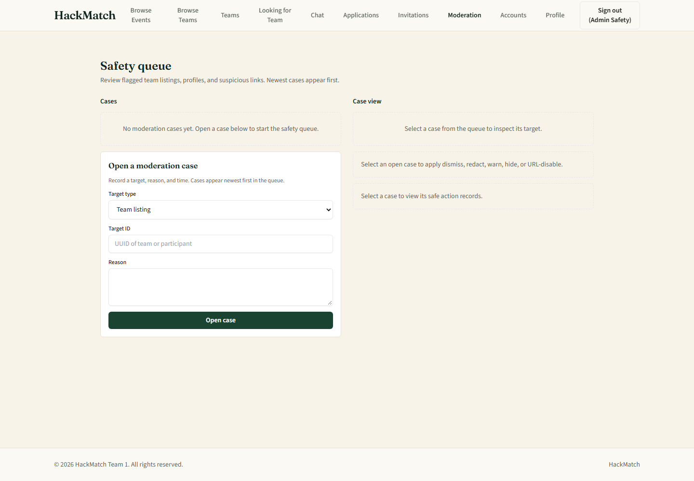
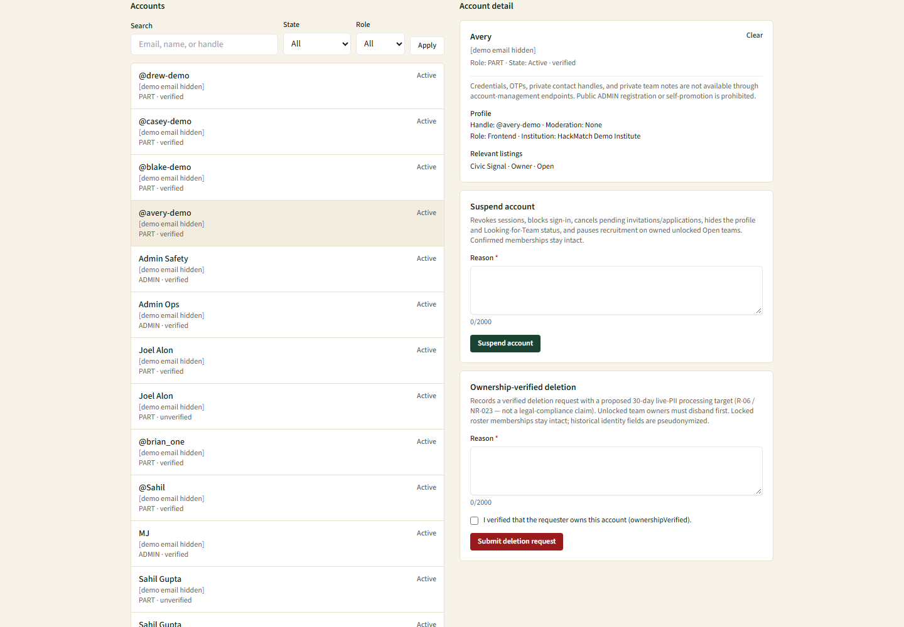
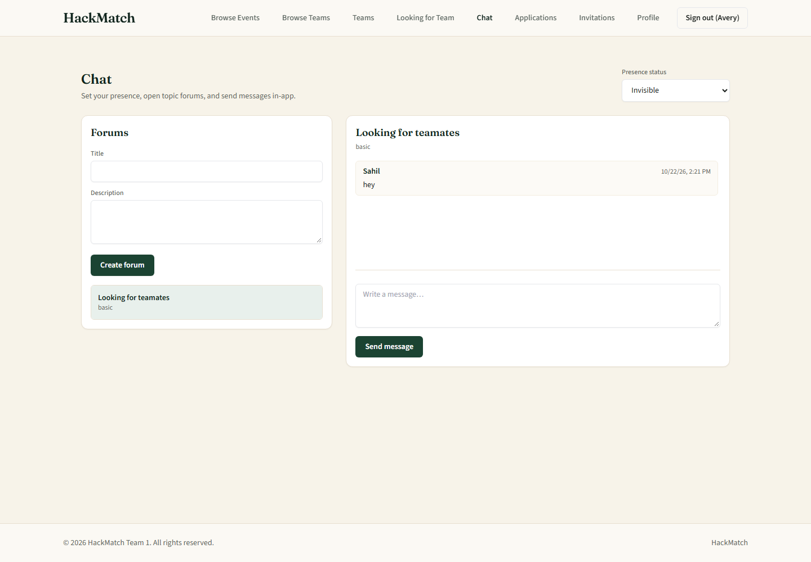

# HackMatch Admin Technical Manual

**Audience:** project administrators, maintainers, developers, and technical reviewers

**Repository baseline:** current `US-030/participant-chat-forums-messaging` branch

**Last reviewed:** October 23, 2026

This manual describes how the current HackMatch implementation is configured, operated, secured, tested, and maintained. It complements the end-user [User Manual](./user_manual.md), the [engineering diagram index](../diagrams/README.md), and the detailed [demo seed guide](../../db-seed/README.md).

## Contents

1. [System overview](#1-system-overview)
2. [Architecture](#2-architecture)
3. [Technology stack](#3-technology-stack)
4. [Repository structure](#4-repository-structure)
5. [Environment configuration](#5-environment-configuration)
6. [Local development setup](#6-local-development-setup)
7. [Authentication and Firebase integration](#7-authentication-and-firebase-integration)
8. [Roles and authorization](#8-roles-and-authorization)
9. [Email OTP and MFA](#9-email-otp-and-mfa)
10. [Supabase and PostgreSQL](#10-supabase-and-postgresql)
11. [Team formation and recruitment](#11-team-formation-and-recruitment)
12. [ADMIN content moderation](#12-admin-content-moderation)
13. [ADMIN account enforcement](#13-admin-account-enforcement)
14. [Participant chat](#14-participant-chat)
15. [Demo seed tooling](#15-demo-seed-tooling)
16. [Testing and continuous integration](#16-testing-and-continuous-integration)
17. [Security and privacy](#17-security-and-privacy)
18. [Operational procedures](#18-operational-procedures)
19. [Troubleshooting](#19-troubleshooting)
20. [Known implementation constraints](#20-known-implementation-constraints)
21. [Technical references](#21-technical-references)

## 1. System overview

HackMatch is a web application for participant profiles, platform-wide teammate discovery, team recruitment, invitations, applications, roster management, administration, and participant chat.

The current user-facing architecture is **Event-Free**:

- users do not choose a hackathon before using team-formation features;
- Looking-for-Team (LFT), recruitment-board discovery, and candidate recommendations are platform-wide;
- a participant may belong to multiple distinct teams;
- membership uniqueness is scoped to a team; and
- US-008, US-009, and US-010—the former event-directory and event-management stories—are deprecated.

The physical PostgreSQL model still contains `events` and `event_id` references. Team creation generates or binds an internal published **shadow event** because existing constraints and database functions still depend on that relationship. A shadow event is a backend compatibility record, not a user-selected or user-managed hackathon.

## 2. Architecture

HackMatch uses a three-tier web architecture with two external managed services.

| Layer | Responsibility |
|---|---|
| React/Vite client | Browser UI, Firebase client sign-in, route-level experience, form validation, and calls to `/api` |
| Express/Node server | Authentication verification, MFA, authorization, validation, privacy projection, domain services, administration, and database access |
| Firebase Authentication | Primary identity, email/password and federated providers, verified-email state, ID tokens, custom role/MFA claims, password reset, and refresh-token revocation |
| Supabase/PostgreSQL | Application accounts, profiles, team/recruitment data, MFA challenge records, notifications, moderation/enforcement records, and chat data |
| SMTP provider | Delivery of verification and six-digit MFA messages; a development-only Ethereal transport is available when production SMTP is not configured |

The browser authenticates through Firebase and ordinarily sends a Firebase ID token to the Express API. The server verifies the token with Firebase Admin, then resolves the corresponding PostgreSQL `participants` row and applies role, verification, active-account, MFA, and resource-ownership checks. Database service-role credentials remain server-side.

Cookie-session endpoints also exist under `/api/auth/session`. Session cookies are HTTP-only and use strict same-site settings; state-changing cookie-authenticated requests are protected by origin and double-submit CSRF checks. The current React API helper primarily uses Firebase bearer tokens.

See the [diagram index](../diagrams/README.md) for focused authentication, profile, recruitment, administration, chat, and data-flow diagrams. The retained [Supabase schema ERD](<../diagrams/shared/HackMatch Supabase Schema ERD.png>) shows the wider physical schema, including compatibility structures.

## 3. Technology stack

Versions below are taken from the current package manifests; caret-prefixed packages may resolve to a newer compatible release in the lockfile.

| Area | Current technology |
|---|---|
| Runtime | Node.js 22 or later (`.nvmrc` specifies `22`) |
| Client | React 18.3, React Router 7, Vite 6, TypeScript 5.7, Tailwind CSS 3.4 |
| Server | Express 4.21, TypeScript 5.7, `tsx`, Helmet 8, CORS, cookie-parser |
| Identity | Firebase JavaScript SDK 13 and Firebase Admin SDK 14.5 |
| Database | Supabase JavaScript SDK 2.117, PostgreSQL, Supabase CLI 2.120 |
| Email | Nodemailer 10.1 with SMTP or development Ethereal transport |
| Testing | Vitest 3, Testing Library, jsdom, Supertest 7, V8 coverage |
| Quality/CI | ESLint 9, TypeScript compiler, Husky, lint-staged, commitlint, GitHub Actions |

## 4. Repository structure

```text
HackMatch/
├── client/                    React/Vite application
├── server/                    Express API, Firebase Admin, repositories, and services
├── supabase/migrations/       Ordered PostgreSQL migrations and RPC definitions
├── db-seed/                   Deterministic Firebase/PostgreSQL demo seed
├── json-file-management/      Safe, human-readable demo scenario references
├── docs/
│   ├── manuals/               Canonical user and technical manuals
│   ├── diagrams/              Mermaid sources, PNG renders, index, and shared ERD
│   ├── assets/wireframes/     Current UI screenshots and coverage index
│   ├── 02_user_stories/       Product stories and Event-Free alignment sources
│   └── 04_requirements/       Functional and non-functional requirements
├── package.json               Root orchestration scripts
└── .github/workflows/         Continuous-integration workflow
```

The server is the trusted integration boundary for Firebase Admin and Supabase service-role operations. The client must never import or receive either privileged credential.

## 5. Environment configuration

Start from `client/.env.example` and `server/.env.example`. Keep real environment files out of version control.

### Client variables

| Variable | Purpose |
|---|---|
| `VITE_API_URL` | Express API base URL, normally `http://localhost:3001/api` |
| `VITE_FIREBASE_API_KEY` | Firebase Web API key used by the browser SDK |
| `VITE_FIREBASE_AUTH_DOMAIN` | Firebase browser authentication domain |
| `VITE_FIREBASE_PROJECT_ID` | Firebase project selected by the client |
| `VITE_FIREBASE_APP_ID` | Firebase web application identifier retained in the example configuration |

Variables prefixed with `VITE_` are compiled into browser code. They must not contain private keys, service-role keys, passwords, SMTP credentials, or server session secrets.

### Server variables

| Category | Variables | Notes |
|---|---|---|
| Runtime | `PORT`, `NODE_ENV`, `CLIENT_URL` | Default development ports are 3001 and 5173 |
| Session/transport | `SESSION_SECRET`, `ENFORCE_HTTPS`, `COOKIE_SECURE`, `TRUST_PROXY`, `SESSION_COOKIE_MAX_AGE_SECONDS` | Production validates the session secret and should enforce HTTPS/secure cookies |
| Supabase | `SUPABASE_URL`, `SUPABASE_ANON_KEY`, `SUPABASE_SERVICE_ROLE_KEY` | The service-role key is server-only and bypasses RLS |
| Firebase Admin | `FIREBASE_PROJECT_ID`, `FIREBASE_CLIENT_EMAIL`, `FIREBASE_PRIVATE_KEY` | `FIREBASE_PRIVATE_KEY` may contain escaped newlines; never expose these values to the client |
| Firebase REST | `FIREBASE_WEB_API_KEY` | Used by server-side Firebase Identity Toolkit flows |
| SMTP | `SMTP_HOST`, `SMTP_PORT`, `SMTP_SECURE`, `SMTP_USER`, `SMTP_PASS`, `SMTP_FROM` | Production MFA delivery fails closed if SMTP is unavailable |
| OTP controls | `OTP_RATE_LIMIT_COOLDOWN_MS`, `OTP_RATE_LIMIT_MAX_PER_HOUR`, `OTP_RATE_LIMIT_STRICT` | Optional overrides for challenge issuance limits |

Production startup rejects missing core Supabase and Firebase Admin settings. Use a randomly generated, high-entropy `SESSION_SECRET` of at least the length described in the example file.

### Demo seed variables

The seed additionally requires:

- `HACKMATCH_DEMO_NAMESPACE=hm-demo-v1`
- `HACKMATCH_DEMO_EXPECTED_FIREBASE_PROJECT_ID`
- `HACKMATCH_DEMO_EXPECTED_SUPABASE_HOST`
- `HACKMATCH_DEMO_ALLOW_REMOTE`
- `HACKMATCH_DEMO_ADMIN_OPS_EMAIL`
- `HACKMATCH_DEMO_ADMIN_SAFETY_EMAIL`
- `HACKMATCH_DEMO_AVERY_EMAIL`
- `HACKMATCH_DEMO_BLAKE_EMAIL`
- `HACKMATCH_DEMO_CASEY_EMAIL`
- `HACKMATCH_DEMO_DREW_EMAIL`
- `HACKMATCH_DEMO_PASSWORD`

Do not put resolved demo emails or the shared password in committed manifests or documentation.

## 6. Local development setup

### Prerequisites

- Node.js 22 or later and npm;
- a Firebase project with Email/Password and any intended OAuth providers configured;
- a Supabase project, or Docker for the local Supabase stack;
- valid server-side Firebase Admin and Supabase credentials; and
- SMTP credentials for realistic mail delivery, or the development-only Ethereal fallback.

### Install and configure

1. Install root, client, and server dependencies:

   ```bash
   npm ci
   ```

   The root `postinstall` script runs `npm ci` in both applications.

2. Create local environment files from the checked-in examples:

   ```text
   client/.env.example  -> client/.env
   server/.env.example  -> server/.env
   ```

3. Fill the local files with values for the same Firebase/Supabase targets. Keep privileged values in `server/.env` only.

4. If using local Supabase, start it and apply migrations:

   ```bash
   npm run db:start
   npm run db:status
   npm run db:push
   ```

5. Start the client and server together:

   ```bash
   npm run dev
   ```

The Vite development server listens on port 5173 and proxies `/api` to the Express server on port 3001. The API also accepts the configured `CLIENT_URL` through CORS.

### Build and quality commands

```bash
npm run lint
npm run typecheck
npm run build
npm run test
npm run test:coverage
```

Component-specific commands can be run with `--prefix client` or `--prefix server`, for example `npm run test --prefix server`.

## 7. Authentication and Firebase integration

### Identity and application data

Firebase is the identity authority. PostgreSQL is the application-data authority. The `participants.firebase_uid` value binds the two records; the PostgreSQL account also stores the normalized email, full name, stored role, verification state, and suspension/deactivation state.

Registration creates a Firebase Email/Password identity and a PostgreSQL `participants` row. If PostgreSQL persistence fails after a new Firebase identity is created, the registration path attempts compensating deletion of only that new identity.

Public registration is restricted to `PART`. Client-supplied role, custom-claim, or administrator fields are rejected. Public sign-in supports:

- Firebase email/password;
- Google OAuth; and
- GitHub OAuth.

OAuth provider identities are tracked in `provider_identities`. Automatic account linking is not based on email alone; explicit provider/account-linking rules protect against account takeover. Successful password or OAuth primary authentication still proceeds through HackMatch email OTP before protected application access.

### Email verification, password recovery, and sign-out

- Verification uses Firebase action codes and synchronizes verified state into PostgreSQL.
- Password-reset requests use an anti-enumeration response so callers cannot determine whether an email is registered.
- Password confirmation uses Firebase password-policy enforcement, invalidates pending MFA challenges, clears the current MFA claim, and revokes refresh tokens.
- Sign-out revokes refresh tokens server-side and clears HackMatch session/CSRF cookies.

### Server-side token checks

Protected routes verify Firebase tokens with revocation checking and reject disabled Firebase identities. Middleware then confirms that the participant exists and is not suspended or deactivated. Route families layer additional checks for MFA, stored role, verified participant status, team ownership, or request ownership.

## 8. Roles and authorization

| Identity/state | Meaning | Typical access |
|---|---|---|
| `VISITOR` | Unauthenticated browser state; not stored as a role | Public landing and privacy-filtered recruitment discovery |
| `PART` | Stored participant account role | Profile, LFT, teams, recruitment, and chat after required verification/MFA checks |
| `ADMIN` | Stored privileged account role | Moderation and account-enforcement APIs/UI after authentication, MFA, and active-account checks |
| Team Lead | Contextual permission held by the `PART` who owns a team | Owner-only team edits, invitations, application decisions, member management, and roster lock |

Team Lead is not a global role and has no ADMIN authority. ADMIN authorization is enforced on the server, not merely by hiding navigation.

The Firebase custom `role` claim is checked alongside PostgreSQL role data. An account with a missing claim may be reconciled to `PART`; it is never elevated to `ADMIN` by default. ADMIN claims are cross-checked against the database.

### Provisioning an ADMIN

Use the server-side provisioning command from an environment with valid Firebase Admin and Supabase service-role credentials:

```bash
npm run admin:provision -- --email <administrator-email> --name <display-name>
```

An optional `--uid` targets an existing exact Firebase UID, and `--demote` changes the account back to `PART`. Do not run this command from a client machine that cannot safely hold administrator credentials. The current provisioning implementation replaces the custom-claim object with the selected role and does not itself revoke existing refresh tokens; require the affected user to sign out and sign in again after a role change.

## 9. Email OTP and MFA

HackMatch implements application-level email OTP after Firebase primary authentication.

1. The server confirms the Firebase identity and active account.
2. A cryptographically random six-digit code is created.
3. Only a SHA-256 hash is stored in `mfa_challenges`; attempts are recorded in `mfa_attempts`.
4. The code is delivered by SMTP and expires after 10 minutes.
5. A newly issued challenge invalidates previous pending challenges for that participant.
6. Five consecutive invalid submissions create a 15-minute lock.
7. Successful verification writes an `mfa_auth_time` custom claim tied to the current Firebase primary `auth_time`.
8. The client refreshes its ID token before calling protected routes.

A new primary login changes `auth_time`, so an old MFA claim cannot satisfy the new session. Resend and issuance are rate limited. Defaults are stricter in production; optional environment variables can tune the cooldown and hourly cap.

In non-production, when SMTP is not configured, Nodemailer may use an Ethereal transport and emit a preview location in server logs. The OTP itself is not logged. Production must use a controlled SMTP provider and fails closed when mail cannot be delivered.

Demo account provisioning verifies account records but never writes `mfa_auth_time`; normal interactive sign-in still requires the OTP workflow.

See the [MFA login sequence](../diagrams/US-004/US-004-mfa-login-sequence.png) and [challenge state diagram](../diagrams/US-004/US-004-mfa-challenge-state.png).

## 10. Supabase and PostgreSQL

### Access model

The Express server initializes Supabase with `SUPABASE_SERVICE_ROLE_KEY` and disabled client-session persistence. Protected application tables enable Row Level Security without granting direct browser policies; authorization and privacy projection occur in the API. The browser must not query these tables with privileged credentials.

### Migrations

Ordered migrations are stored in `supabase/migrations/`. Apply them through the Supabase CLI rather than manually editing a deployed schema:

```bash
npm run db:start
npm run db:status
npm run db:push
```

Review migration diffs and the selected Supabase target before applying any change. Never edit an already-applied migration to repair a shared database; add a new ordered migration instead.

### Principal entities

| Area | Tables |
|---|---|
| Accounts/authentication | `participants`, `provider_identities`, `mfa_challenges`, `mfa_attempts` |
| Profiles | `participant_profiles`, `participant_skills`, `participant_portfolios` |
| Team compatibility/availability | `events`, `event_availability` |
| Recruitment | `teams`, `team_memberships`, `team_vacancies`, `team_requests`, `participant_notifications` |
| Administration | `moderation_cases`, `event_action_records`, `account_deletion_requests` |
| Chat | `chat_channels`, `chat_messages`; presence is stored on `participants` |
| Legacy compatibility | `pending_event_submissions` and event-oriented columns retained by the physical schema |

`moderation_cases.target_id` and `event_action_records.target_id` are polymorphic identifiers interpreted with their target type; they are not physical foreign keys to every possible target table.

### Transactional operations

Recruitment operations use PostgreSQL functions/RPCs and advisory locking where necessary to protect membership, vacancy, capacity, and request-state invariants. Application code maps expected database outcomes to explicit conflict/authorization responses. Refer to the focused [engineering diagrams](../diagrams/README.md) and migration SQL for the exact current transaction contract.

## 11. Team formation and recruitment

The React workflow is platform-wide and does not ask the user to select an event.

- **Availability:** a verified active `PART` can enable LFT with role, commitment, and goal preferences. The database stores this against a deterministic compatibility pool event, but the API presents it as platform-wide.
- **Team creation:** the creator becomes owner/Team Lead and the first confirmed member. The service creates an internal shadow event when needed, then creates the team and owner membership.
- **Recruitment board:** visitors receive an anonymized projection; authenticated participants receive only fields allowed by profile privacy rules.
- **Vacancies:** the owner defines role/skill requirements and may edit or remove vacancies while the roster is unlocked.
- **Recommendations:** owner-only scoring considers skills, primary role, goal, and commitment. The intended pool is platform-wide.
- **Invitations:** owner-issued invitations target a specific open vacancy, start pending, and use a 48-hour expiry.
- **Applications:** a participant applies to a specific open vacancy with an optional message limited to 250 characters and may withdraw a pending application.
- **Placement:** invitation acceptance and application approval revalidate the target team, vacancy, membership, and capacity before creating membership and filling a slot.
- **Roster lock:** the owner may lock an eligible active roster. Locking freezes ordinary membership and vacancy mutation and cancels remaining recruitment requests.

The product default capacity is four. The physical model currently derives several boundaries from the team's shadow event, and current validators also retain a configurable `maxTeamSize` range. Treat the shadow-event relation as compatibility plumbing, not a public workflow.

## 12. ADMIN content moderation

ADMIN moderation routes are mounted under `/api/admin/moderation` and require valid Firebase authentication, current MFA, an active account, and server-confirmed `ADMIN` role.

The current module supports:

- listing and inspecting moderation cases;
- creating cases for `team`, `profile`, or `url` targets;
- viewing action records;
- dismissing a case; and
- applying supported decisions such as redact, warn, hide, or disable URL, subject to target type.

Cases use `Open`, `Dismissed`, and `Resolved` states. Reasons are validated, URL targets require HTTPS, and stale or missing targets fail safely. Target resolution is application logic over the polymorphic `target_type`/`target_id` pair.

Depending on target and action, the service can redact a team pitch or profile handle, record a warning and notification, hide a team/profile, or disable a communication URL. It does not delete team memberships as a side effect of content hiding. Action records retain safe actor, target, outcome, and timestamp metadata; credentials and authentication artifacts are excluded.

An empty safety queue is valid. The current seeded `recruitment-v1` scenario intentionally creates no moderation cases.



See the [moderation workflow sequence](../diagrams/US-026/US-026-moderation-workflow-sequence.png) and [case lifecycle](../diagrams/US-026/US-026-moderation-case-lifecycle-flow.png).

## 13. ADMIN account enforcement

ADMIN account routes are mounted under `/api/admin/accounts` and use the same authentication, MFA, active-account, and server-side ADMIN gates as moderation.

The current implementation provides:

- account list/search with role and state filters;
- selected-account details and related team listings;
- suspension with a recorded reason; and
- deletion-request processing with ownership safeguards.

Suspension updates PostgreSQL state, cancels relevant pending requests, hides open teams owned by the participant, hides the profile, revokes Firebase refresh tokens, and disables Firebase sign-in. Protected endpoints also check PostgreSQL suspension/deactivation, so a stale token does not grant normal application access.

There is no current unsuspend/reactivate endpoint in the ADMIN API. Do not promise reactivation through the UI.

Deletion requires a reason and an explicit ownership-verification acknowledgement. An owner of an unlocked team is blocked until the team is disbanded. Processing revokes or deletes the Firebase identity, removes live profile/authentication-related records where permitted, and pseudonymizes retained locked-team membership history. Deletion is a multi-step operation; administrators should inspect the returned state before retrying after an interruption.

ADMIN payloads omit passwords, OTP values/hashes, tokens, private contact content, and unrelated team notes. Account email is visible to authorized administrators for account identification.



See the [suspension sequence](../diagrams/US-027/US-027-account-suspension-sequence.png) and [account deletion sequence](../diagrams/US-027/US-027-account-deletion-sequence.png).

## 14. Participant chat

US-030 is implemented as global participant forums/channels. All presence and chat routes require Firebase authentication, current MFA, an active account, stored `PART` role, and verified participant status.

### API and persistence

| Capability | Current route family | Persistence |
|---|---|---|
| Read/update own presence | `GET/PUT /api/presence/me` | `participants.presence_status` |
| List/create channels | `GET/POST /api/chat/channels` | `chat_channels` |
| List/send channel messages | `GET/POST /api/chat/channels/:channelId/messages` | `chat_messages` |

Presence values are `Online`, `Idle`, `Do Not Disturb`, and `Invisible`; selection is explicit. No automatic idle timer is implemented.

Channel titles and descriptions are required and validated. Message bodies must be nonblank and are bounded by the database/API limit. The React UI retains channel-form and composer drafts on validation or request failure. Message responses resolve the author handle and UTC timestamp while excluding email, password, OTP, Firebase UID, private contact, and credential fields.

The MVP has no channel-membership persistence or join/leave mechanism: every verified active `PART` passes the same global-channel access gate. There is also no implemented peer-presence directory; `Invisible` is filtered by helper logic, but broader peer visibility policy remains undefined.

Team-specific channels, direct messages, reactions, typing indicators, attachments, voice/video, unread/mention tracking, and moderation/report integration are deferred.



See the [core chat sequence](../diagrams/US-030/US-030-core-chat-sequence.png) and [presence/access flow](../diagrams/US-030/US-030-presence-access-flow.png). The central diagram index still describes US-030 from its earlier specification-only audit; current migrations and source code supersede that status note.

## 15. Demo seed tooling

The deterministic seed under `db-seed/` coordinates Firebase identities/custom claims with PostgreSQL accounts and creates the `recruitment-v1` scenario. It owns exact deterministic IDs for two ADMIN accounts, four PART accounts, profiles, platform-wide availability, two teams, shadow events, memberships, vacancies, one invitation, and one application.

The scenario demonstrates:

- **Civic Signal:** open team owned by Avery, with an invitation to Blake and an application from Casey;
- **Campus Compass:** locked team owned by Drew, with Drew and Blake as confirmed members; and
- manually re-enabled platform-wide LFT for Blake after membership creation.

### Safe operating sequence

Coordinate with everyone using the shared development database before any seed or reset operation.

1. Confirm the Firebase project and Supabase host.
2. Confirm no teammate is running seed/reset or depending on mutable demo state.
3. Run the read-only check:

   ```bash
   npm run demo:seed -- --check --scenario recruitment-v1
   ```

4. Review the redacted plan, then apply:

   ```bash
   npm run demo:seed -- --apply --scenario recruitment-v1
   ```

Normal apply is idempotent: it reconciles exact owned accounts, replaces only the manifest-owned scenario graph in dependency order, restores final LFT state, and verifies the result. `--check` performs no Firebase, database, or runtime-index writes.

Reset and password rotation require extra caution:

```bash
npm run demo:seed -- --apply --scenario recruitment-v1 --rotate-password
npm run demo:reset -- --scenario-only --apply --scenario recruitment-v1 --confirm hm-demo-v1
npm run demo:reset -- --all --apply --scenario recruitment-v1 --confirm hm-demo-v1
```

Scenario-only reset preserves the six accounts. All-reset deletes only exact deterministic account IDs after dependencies are removed. The tool does not enumerate Firebase users or delete by display name, email domain, or UID prefix. Production targets are rejected, and remote targets require an exact expected host plus explicit opt-in.

The seed never bypasses MFA. Seeded accounts are verified in Firebase/PostgreSQL, but interactive login still requires the normal email OTP challenge. Full setup, compensation, collision, and reset details are in the [demo seed README](../../db-seed/README.md); safe copy/paste scenario descriptions are in [JSON file management](../../json-file-management/README.md).

## 16. Testing and continuous integration

### Command matrix

| Purpose | Command |
|---|---|
| All tests | `npm run test` |
| Coverage | `npm run test:coverage` |
| Client tests | `npm run test --prefix client` |
| Server tests | `npm run test --prefix server` |
| Lint all areas | `npm run lint` |
| Type-check all areas | `npm run typecheck` |
| Production builds | `npm run build` |
| Demo seed tests | `npm run demo:test` |
| Demo seed type-check | `npm run demo:typecheck` |
| Demo seed lint | `npm run demo:lint` |

GitHub Actions uses Node 22 and runs dependency installation, commit-message validation for pull requests, lint, type-check, build, and coverage tests.

### Current branch validation baseline

The following results were observed while preparing this manual. They are existing branch conditions; no application or test files were changed to alter them.

| Check | Result |
|---|---|
| `npm run lint` | Passes for client, server, and demo seed |
| `npm run demo:test` | Passes: 12 tests in 4 suites |
| `npm run typecheck` | Client passes; server fails on current test mock typings and Express parameter `string | string[]` typing in account/chat/moderation validators/routes |
| `npm run build` | Client bundle builds with a large-chunk warning; server build fails on the same TypeScript errors |
| `npm run test` | Stops after client: 88 files pass, 2 fail; 743 tests pass and 2 fail in post-lock/team integration assertions |
| Server tests | 124 files pass, 1 fails, 3 skip; 1,938 tests pass, 11 fail, 36 skip, 1 todo. Failures are concentrated in OAuth/auth response expectations and test setup behavior |

Three real-database integration suites are skipped by default. They require `RUN_DB_INTEGRATION=1` and an explicitly local Supabase target (`localhost` or `127.0.0.1`). Do not point these destructive integration paths at a shared or production database.

## 17. Security and privacy

Current controls include:

- Firebase Admin verification with revocation checks on protected routes;
- server-side role, active-account, MFA, verification, resource-ownership, and team-owner checks;
- production HTTPS and secure-cookie options;
- HTTP-only session cookie, strict same-site cookies, origin validation, and double-submit CSRF protection for cookie sessions;
- Helmet headers, restricted CORS, request IDs, sanitized logging, and centralized safe error responses;
- password-policy enforcement and anti-enumeration password-reset responses;
- hashed OTP storage, challenge expiry/invalidation, attempt locking, and issuance limits;
- Supabase service-role isolation on the server;
- server-generated privacy projections for visitor/profile/recruitment/admin/chat responses;
- suspension checks across protected workflows; and
- exact-ID, target-guarded, redacted demo seed/reset behavior.

Operational rules:

1. Never commit `.env` files, Firebase service-account JSON, SMTP credentials, demo passwords, OTPs, tokens, or session cookies.
2. Never expose `SUPABASE_SERVICE_ROLE_KEY` or `FIREBASE_PRIVATE_KEY` through a `VITE_` variable.
3. Rotate compromised credentials at the provider and update deployment secrets; removing a value from Git history alone is insufficient.
4. Revoke sessions after privilege or account-state changes and require a new sign-in/MFA cycle.
5. Treat ADMIN views and moderation reasons as restricted operational data.
6. Use demo identities—not personal accounts—for screenshots, presentations, and repeatable manual tests.

## 18. Operational procedures

### Before a database migration

1. Confirm the exact Supabase project/host.
2. Review pending migration filenames in order.
3. Back up material shared data according to the environment's policy.
4. Apply through the Supabase CLI.
5. Run server tests and focused real-DB tests against local Supabase before shared deployment.
6. Verify health, authentication, and one representative transactional workflow.

### After changing role or account status

1. Confirm PostgreSQL and Firebase state agree.
2. Revoke Firebase refresh tokens or disable the account as appropriate.
3. Ask the affected user to sign out and sign in again.
4. Require email OTP again; do not seed or manually forge `mfa_auth_time`.
5. Inspect pending team requests and owned-team visibility after suspension.

### Before a demo

1. Coordinate ownership of the shared development environment.
2. Run the seed in `--check` mode.
3. Apply only after the target guard and redacted plan are correct.
4. Sign in through the normal OTP flow.
5. Avoid password rotation/reset unless explicitly required.

## 19. Troubleshooting

| Symptom | Likely cause | Action |
|---|---|---|
| Server fails at startup | Required production Firebase/Supabase/session variable is absent or malformed | Compare `server/.env` with `server/.env.example`; check escaped newlines in `FIREBASE_PRIVATE_KEY` |
| Firebase token accepted but API returns 401/403 | Token is stale/revoked, MFA claim is absent, PostgreSQL account is suspended/deactivated, or role/verification data disagrees | Refresh or sign in again; inspect Firebase disabled/claims state and the matching participant row |
| ADMIN navigation exists but API denies access | Firebase claim and stored role differ, MFA is stale, or active-account check fails | Reconcile role deliberately, revoke tokens, then repeat sign-in and OTP |
| OTP does not arrive | SMTP configuration/transport failed, address is wrong, rate limit is active, or development Ethereal preview is being used | Inspect sanitized server logs; verify SMTP variables; wait for cooldown; never log or paste the OTP into source control |
| MFA tables unavailable | Database migrations are incomplete | Check migration status and apply the ordered migrations to the correct target |
| Password reset succeeds but session is rejected | Expected refresh-token revocation/MFA invalidation occurred | Sign in with the new password and complete OTP again |
| Seed rejects target | Firebase project ID or Supabase host does not exactly match expected guards, or remote access is disabled | Correct the expected identifiers; do not disable guards merely to force a run |
| Seed reports UID/email collision | Deterministic UID and normalized email resolve to different accounts | Stop and resolve ownership manually; do not overwrite an unrelated identity |
| Seed reset is blocked by foreign keys | Non-manifest data references an owned deterministic record | Investigate the reference; the reset correctly fails rather than deleting unrelated data |
| Team/recruitment behavior mentions an event internally | Compatibility `event_id`, event-bound constraint, or RPC is still active | Treat it as backend implementation; do not add user-facing event selection |
| Chat access returns 403 | User is not a verified active `PART`, MFA is missing, or account is suspended | Correct the account state and complete authentication; ADMIN is not treated as a normal chat participant |
| Build/type-check currently fails | Known server TypeScript errors in tests and parameter parsing remain on this branch | Use the validation baseline above and address under a separate application/test issue |

## 20. Known implementation constraints

- The schema and several RPCs still require internal events. Availability uses a deterministic platform-pool event, while team creation uses shadow events. Some remaining recommendation, quota, lifecycle, and roster checks are still event-oriented internally.
- The current client does not require event selection, but some validation/API compatibility fields and UI wording may still mention events or hackathons.
- Team capacity defaults to four in the current product design, while physical event bounds and current validators can permit configured sizes outside that default.
- New MFA challenge creation and some ADMIN moderation/account-enforcement workflows consist of sequential cross-service or multi-write operations rather than a single distributed transaction. Retry only after inspecting resulting state.
- ADMIN account enforcement supports suspension and deletion processing, but not unsuspension/reactivation through the current API.
- Chat is global to verified active participants. Channel membership, peer presence discovery policy, team channels, direct messages, rich media, reactions, typing, and moderation hooks are not implemented.
- The diagram index was produced through repository audits and may lag very recent implementation changes; current source, migrations, and tests govern operations when a status label differs.
- The development database and deterministic demo identities are shared resources. Coordinate seed, reset, migration, and destructive account operations.
- Current branch quality checks have known failures listed in [Testing and continuous integration](#16-testing-and-continuous-integration).

## 21. Technical references

- [HackMatch User Manual](./user_manual.md)
- [Engineering diagrams and traceability index](../diagrams/README.md)
- [Shared Supabase schema ERD](<../diagrams/shared/HackMatch Supabase Schema ERD.png>)
- [Current wireframe/screenshot index](../assets/wireframes/README.md)
- [Deterministic demo seed operations](../../db-seed/README.md)
- [Safe demo JSON reference](../../json-file-management/README.md)
- [Current User Stories](../02_user_stories/user_stories.md)
- [Functional and non-functional requirements](../04_requirements/functional_nonfunctional_requirements.md)
- [Supabase migrations](../../supabase/migrations/)
- [Server environment template](../../server/.env.example)
- [Client environment template](../../client/.env.example)
