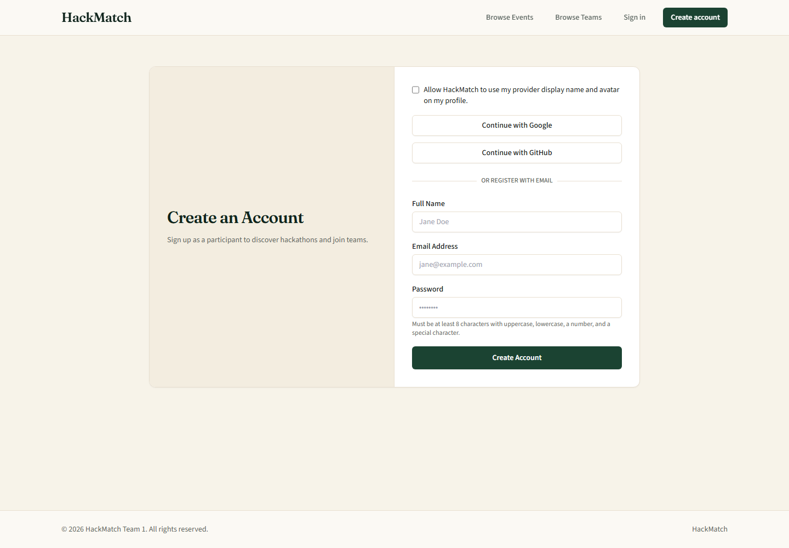
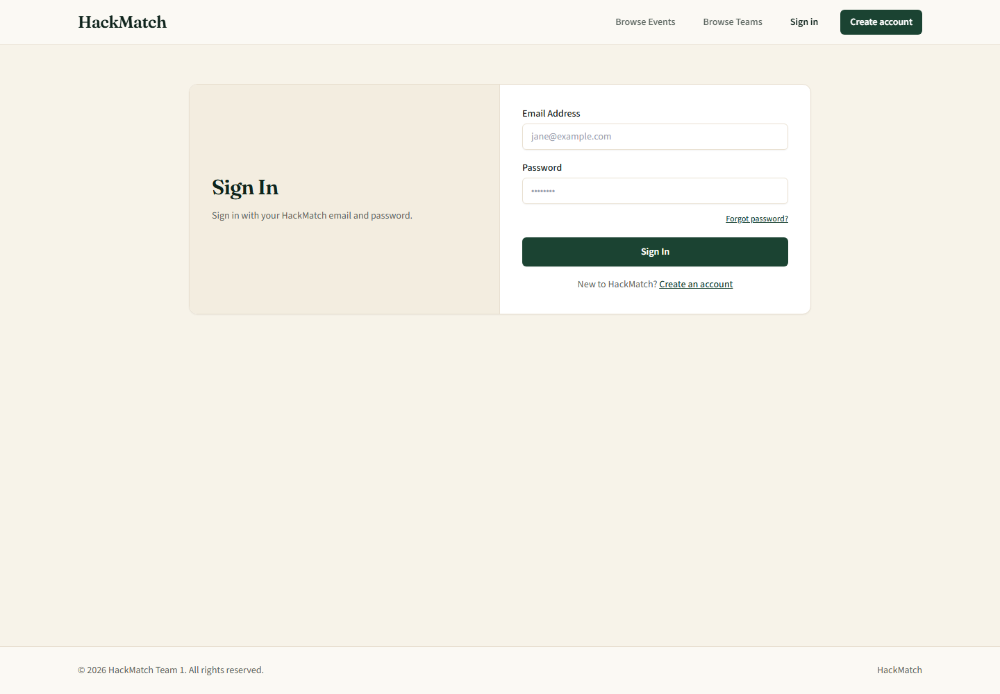
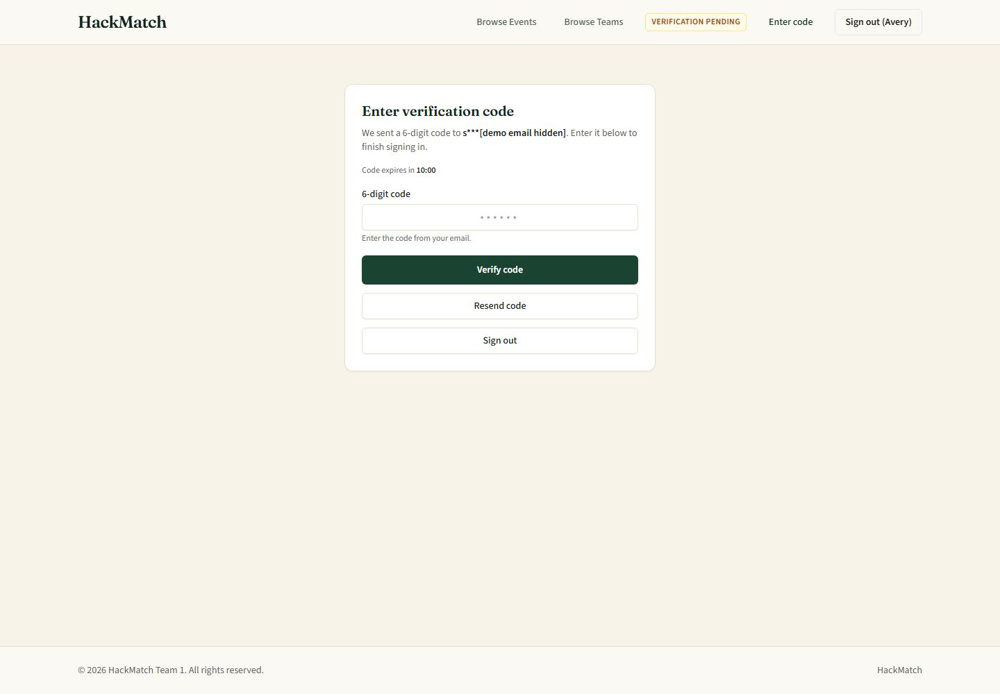
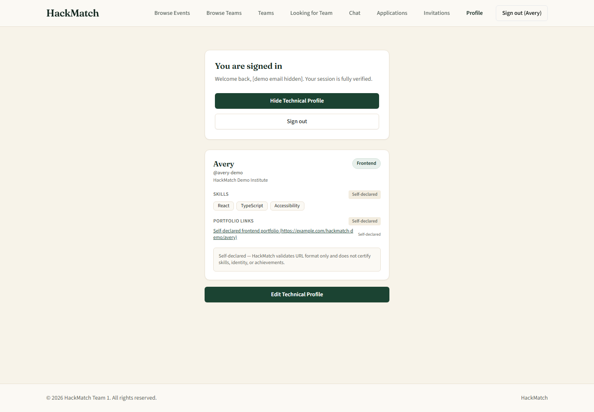
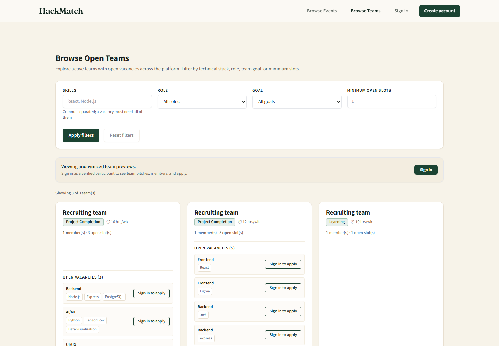
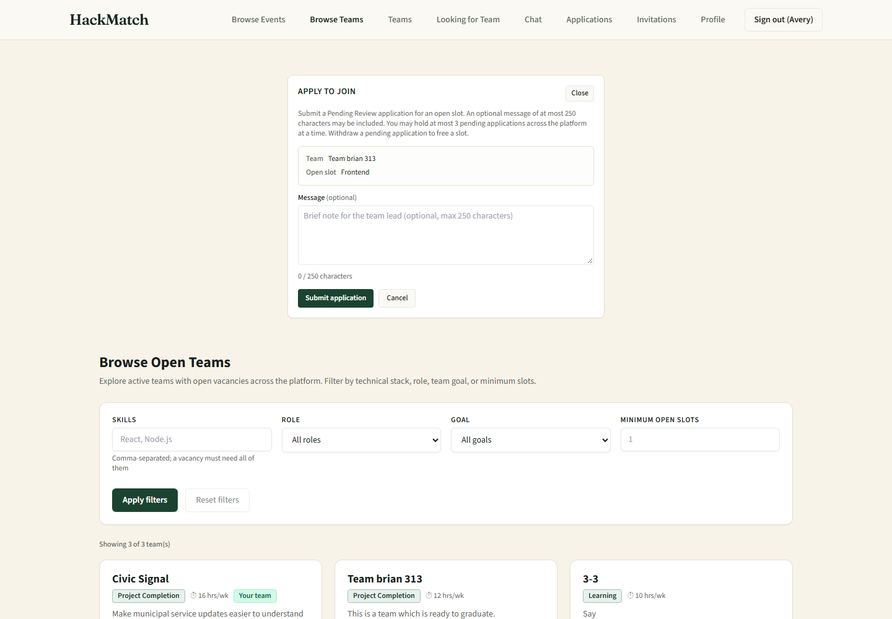
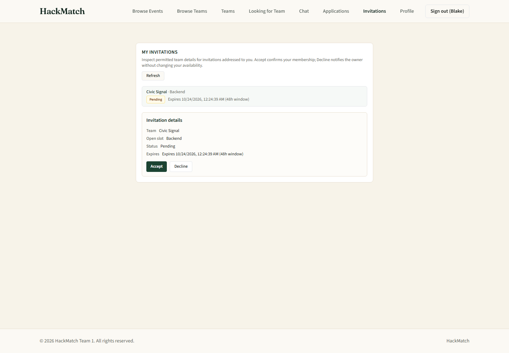
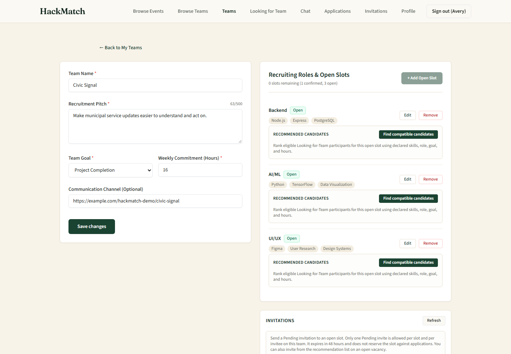
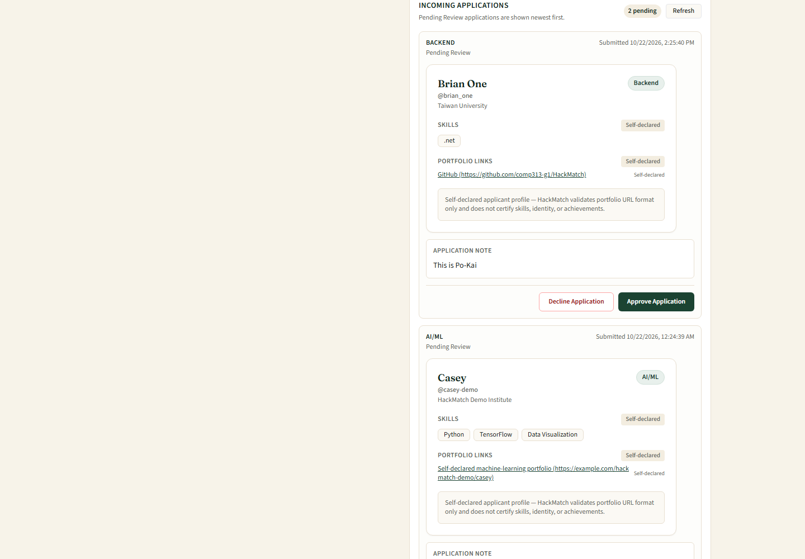
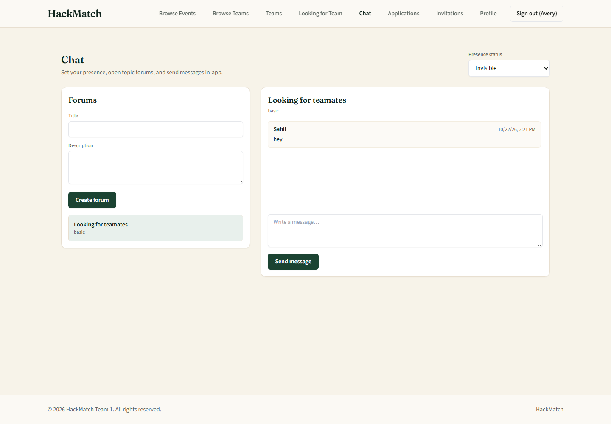

# HackMatch User Manual

This manual explains how to use the current HackMatch web application. It is written for Participants (`PART`), contextual Team Leads, Platform Administrators (`ADMIN`), and unauthenticated visitors.

| Item | Current manual scope |
|---|---|
| Version | 5.2 — Issue #430 update for completed user stories through US-034 |
| Covers | Registration, email verification, sign-in, email OTP, password recovery, profiles, hackathon history and experience badges, Looking for Team, team discovery, candidate directory search, recruitment, requests, roster locking, notifications, private team workspace, team manifest export, abuse reporting, forums chat, private team chat, direct messages, chat unread/mention indicators, chat moderation, and ADMIN screens (moderation, accounts, audit log) |
| Does not cover | Removed hackathon-directory workflows (US-008–US-010), authenticator-app 2FA (US-029, future), starting a brand-new direct message from a profile or card (not available yet), blocking and unblocking controls, or other unimplemented features |
| Sources checked | Current React components, Express routes and access middleware, tests, User Stories, requirements, and real application captures |

> **Current-scope note:** Team formation is presented as a platform-wide workflow. Users do not choose a hackathon before creating, finding, or joining a team. A few current screens and older real captures still contain words such as “event” or “hackathon”; those are transitional interface or internal-compatibility terms, not a user-facing event-directory workflow.

## Contents

1. [About HackMatch](#1-about-hackmatch)
2. [Roles and access](#2-roles-and-access)
3. [Getting started and navigation](#3-getting-started-and-navigation)
4. [Create and verify an account](#4-create-and-verify-an-account)
5. [Sign in and complete email OTP](#5-sign-in-and-complete-email-otp)
6. [Recover a password](#6-recover-a-password)
7. [Create or update a Participant profile](#7-create-or-update-a-participant-profile)
8. [Set Looking-for-Team availability](#8-set-looking-for-team-availability)
9. [Discover teams and apply](#9-discover-teams-and-apply)
10. [Manage applications and invitations](#10-manage-applications-and-invitations)
11. [Create and manage a team](#11-create-and-manage-a-team)
12. [Use recommendations and invite candidates](#12-use-recommendations-and-invite-candidates)
13. [Review applications and lock a roster](#13-review-applications-and-lock-a-roster)
14. [Notifications](#14-notifications)
15. [Hackathon history and experience badge](#15-hackathon-history-and-experience-badge)
16. [Search the candidate directory](#16-search-the-candidate-directory)
17. [Use the private team workspace](#17-use-the-private-team-workspace)
18. [Export the team manifest](#18-export-the-team-manifest)
19. [Report abusive content](#19-report-abusive-content)
20. [Use chat and forums](#20-use-chat-and-forums)
21. [Use the private team chat](#21-use-the-private-team-chat)
22. [Use direct messages](#22-use-direct-messages)
23. [Administrator screens](#23-administrator-screens)
24. [Profile menu, session, and sign out](#24-profile-menu-session-and-sign-out)
25. [Troubleshooting and FAQ](#25-troubleshooting-and-faq)
26. [Screenshot coverage](#26-screenshot-coverage)

## 1. About HackMatch

HackMatch helps Participants find collaborators, publish team recruitment listings, apply for vacancy slots, invite candidates, and finalize rosters. Verified active Participants can also use topic-based chat forums.

The current application supports:

- platform-wide open-team discovery;
- technical profiles and Looking-for-Team cards;
- team creation, vacancy management, recommendations, applications, and invitations;
- accepting, declining, withdrawing, and reviewing recruitment requests;
- permanent roster locking once the roster is eligible;
- an in-app notification bell with unread alerts;
- self-reported hackathon history with an experience badge;
- a candidate directory search for Team Leads;
- a private workspace and an exportable roster manifest for locked teams;
- reporting of abusive profiles, team listings, and suspicious links, plus server-side intake for visible forum/team-chat messages;
- participant presence, shared forums, and text messages;
- a private team chat for the confirmed members of a team;
- one-to-one direct messages between Participants;
- persistent unread-message and `@mention` indicators for accessible chat conversations; and
- ADMIN-only content moderation, account enforcement, and a read-only audit log.

The current application does **not** provide a public hackathon directory, hackathon submission, event approval workflow, a "new message" button for starting a direct message from a profile, block or unblock controls, attachments, voice/video, reactions, typing indicators, or authenticator-app two-factor sign-in.

## 2. Roles and access

| Term | Meaning and access |
|---|---|
| Visitor | Not signed in. Can view the landing page and anonymized open-team previews, register, or sign in. |
| `PART` | Stored Participant role. A verified, active Participant can use profiles, discovery, recruitment, teams, and chat after OTP. |
| Team Lead | Contextual permission held by the Participant who owns a team. It is not a separate account role. |
| `ADMIN` | Stored Platform Administrator role. Can open **Moderation**, **Accounts**, and **Audit log** after completing OTP. Public registration never creates an ADMIN. |

Most protected actions require all of the following:

1. A valid account.
2. Verified email ownership.
3. An active, non-suspended account.
4. Successful email OTP for the current sign-in.
5. The correct role or team ownership for the selected action.

## 3. Getting started and navigation

### Visitor navigation

Visitors see these main actions:

- **Open teams** — browse anonymized recruiting-team previews;
- **Sign in** — use an existing account; and
- **Create account** — register as a Participant.

### Signed-in navigation

After OTP succeeds, the main navigation shows:

- **Open teams** — platform-wide recruitment board;
- **My teams** — owned and joined teams;
- **Find teammates** — Looking-for-Team profile and candidate cards;
- **Recommended teams** — ranked open roles matched to the signed-in Participant's own profile;
- **Requests** — tabs for **Applications** and **Invitations**; and
- the **Notifications** bell, which shows an unread alert badge;
- the account-name menu — **Profile** and **Sign out**.

Chat opens from the floating **Open chat** button at the lower-left corner. For a Participant, this button shows the total unread chat-message count in red and the total unread `@mention` count in amber. These chat indicators are separate from the general **Notifications** bell. An ADMIN also sees an **Admin ▾** menu containing **Moderation**, **Accounts**, and **Audit log**.

On a small screen, choose **Open menu** to display the same destinations.

## 4. Create and verify an account

**Purpose:** Create a standard Participant account and prove ownership of its email address.

**Prerequisite:** Access to the email inbox used for registration.

1. Select **Create account**.
2. Choose either:
   - **Continue with Google** or **Continue with GitHub**; or
   - the email form under **Or register with email**.
3. For email registration, enter **Full Name**, **Email Address**, and **Password**.
4. Use a password with at least 8 characters, including uppercase, lowercase, a number, and a special character.
5. Select **Create Account**.
6. Open the verification email and follow its link.
7. If the link is missing or no longer valid, use **Didn't receive the email? Request a replacement link**.
8. After verification, return to HackMatch and sign in. Email verification alone does not create a full session.

For Google or GitHub, the optional consent checkbox controls whether HackMatch may use the provider display name and avatar. Provider sign-in still proceeds to the HackMatch email OTP step.

*Figure 1 — Participant registration and provider entry points. Public registration contains no role selector.*

**Expected result:** The account is a verified `PART`; protected features remain unavailable until sign-in and OTP are complete.

## 5. Sign in and complete email OTP

**Purpose:** Establish a fully authenticated HackMatch session.

1. Select **Sign in**.
2. Enter **Email Address** and **Password**, then select **Sign In**. Provider users may instead use Google or GitHub from the provider entry point.
3. HackMatch displays **Enter verification code** and sends a 6-digit code to the account email.
4. Enter the code within 10 minutes and select **Verify code**.
5. If necessary, select **Resend code**. A resent code replaces the previous code.

*Figure 2 — Email/password sign-in and the **Forgot password?** link.*

*Figure 3 — Mandatory 6-digit email OTP after primary sign-in. Demo email details are redacted.*

Important restrictions:

- A code expires after 10 minutes.
- Five incorrect OTP attempts cause a 15-minute OTP lock.
- Primary credential failures are also rate-limited; follow the displayed retry guidance.
- OAuth does not bypass OTP.
- A suspended account cannot start or renew a protected session.

**Expected result:** The full navigation appears and protected features become available according to the account role.

## 6. Recover a password

**Purpose:** Set a new password without revealing whether an email address is registered.

1. On **Sign In**, select **Forgot password?**.
2. Enter the account email and submit the recovery request.
3. Read the generic confirmation. HackMatch shows the same style of response for known and unknown addresses.
4. Open a valid reset link from the email.
5. Enter and confirm a password that follows the registration password rules.
6. Return to **Sign In** and use the new password.
7. Complete the normal email OTP step.

An expired, used, or invalid reset link cannot change the password; request a new link. Password recovery never signs the user in automatically and never bypasses OTP.

## 7. Create or update a Participant profile

**Purpose:** Share the permitted technical details that teams use for discovery and recruitment.

**Prerequisite:** Signed in as a verified active `PART` with OTP complete.

1. Open the account-name menu and select **Profile**.
2. Select **Edit Technical Profile**.
3. Complete any desired fields:
   - **Display Handle** — 2–50 letters, numbers, underscores, or hyphens;
   - **Primary Role** — Frontend, Backend, Mobile, AI/ML, UI/UX, or Pitch;
   - **Academic Institution** — up to 150 characters;
   - **Skill Tags (Comma-separated)** — up to 25 tags, each up to 50 characters;
   - **Portfolio Links (HTTPS Only)** — up to 10 links, with optional labels; and
   - **Shared Contact Handle (Optional)** — up to 150 characters.
4. Select **Save Technical Profile**.

*Figure 4 — A saved technical profile with self-declared skills and portfolio data.*

HackMatch labels skills and portfolio links as self-declared. Portfolio URLs must use HTTPS. Validation errors keep the other entered values. Account email is not displayed on profile or recruitment cards, and the shared contact handle is intended only for confirmed teammates.

**Expected result:** The updated profile is saved and its permitted fields can appear in authenticated recruitment views.

You can also record past hackathons on the same page; see [Hackathon history and experience badge](#15-hackathon-history-and-experience-badge).

## 8. Set Looking-for-Team availability

**Purpose:** Publish a platform-wide candidate card so Team Leads can find the Participant.

**Prerequisite:** A verified active Participant profile. Looking-for-Team cards require a handle, institution, at least one skill, and at least one HTTPS portfolio link.

1. Select **Find teammates**.
2. Complete or correct the profile fields shown in the combined form.
3. Turn on the Looking-for-Team option.
4. Select a desired role.
5. Enter commitment hours from 0 to 168.
6. Choose **Learning**, **Project Completion**, or **Competitive**.
7. Select **Save Looking for Team Card**.

The page also lists eligible available candidates for authenticated Participants. Visitors cannot inspect candidate availability cards. A successful team placement clears Looking-for-Team status; a Participant who is allowed to pursue another team can later turn it on again manually.

**Expected result:** The Participant appears in the platform-wide candidate pool with permitted profile and availability fields.

## 9. Discover teams and apply

### Browse and filter open teams

1. Select **Open teams**. This page is available to Visitors and signed-in users.
2. Optionally combine these filters:
   - **Skills** — comma-separated required skills;
   - **Role**;
   - **Goal**; and
   - **Minimum open slots**.
3. Select **Apply filters**.
4. Select **Reset filters** to clear the active filters.

Visitors receive anonymized previews and **Sign in to apply** prompts. A signed-in Participant receives permitted team details, open vacancies, and **Apply** actions. Locked, hidden, disbanded, full, or otherwise unavailable teams cannot accept an application.

*Figure 5 — Platform-wide open-team filtering and anonymized visitor previews.*

### Review recommended teams

**Prerequisite:** Signed in as a verified active `PART` with OTP complete. Suggestions require **Looking for Team** to be on and at least one skill on the Participant profile.

1. Select **Recommended teams**.
2. While HackMatch evaluates the current profile and open roles, the page shows **Finding teams for you…**.
3. Review the suggestions in best-match-first order. Each card identifies the team and open role, shows a match percentage, and separates skills already on the profile from skills the role asks for that are not yet listed.
4. Select **Why this match?** to see the plain-language skill, goal, and weekly-hours explanation. Select it again to hide the explanation.
5. Select **Refresh** to request the latest suggestions.
6. To continue, select **Apply to _team name_**. HackMatch opens the existing application dialog with that team and vacancy fixed as the target.

The percentage compares self-declared profile and Looking-for-Team information with the team's declared role requirements, goal, and hours. It is a suggestion, not a prediction, guarantee of compatibility, or approval of an application. Two open roles on the same team can appear separately.

HackMatch omits teams the Participant already owns or has joined, hidden or unavailable teams and vacancies, and teams with an existing pending application or invitation for that Participant. Suggestions can change when the profile, team, vacancy, membership, or request state changes.

| State | What the page does |
|---|---|
| Looking for Team is off | Shows **Turn on Looking for Team to see suggestions** and **Set up Looking for Team**. |
| No profile skills | Shows **Add your skills to see suggestions** and **Update my profile**. |
| No current match | Shows **No open teams match you right now**, with **Browse open teams** and **Check again**. |
| Initial request fails | Shows a safe error and **Try again**. |
| Refresh fails | Keeps the last successful list and says that the last results are still displayed. |
| Session is no longer valid | Removes recommendation data and asks the Participant to sign in again. |

Recommendations are generated only for the signed-in Participant's own profile. They never expose account email, private membership/request details, or another Participant's recommendation results.

### Apply to an open vacancy

**Prerequisite:** Signed in as a verified active `PART`, not already a confirmed member of the target team.

1. Find the desired vacancy, then select **Apply** on **Open teams** or **Apply to _team name_** on **Recommended teams**.
2. Review the displayed team and open-slot role.
3. Optionally enter a message of no more than 250 characters.
4. Select **Submit application**.

*Figure 6 — Slot-specific application form with its 250-character message counter.*

Rules shown by the current UI:

- A Participant may have at most 3 concurrent **Pending Review** applications across the platform.
- A duplicate pending application to the same team is rejected.
- Withdrawing a pending application immediately frees one quota position.
- Membership in another team does not by itself prevent applying to a different team.
- A validation or request failure keeps the application message for correction or retry.

When the dialog was opened from a recommendation, the selected team and vacancy also remain fixed after a validation or request failure. Opening a different recommendation resets the target-specific draft so an application intended for Team A cannot be submitted to Team B. A recommendation can become stale before submission; the server rechecks the current account, vacancy, membership, recruiting state, duplicate request, and pending-application quota. Rejection keeps the selected target and entered message available for review. A successful submission clears the message, shows the existing success notice, and refreshes the recommendation list.

**Expected result:** A successful application appears as **Pending Review** in **Requests → Applications**.

## 10. Manage applications and invitations

Open **Requests**, then choose **Applications** or **Invitations**.

### Applications tab

The **Applications** tab lists submitted applications and their current status.

1. Select **Refresh** to reload the list.
2. For an application still in **Pending Review**, select **Withdraw** if you no longer want to be considered.
3. Confirm the withdrawal when prompted.

Approved, declined, withdrawn, and canceled outcomes remain visible as status information. Only a pending application can be withdrawn.

### Invitations tab

The **Invitations** tab contains invitations addressed to the signed-in Participant.

1. Select an invitation to open **Invitation details**.
2. Review the team, open slot, status, and expiry.
3. Select **Accept** to join or **Decline** to refuse.

*Figure 7 — A pending invitation with distinct **Accept** and **Decline** actions.*

Invitations expire after 48 hours and can become unavailable sooner if the slot fills or the team locks. Acceptance rechecks the account, team, vacancy, capacity, and membership. A successful acceptance creates the membership, fills the vacancy, and clears Looking-for-Team status. Declining does not create membership and does not change availability.

If two people try to take the final slot or capacity at the same time, one operation can succeed and the other receives a conflict message. Refresh before retrying.

## 11. Create and manage a team

### Create a team

**Prerequisite:** Signed in as a verified active `PART` with OTP complete.

1. Select **My teams**.
2. Select **Create a team**.
3. Complete **Team Name** and **Description / Pitch**.
4. Choose a **Goal** and enter **Estimated Hours/Week** from 0 to 168.
5. Review **Max Team Size**. The current form defaults to 4 and accepts an integer from 2 to 20.
6. Optionally enter an HTTPS **Communication Channel Link**.
7. Under **Initial Vacancy Slots**, choose a role, enter comma-separated skills, and select **+ Add Role Slot**. The owner occupies one roster position, so the number of initial vacancies cannot exceed the remaining team capacity.
8. Select **Create Team**.

No hackathon selection is required. The creator becomes the Team Lead/owner and first confirmed member.

### Manage an unlocked team

Open the team from **My teams**. The owner workspace supports:

- editing team name, pitch, goal, weekly commitment, and communication link, then selecting **Save changes**;
- selecting **+ Add Open Slot**;
- **Edit** or **Remove** on open vacancies;
- reviewing recommendations, invitations, and incoming applications;
- removing a non-owner member with a required reason; and
- disbanding an unlocked team.

Removing an open vacancy warns that its pending requests will be canceled. A confirmed non-owner member can use **Leave team** before roster lock. The owner cannot use the ordinary leave action and must disband an eligible unlocked team instead.

*Figure 8 — Owner workspace with editable listing fields, vacancies, recommendations, and invitation controls.*

**Expected result:** Changes are reflected in the workspace and eligible open vacancies can appear on **Open teams**.

## 12. Use recommendations and invite candidates

**Prerequisite:** The signed-in Participant owns an active unlocked team with an open vacancy.

### Candidate recommendations

1. Open the owner workspace from **My teams**.
2. Find an open vacancy under **Recruiting Roles & Open Slots**.
3. Select **Find compatible candidates**.
4. Review ranked eligible Looking-for-Team candidates and the displayed score contribution explanation.
5. Select the invite action for the desired candidate and confirm the invitation.

The rule-based score uses declared skills, role alignment, goal, and commitment hours. If ranking fails, the interface may provide an unranked eligible list rather than inventing scores.

### Direct invitation controls

The **Invitations** area can also send a slot-specific invitation using the current direct-invite form. Select an **Open slot**, enter the **Invitee participant ID**, and select **Send invitation**. Using the recommendation list is generally easier because it preselects an eligible candidate.

Invitation rules:

- only the team owner can send or cancel one;
- it starts as **Pending** and expires after 48 hours;
- only one pending invitation is allowed per vacancy and per invitee/team; and
- a pending invitation does not reserve the slot against applications.

The owner can inspect outbound invitation status and cancel a pending invitation before response.

## 13. Review applications and lock a roster

### Approve or decline an application

**Prerequisite:** The signed-in Participant owns the target team.

1. Open the team workspace.
2. Under **Incoming Applications**, select **Refresh** if necessary.
3. Review the vacancy, application note, and permitted self-declared profile fields.
4. Select **Approve Application** or **Decline Application**.

*Figure 9 — Owner review of permitted candidate fields, application note, and decision controls.*

Approval rechecks the applicant, team, vacancy, capacity, and current application state. A successful approval confirms membership, fills the vacancy, clears the applicant's Looking-for-Team state, and cancels conflicting pending requests. Declining leaves the roster and vacancy unchanged. A stale or repeated decision produces a safe conflict rather than a duplicate membership.

### Confirm and lock the roster

1. In the owner workspace, find **Confirm & lock roster**.
2. Select **Re-check** to refresh eligibility.
3. Confirm that the roster meets the displayed minimum and maximum. The current MVP rule requires at least 2 confirmed members and no more than the team's capacity.
4. Select **Confirm & Lock Roster**.
5. Read the permanent-lock warning.
6. Select **Yes, Lock Roster**.

Locking is permanent in the current workflow. It cancels remaining pending applications and invitations and prevents ordinary invitations, applications, vacancy changes, member leave/removal, and disbanding.

**Expected result:** The team displays a locked status and the roster becomes read-only. The locked roster unlocks the private workspace ([§17](#17-use-the-private-team-workspace)) and the manifest export ([§18](#18-export-the-team-manifest)) for its confirmed members.

## 14. Notifications

**Purpose:** Be told about invitations, applications, decisions, and roster changes without refreshing pages.

**Prerequisite:** Signed in as a verified active `PART` with OTP complete.

1. Find the **Notifications** bell in the main navigation. A number badge shows how many alerts are unread; the bell reads **Notifications, no unread** when there are none.
2. Select the bell to open the **Notification list**. Alerts are newest first and each carries a label, such as **Invitation**, **Invitation accepted**, **Invitation declined**, **Application received**, **Application approved**, **Application declined**, **Application withdrawn**, or a **Roster** update.
3. Select an alert to mark it read and open the related screen (for example your invitations, the team review area, or your team).
4. Select **Mark all as read** to clear the badge in one step.
5. If the list is long, select **Load older notifications**.

The bell refreshes by itself about every 30 seconds, and sooner when a live connection is available, so new alerts appear without reloading. When there are no alerts the list shows an empty state. If an alert's target is no longer available you see **That notification is no longer available.** A temporary network problem shows a message with a way to retry and does not lose your list.

*Figure 11 — Placeholder: replace with a capture of the Notifications bell, unread badge, and dropdown.*

**Expected result:** Unread count drops as you read alerts, and each alert takes you to the screen where you can act.

## 15. Hackathon history and experience badge

**Purpose:** Share your past hackathon experience so Team Leads can see it. Everything here is **self-reported**; HackMatch does not verify it.

**Prerequisite:** Signed in as a verified active `PART`.

1. Open **Profile** and find **Hackathon History**.
2. Select **Add Hackathon Record** and enter the event name, date, your team role, the project title, and an HTTPS project link.
3. Select **Save Record**. A message confirms **Hackathon history saved successfully.**
4. To change a record, select edit, then **Update Record**. To delete one, select **Remove** and confirm.

Your **experience badge** is calculated from the number of records and is labelled as self-reported:

| Records | Badge |
|---|---|
| 0 | Beginner |
| 1–3 | Competitor |
| 4 or more | Veteran |

The badge recalculates when you add or remove a record. Signed-in Participants can see permitted history and links on a profile; Visitors cannot. Links must start with `https://`, and validation errors keep what you typed.

*Figure 12 — Placeholder: replace with a capture of the Hackathon History section and badge.*

## 16. Search the candidate directory

**Purpose:** Let a Team Lead look for suitable candidates manually, in addition to the ranked recommendations.

**Prerequisite:** You own an active, unlocked team. Only the owner can use this search.

1. Open your team from **My teams**.
2. Find **Candidate Directory Search and Filter**.
3. Choose any filters:
   - skills, with **Match ALL listed skills (AND)** or **Match ANY listed skill (OR)**;
   - **All primary roles** or a specific primary role;
   - **All desired roles**, **All goals**, and commitment hours; and
   - **All experience tiers**, or **Beginner (0 hackathons)**, Competitor, or **Veteran (4+ hackathons)**.
4. Select **Search Candidates**.
5. Select **Inspect Profile** on a card to see skills and portfolio links, or **Invite to Team**, choose an open vacancy, and select **Send Invitation**.

Cards show only permitted fields (handle, role, self-reported badge, skills). People who are already confirmed members are not listed. If nothing matches you see **No candidates match your criteria.** After an invitation is sent, your filters and results stay in place so you can continue searching.

*Figure 13 — Placeholder: replace with a capture of the candidate search filters and results.*

## 17. Use the private team workspace

**Purpose:** Keep shared links, notes, and teammate contact handles in one private place after the roster is locked.

**Prerequisite:** You are a confirmed member (or the owner) of a **locked** team. Visitors, unrelated Participants, and an ADMIN who is not on the team cannot open it.

1. Open the locked team from **My teams**.
2. Find the **Private Coordination Workspace**.
3. Under **Confirmed Teammates & Contact Handles**, review each teammate's role, institution, portfolio links, and shared contact handle. Account emails are never shown, and shared contact handles are visible only to confirmed teammates.
4. **Owner only:** update the shared external links (for example a meeting or repository link) and select **Save External Links**. Only `https://` links are accepted.
5. **All members:** edit the shared markdown note and select **Save Shared Note**.
6. Select **Inspect Revision** to see who changed the note and when; select **Hide Revision** to close it.

If a teammate saved the note after you opened it, your save is refused with **This note was updated by another teammate. Review the latest revision before saving.** Review the latest version, re-apply your change, and save again. Nothing is overwritten silently.

*Figure 14 — Placeholder: replace with a capture of the workspace links, note editor, and revisions.*

## 18. Export the team manifest

**Purpose:** Produce a roster record you can share if an event accepts it, with a checksum others can compare.

**Prerequisite:** You are a confirmed member of a **locked** team.

1. Open the locked team and find the manifest card on the team page.
2. Choose a format:
   - **Printable HTML Card (.html)**;
   - **Verification PDF (.pdf)**; or
   - **JSON Manifest (.json)**.
3. The export lists the team, the lock time recorded by HackMatch, member display names, institution, portfolio links, and roles. Account emails and private contact handles are **never** included.
4. To check a copy, paste its SHA-256 checksum into the verification box and select **Verify Checksum**. A match means the roster is identical to the stored snapshot.

The checksum is an integrity check only. It does not prove when the team formed or that an event organizer approved it. If the manifest cannot be loaded you see **Manifest Export Unavailable** with the reason.

*Figure 15 — Placeholder: replace with a capture of the export buttons and checksum verification.*

## 19. Report abusive content

**Purpose:** Tell Administrators about abusive content that you are permitted to view.

**Prerequisite:** Signed in as a verified active `PART`.

1. Select **Report** on an open team card, or **Report Profile** on a candidate profile.
2. In the report window, confirm the target (**Team Listing**, **Participant Profile**, **Verified Event Listing**, or **Suspicious External URL**).
3. Choose a **Category**, such as Harassment, Spam, Phishing Link, or Fake Account.
4. Optionally add context (up to 1,000 characters). For a suspicious link, enter its full `https://` address.
5. Select **Submit Report**. A **Receipt ID** confirms that Administrators will see it.

You can send at most **5 reports per hour**. If you reach the limit, wait and try again; the message tells you when. Other Participants cannot see your report. If validation fails, correct the highlighted fields and your text is kept.

### Chat-message reports (US-033)

The protected reporting service also accepts a report for a visible forum or team-chat message. The same four categories apply, and the explanation remains optional with a 1,000-character limit. A successful submission enters the existing safety queue and returns a receipt; repeated reports for the same message can link to the same open moderation case.

Normal chat access remains authoritative:

- a public-forum message is reportable only by an eligible signed-in Participant;
- a private team-chat message is reportable only while the reporter is a current confirmed member of that message's team;
- a missing message or one the reporter cannot view produces the same unavailable result, so reporting cannot be used to discover private content; and
- US-032 direct messages use a separate message model and are **not** supported by the current `chat_message` report target.

**Current interface limitation:** the server-side chat-message reporting path is implemented, but the current React forum, team-chat, and direct-message rows do not show a **Report message** button, and the existing report window is still wired only to team/profile/event/URL targets. Therefore there is no clickable chat-message reporting workflow in the current UI. Do not use a copied message identifier to try to bypass this limitation.

A report never gives the reporter access to another Participant's reports, Administrator notes, moderation evidence, action records, internal moderation metadata, or unrelated chat history. Participant report-list and report-detail requests are denied.

*Figure 16 — Placeholder: replace with a capture of the report window and the receipt confirmation.*

## 20. Use chat and forums

**Purpose:** Set presence, create shared topic forums, and exchange text messages with other Participants.

**Prerequisite:** Signed in as a verified, active `PART` with OTP complete. Visitors, unverified Participants, suspended Participants, and ADMIN-only accounts are not normal chat users.

1. Select the floating **Open chat** button at the lower-left corner. The chat panel has two tabs: **Forums** (this section) and **Direct messages** ([§22](#22-use-direct-messages)).
2. Under **Presence status**, choose **Online**, **Idle**, **Do Not Disturb**, or **Invisible**. Presence changes only when selected; no automatic idle timer is documented.
3. To create a forum, enter a **Title** and **Description**, then select **Create forum**.
4. Select a forum from the **Forums** list.
5. Read messages in the **Message thread**.
6. Enter a nonblank message and select **Send message**.

The **Open chat** button, **Forums** tab, and individual forum rows show nonzero unread counts. An amber badge prefixed with `@` shows unread messages that mention your handle. A zero count is hidden. When a forum opens successfully, HackMatch records the newest loaded message as read and refreshes the forum and navigation badges. If that update fails, the messages stay visible and the existing badges remain until the server confirms a later update.

To mention a Participant, type `@` followed by their HackMatch handle, for example `@alex_7`. Handle matching is case-insensitive. Repeating the same handle in one message creates one mention indicator, not several. Text that is not a valid handle mention remains ordinary message text; HackMatch does not reveal whether an unavailable or ineligible handle belongs to an account.

### Unread and mention indicators

Chat activity is stored by HackMatch, so confirmed read positions and badges survive a page refresh, browser restart, or sign-in on another device. On initial load, a small loading indicator appears instead of a misleading zero. Refreshing the inbox or messages, sending successfully, and opening a conversation request updated counts from the server; constant per-channel polling and realtime chat delivery are not used.

If chat activity cannot be loaded, the **Open chat** button shows an error indicator and the chat panel offers **Retry chat activity**. A failed refresh keeps the last server-confirmed badges. A failed mark-read does not clear a badge and shows that messages loaded but unread activity could not be updated. Signing out or changing accounts clears the participant-specific badge state so it cannot carry over to another account.

Unread and mention indicators include only conversations the signed-in Participant may currently access. They contain counts, not message bodies, account emails, credentials, OTPs, tokens, private membership data, or unrelated participant details. A later handle change does not transfer an earlier mention to another account; the mention remains associated with the Participant who owned the handle when the message was sent. Suspended, deactivated, or otherwise ineligible accounts do not receive activity summaries while ineligible.

*Figure 17 — Participant presence, forum selection, and a text-message thread.*

Current limits are 120 characters for a forum title, 2,000 for its description, and 4,000 for a message. Validation and request failures preserve drafts. Messages show the author handle, UTC-backed timestamp rendered for the viewer, and content; chat responses do not expose account email, passwords, OTPs, or OTP hashes.

Forums are shared: every verified active Participant can read and post in them. For a private conversation use your team's chat ([§21](#21-use-the-private-team-chat)) or a direct message ([§22](#22-use-direct-messages)). Reactions, typing indicators, attachments, and voice/video are not available.

## 21. Use the private team chat

**Purpose:** Talk with your teammates in a channel that only the confirmed members of your team can open.

**Prerequisite:** You are a confirmed member (or the owner) of the team, signed in as a verified active `PART` with OTP complete. The team can be open or locked.

1. Open the team from **My teams**.
2. Find the **Team chat** panel ("Private messages for confirmed ... team members").
3. Select **Open team chat**. The channel name and the **Team messages** list appear.
4. Read the messages, oldest first. Each shows the author's handle and the time.
5. Type in **Write a private team message...** and select **Send message**. A short confirmation says **Message sent.**
6. Select **Refresh messages** to load new messages, or **Close** to hide the chat.

After the team channel has loaded, its heading shows nonzero unread and `@mention` badges. Opening the channel and successfully loading its messages marks the newest loaded message as read. Only current confirmed members receive activity for the private channel; if membership is lost, its badges are removed when activity refreshes rather than revealing continued team conversation.

What you will see in other situations:

| Situation | What you see |
|---|---|
| Nobody has written yet | **No team messages yet. Start the conversation below.** |
| You are not (or are no longer) a confirmed member of this team | **Team chat access denied**, with no messages |
| You were removed from the team or left it | You can no longer open or write in the chat. Messages written earlier stay for the team |
| The team was disbanded | The chat is history only; nobody can write new messages |
| The message is empty or too long (over 4,000 characters) | A message under the box; **your text stays in the box** |
| The server could not be reached | **Could not send message.** or **Could not load team chat** with **Retry**; your text is kept |
| Your account is suspended | You cannot write |

Messages show handles only. Account emails, contact details, and presence are never shown.

*Figure 19 — Placeholder: replace with a capture of the Team chat panel with a few messages.*

## 22. Use direct messages

**Purpose:** Exchange private one-to-one messages with another Participant.

**Prerequisite:** Signed in as a verified active `PART` with OTP complete. Only the two people in a conversation can read or write in it.

1. Select the floating **Open chat** button, then the **Direct messages** tab.
2. The **Direct-message conversations** list shows each conversation with the other person's handle, the latest message, and its time, most recent first. Select **Refresh inbox** to reload it.
3. Select a conversation to open it. Messages appear oldest first, each with the author's handle and the time.
4. Type in **Write a direct message...** and select **Send message**.

The **Direct messages** tab shows aggregate DM activity, and each inbox row shows that conversation's nonzero unread and `@mention` counts. Opening a conversation and successfully loading its messages marks the newest loaded message as read. The indicators are available only to the two people in the thread and do not reveal unrelated conversations.

What you will see in other situations:

| Situation | What you see |
|---|---|
| You have no conversations yet | **No direct-message conversations yet.** |
| A conversation has no messages yet | **No messages yet. Start the conversation below.** |
| You are not one of the two people in a conversation, or it does not exist | **Direct-message access denied. This private conversation is not available.** No messages are shown |
| The other person is suspended, deactivated, or unverified | You can read the conversation but cannot send. A message says you cannot send messages in it |
| You blocked the other person | You can read but not send; the message says **You have blocked this participant** |
| The other person blocked you | You can read but not send. The message does not say why, so it looks the same as an unavailable person |
| The message is empty or over 4,000 characters | **Message is required.** or a length message; your text stays in the box |
| The server could not be reached | **Could not send message. Your draft has been kept.** |

Direct messages show handles only. Account emails, full names, contact details, presence, and passwords are never included, and someone who is not part of a conversation cannot find out whether it exists.

**Starting a new conversation.** A conversation appears in your inbox once it exists. The current screen has no "message this person" button on profiles or candidate cards yet, so you cannot start a brand-new conversation from the interface today. Existing conversations can be opened and continued as described above.

*Figure 20 — Placeholder: replace with a capture of the inbox and an open conversation.*

## 23. Administrator screens

Only an active `ADMIN` with OTP complete sees **Admin ▾**. Participants and Visitors are denied by the server even if they attempt a direct request.

### Moderation

1. Open **Admin ▾ → Moderation**.
2. Review the newest cases in **Safety queue**.
3. Select a case to open **Case view** and safe action records.
4. If needed, use the open-case form to create a case for a supported target, including **Chat channel** or **Chat message**. Enter the target UUID and the required case reason.
5. For a chat case, review only the safe channel/message evidence shown in **Case view**. If the original target no longer exists, the case remains available and the target is labelled unavailable.
6. Chat targets currently offer **Dismiss** only. Other target types may offer **Redact text**, **Warn**, **Hide listing**, or **Disable unsafe URL** where supported.
7. Enter the required **Decision reason** and submit.

Closed cases cannot receive another decision. Failed validation preserves the reason draft.

Cases can also appear in the queue because a Participant reported content (see [§19](#19-report-abusive-content)). A report links to an existing open case for that target or creates one, and the reporter receives a receipt without ADMIN-only evidence or action history.

### Accounts

1. Open **Admin ▾ → Accounts**.
2. Search by email, name, or handle, or filter by account **State** and **Role**.
3. Select **Apply**, then select an account row.
4. Review account status, permitted profile summary, and relevant listings.
5. To suspend an eligible account, enter the required **Reason** and select **Suspend account**.
6. For an ownership-verified deletion request, enter the reason, confirm ownership verification, and submit the deletion action.

Suspension revokes access, hides recruitment visibility, and cancels affected pending requests while preserving confirmed memberships. Deletion can be blocked until an owner disbands unlocked teams. The ADMIN interface does not display passwords, OTPs, tokens, or private team notes.

### Audit log

**Purpose:** Review past administrative decisions. The audit log is **read-only**: nobody can edit or delete a record from this page.

1. Open **Admin ▾ → Audit log**.
2. Read the **Audit records** table. Each row shows the **Record ID**, **Actor**, **Action**, **Target**, a safe summary, the **Reason**/**Outcome**, and the **Time (UTC)**.
3. Narrow the list with **Filter audit records**:
   - **Actor** — paste an Actor ID copied from the table;
   - **Action type** — for example `account_suspend`;
   - **Category** — Event, Moderation, or Account; and
   - **From** and **To** dates.
4. Select **Apply filters**. The line **Showing records where:** repeats the active filters. If nothing matches you see **No records match these filters.**
5. Use the **Audit records pagination** controls to move between pages and choose a page size of 25, 50, or 100.

Records older than the configured retention period are labelled **Past retention** for review; they are never changed or removed here. Personal details are shown in the reduced form required by the privacy policy. Participants and Visitors cannot open the audit log.

*Figure 18 — Placeholder: replace with a capture of the audit table, filters, and pagination.*

## 24. Profile menu, session, and sign out

The account-name menu contains **Profile** and **Sign out**; there is no separate general settings page in the current application.

To end the session:

1. Open the account-name menu.
2. Select **Sign out**.
3. Wait for the public navigation to return.

After sign-out, protected actions require a new primary sign-in and email OTP. Do not use a shared browser without signing out.

## 25. Troubleshooting and FAQ

### Why can I browse teams but not apply?

Visitors receive anonymized previews. Select **Sign in to apply**, complete sign-in and OTP, and make sure the account is verified and active.

### Why am I seeing “Verification pending”?

Primary sign-in succeeded but email OTP is incomplete. Select **Enter code**, use the newest 6-digit code, or select **Resend code**. After five incorrect codes, wait for the displayed lock period.

### Why can’t I enable Looking for Team?

Complete the required candidate-card fields: display handle, institution, at least one skill, and at least one valid HTTPS portfolio link. Commitment hours must be 0–168 and the goal/role must be supported values.

### Why is **Apply** missing or rejected?

The team may be locked, hidden, full, or disbanded; the vacancy may already be filled; you may already be on the target team; you may already have a pending application to that team; or you may have reached 3 pending applications.

### Why did an invitation or approval report a conflict?

Another action may have filled the vacancy, reached capacity, locked the team, or resolved the same request. Select **Refresh** and use the latest status.

### Why can’t I edit a team or leave it?

Locked teams reject ordinary roster and vacancy changes. A Team Lead cannot leave through the member action; the owner can disband only while the team is unlocked and otherwise eligible.

### Why can’t I open Chat?

Chat (forums, team chat, and direct messages) requires a verified, active Participant session with OTP complete. It is not available to Visitors, unverified or suspended Participants, or as an ordinary ADMIN feature.

### Why is my notification bell empty or showing an error?

An empty list means no alerts yet. If you see a session message, sign in again. A network message means the bell could not reach the server; it retries by itself, and you can reopen it to try now.

### Why can't I open the workspace or export the manifest?

Both need a **locked** team and a confirmed membership. Ask your Team Lead to lock the roster, and make sure you were not removed from the team.

### Why was my report rejected?

You may have reached the limit of 5 reports per hour, left the category empty, entered a link that does not start with `https://`, or selected content that is no longer available. A team-chat message also becomes ineligible when you are no longer a confirmed member of its team. Direct messages are not accepted by the current chat-message report target. The current chat UI does not yet expose a report button.

### Why was my note not saved in the workspace?

A teammate saved a newer version first. Open the latest revision, re-apply your change, and save again.

### Why does the Team chat panel say it could not load?

Private team chat needs a chat channel for your team. If your team does not have one yet, the panel shows an error such as **Could not load team chat** with **Retry**. Ask the project team to set up the channel; nothing is wrong with your account.

### Why does the team chat say access denied?

Only active confirmed members of that team can open it. Check that you were not removed from the team and that you are signed in with the right account.

### Why can't I send a direct message?

The other person may be suspended, deactivated, unverified, or may have blocked you, or you may have blocked them. You can still read the conversation. Messages must also be between 1 and 4,000 characters.

### Why is there no button to message someone from their profile?

Starting a brand-new direct message from a profile is not available yet. Conversations that already exist appear under **Direct messages** in the chat panel.

### How do I stop messages from someone?

Block and unblock controls are not available in the interface yet. If someone is sending abusive messages, use the report option described in [§19](#19-report-abusive-content) and contact the project team.

### What happens when a form fails?

The current forms are designed to keep valid entered values or drafts when validation, network, or server errors occur. Correct the highlighted field or use **Retry**/**Refresh** where offered.

### Why do some labels mention events or hackathons?

The current user workflow is platform-wide and does not include a hackathon directory. Some visible copy and internal compatibility fields have not yet been renamed. Follow the current navigation in this manual: **Open teams**, **My teams**, **Find teammates**, and **Requests**.

## 26. Screenshot coverage

This manual embeds 10 genuine captures and 9 labelled placeholders from the current feature implementations under [`docs/assets/wireframes/`](../assets/wireframes/README.md). Demo account emails and authentication values are hidden. No screenshot contains passwords, OTP values, tokens, or environment secrets.

The browser-control helper was unavailable during this Issue #353 update, so no screenshot was fabricated or replaced. The embedded captures accurately show the documented workflow panels; some retain the previous header labels (**Browse Events**, **Browse Teams**, separate **Applications**/**Invitations**, or a top-level **Chat** link). The current code has consolidated those destinations into **Open teams**, **Requests**, and the floating **Open chat** button as described in §3.

**Placeholders (Issues #419 and #420).** Figures 11–16 and 18–20 point to files that do not exist yet: `US-021-notification-bell-dropdown.png`, `US-007-hackathon-history.png`, `US-014-candidate-directory-search.png`, `US-023-private-coordination-workspace.png`, `US-024-team-manifest-export.png`, `US-025-report-abuse-modal.png`, `US-028-admin-audit-log.png`, `US-031-team-chat.png`, and `US-032-direct-messages.png`. Capture each with demo accounts only (no real emails, OTPs, or tokens), save it in `docs/assets/wireframes/` under the same name, and the image will appear.

Additional real captures for empty, locked, recommendation, application-list, moderation, and account-enforcement states remain available in the same wireframes folder.

---

HackMatch · COMP 313 · Team 1 · User Manual · Issue #425
