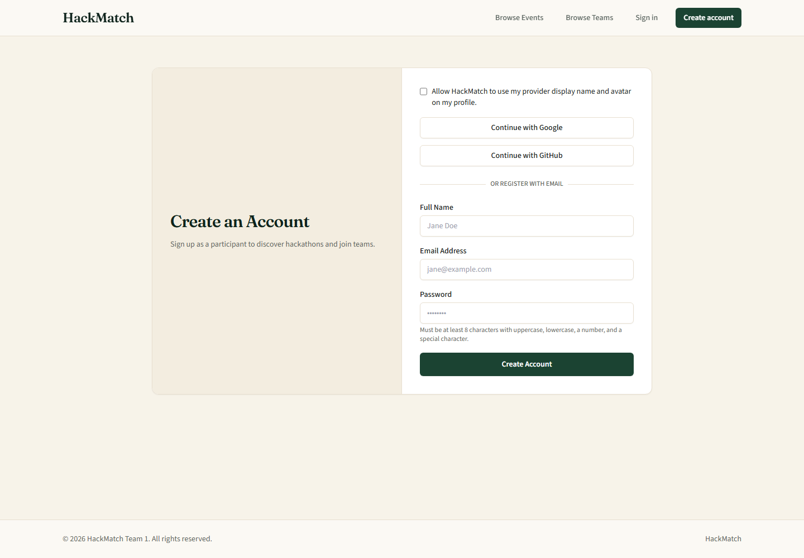
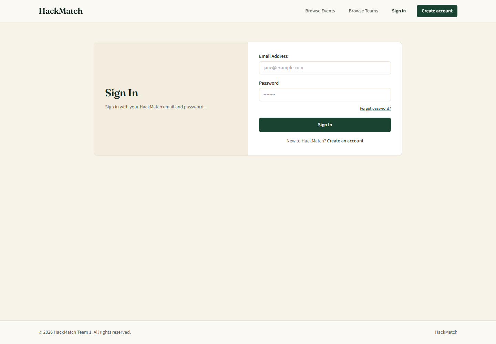
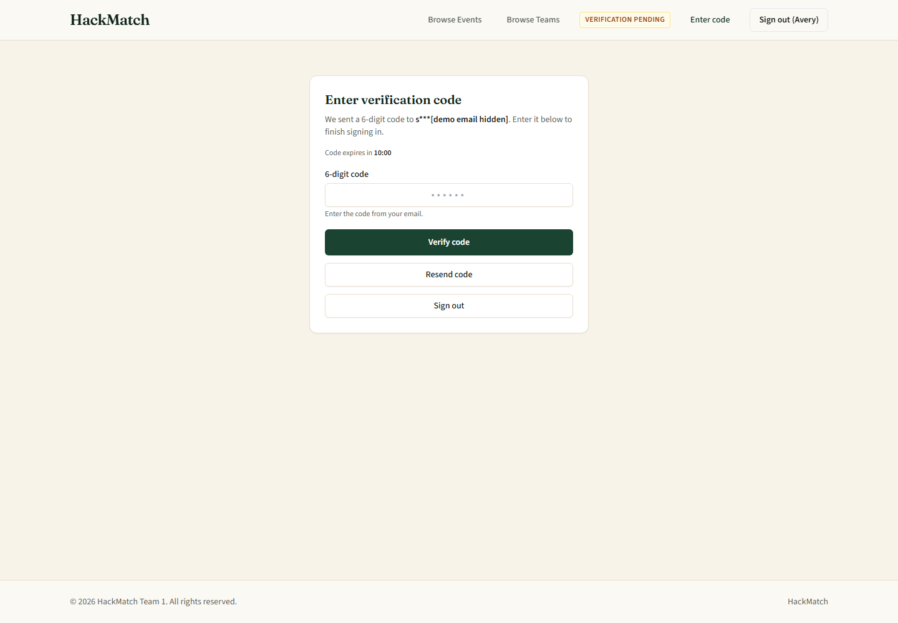
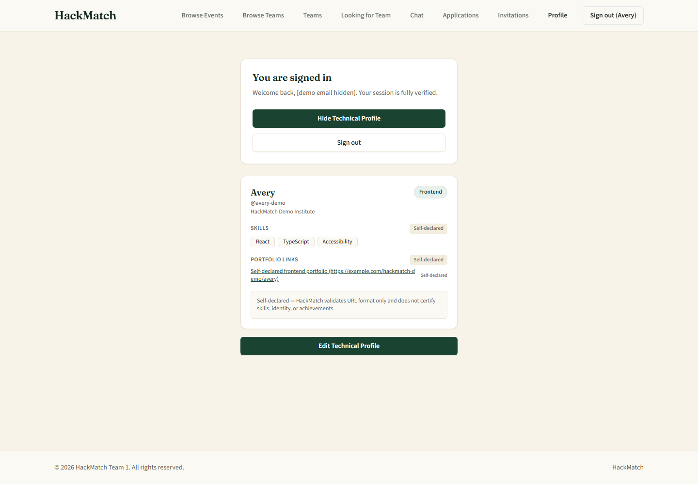
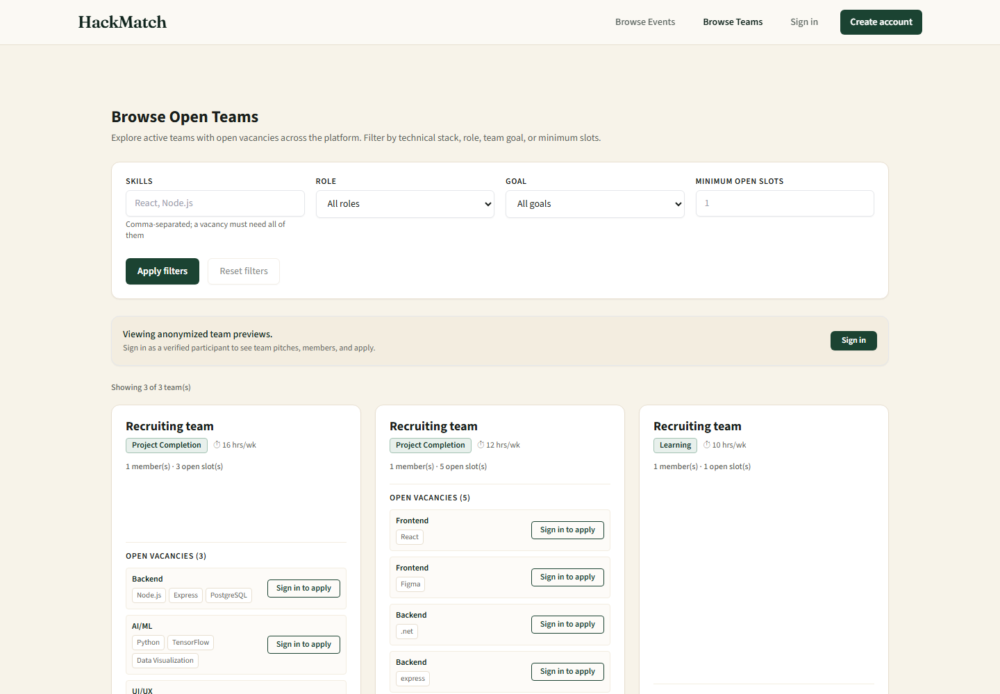
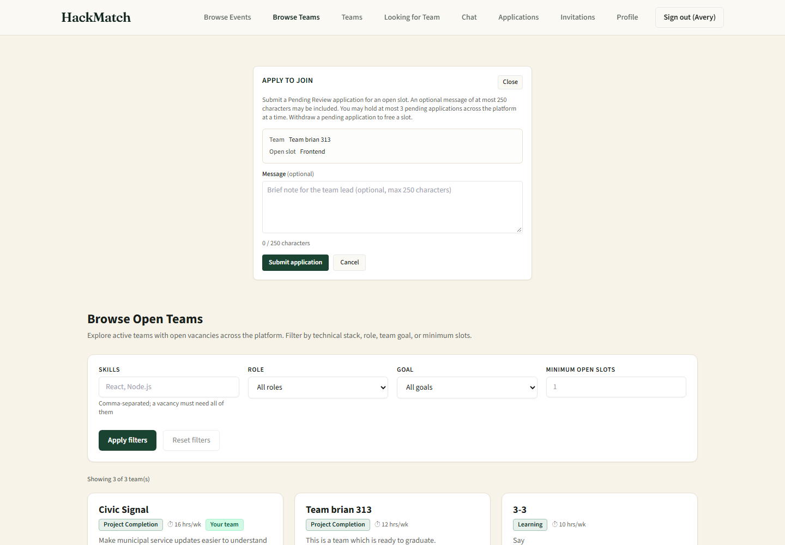
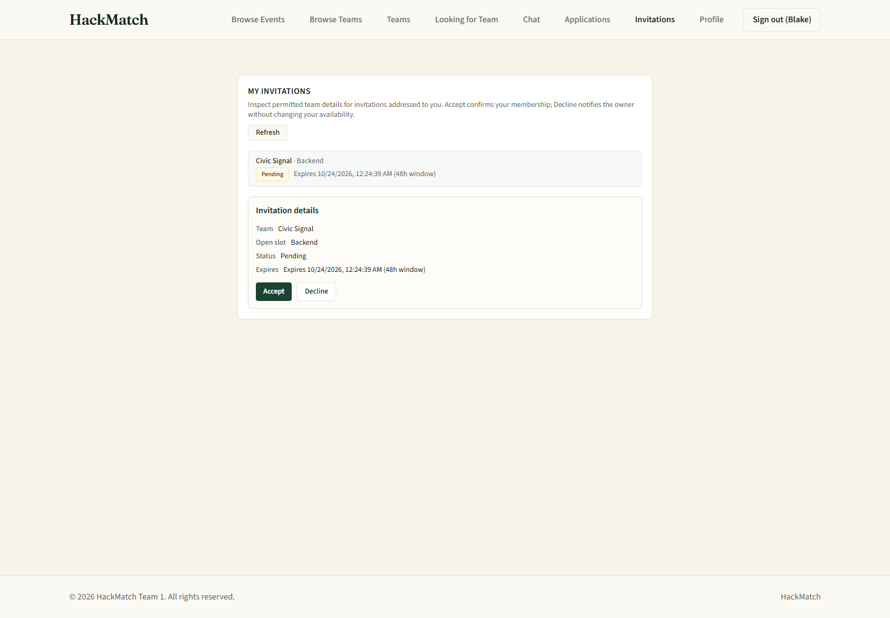
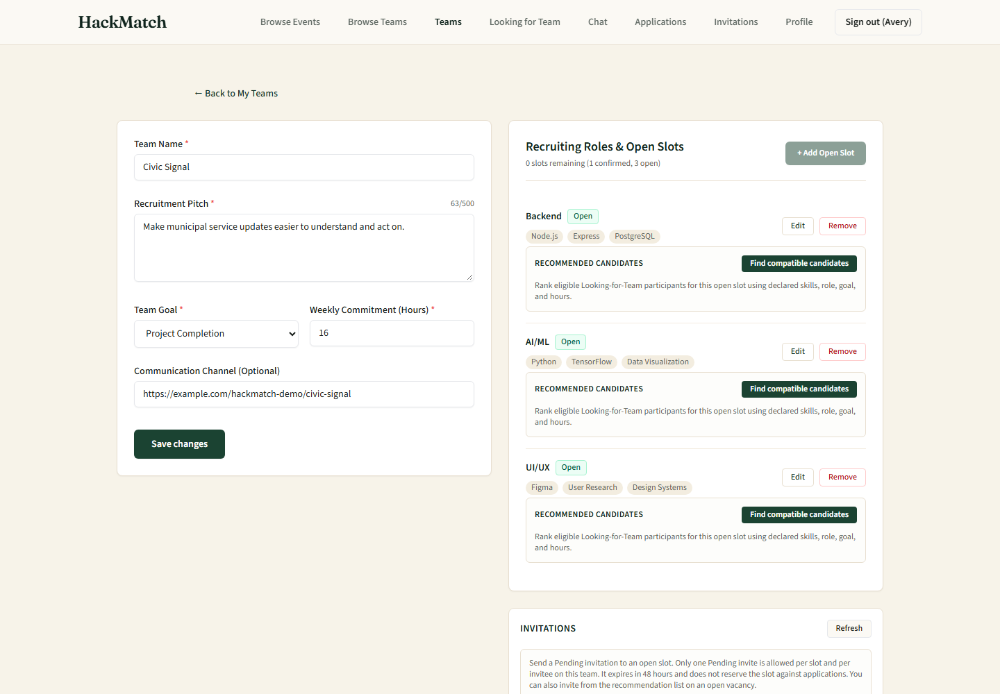
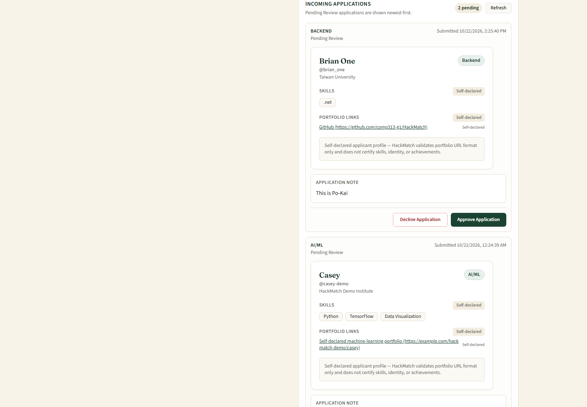

# HackMatch User Manual

This manual explains how to use the current HackMatch web application. It is written for Participants (`PART`), contextual Team Leads, Platform Administrators (`ADMIN`), and unauthenticated visitors.

| Item | Current manual scope |
|---|---|
| Version | 3.0 — Issue #353 current-implementation review |
| Covers | Registration, email verification, sign-in, email OTP, password recovery, profiles, Looking for Team, team discovery, recruitment, requests, roster locking, chat, and ADMIN screens |
| Does not cover | Removed hackathon-directory workflows (US-008–US-010) or unimplemented post-MVP features |
| Sources checked | Current React components, Express routes and access middleware, tests, User Stories, requirements, and real application captures |

> **Current-scope note:** Team formation is presented as a platform-wide workflow. Users do not choose a hackathon before creating, finding, or joining a team. A few current screens and older real captures still contain words such as “event” or “hackathon”; those are transitional interface or internal-compatibility terms, not a user-facing event-directory workflow.

## Contents

1. [About HackMatch](#1-about-hackmatch)
2. [Roles and access](#2-roles-and-access)
3. [Getting started and navigation](#3-getting-started-and-navigation)
4. [Create and verify an account](#4-create-and-verify-an-account)
5. [Sign in and complete email OTP](#5-sign-in-and-complete-email-otp)
6. [Recover a password](#6-recover-a-password)
7. [Create or update a Participant profile](#7-create-or-update-a-participant-profile)
8. [Set Looking-for-Team availability](#8-set-looking-for-team-availability)
9. [Discover teams and apply](#9-discover-teams-and-apply)
10. [Manage applications and invitations](#10-manage-applications-and-invitations)
11. [Create and manage a team](#11-create-and-manage-a-team)
12. [Use recommendations and invite candidates](#12-use-recommendations-and-invite-candidates)
13. [Review applications and lock a roster](#13-review-applications-and-lock-a-roster)
14. [Use chat and messaging](#14-use-chat-and-messaging)
15. [Administrator screens](#15-administrator-screens)
16. [Profile menu, session, and sign out](#16-profile-menu-session-and-sign-out)
17. [Troubleshooting and FAQ](#17-troubleshooting-and-faq)
18. [Screenshot coverage](#18-screenshot-coverage)

## 1. About HackMatch

HackMatch helps Participants find collaborators, publish team recruitment listings, apply for vacancy slots, invite candidates, and finalize rosters. Verified active Participants can also use topic-based chat forums.

The current application supports:

- platform-wide open-team discovery;
- technical profiles and Looking-for-Team cards;
- team creation, vacancy management, recommendations, applications, and invitations;
- accepting, declining, withdrawing, and reviewing recruitment requests;
- permanent roster locking once the roster is eligible;
- participant presence, forums, and text messages; and
- ADMIN-only content moderation and account enforcement.

The current application does **not** provide a public hackathon directory, hackathon submission, event approval workflow, direct messages, team-only chat channels, attachments, voice/video, reactions, typing indicators, or a consolidated notification center.

## 2. Roles and access

| Term | Meaning and access |
|---|---|
| Visitor | Not signed in. Can view the landing page and anonymized open-team previews, register, or sign in. |
| `PART` | Stored Participant role. A verified, active Participant can use profiles, discovery, recruitment, teams, and chat after OTP. |
| Team Lead | Contextual permission held by the Participant who owns a team. It is not a separate account role. |
| `ADMIN` | Stored Platform Administrator role. Can open **Moderation** and **Accounts** after completing OTP. Public registration never creates an ADMIN. |

Most protected actions require all of the following:

1. A valid account.
2. Verified email ownership.
3. An active, non-suspended account.
4. Successful email OTP for the current sign-in.
5. The correct role or team ownership for the selected action.

## 3. Getting started and navigation

### Visitor navigation

Visitors see these main actions:

- **Open teams** — browse anonymized recruiting-team previews;
- **Sign in** — use an existing account; and
- **Create account** — register as a Participant.

### Signed-in navigation

After OTP succeeds, the main navigation shows:

- **Open teams** — platform-wide recruitment board;
- **My teams** — owned and joined teams;
- **Find teammates** — Looking-for-Team profile and candidate cards;
- **Requests** — tabs for **Applications** and **Invitations**; and
- the account-name menu — **Profile** and **Sign out**.

Chat opens from the floating chat button at the lower-left corner. An ADMIN also sees an **Admin ▾** menu containing **Moderation** and **Accounts**.

On a small screen, choose **Open menu** to display the same destinations.

## 4. Create and verify an account

**Purpose:** Create a standard Participant account and prove ownership of its email address.

**Prerequisite:** Access to the email inbox used for registration.

1. Select **Create account**.
2. Choose either:
   - **Continue with Google** or **Continue with GitHub**; or
   - the email form under **Or register with email**.
3. For email registration, enter **Full Name**, **Email Address**, and **Password**.
4. Use a password with at least 8 characters, including uppercase, lowercase, a number, and a special character.
5. Select **Create Account**.
6. Open the verification email and follow its link.
7. If the link is missing or no longer valid, use **Didn't receive the email? Request a replacement link**.
8. After verification, return to HackMatch and sign in. Email verification alone does not create a full session.

For Google or GitHub, the optional consent checkbox controls whether HackMatch may use the provider display name and avatar. Provider sign-in still proceeds to the HackMatch email OTP step.

*Figure 1 — Participant registration and provider entry points. Public registration contains no role selector.*

**Expected result:** The account is a verified `PART`; protected features remain unavailable until sign-in and OTP are complete.

## 5. Sign in and complete email OTP

**Purpose:** Establish a fully authenticated HackMatch session.

1. Select **Sign in**.
2. Enter **Email Address** and **Password**, then select **Sign In**. Provider users may instead use Google or GitHub from the provider entry point.
3. HackMatch displays **Enter verification code** and sends a 6-digit code to the account email.
4. Enter the code within 10 minutes and select **Verify code**.
5. If necessary, select **Resend code**. A resent code replaces the previous code.

*Figure 2 — Email/password sign-in and the **Forgot password?** link.*

*Figure 3 — Mandatory 6-digit email OTP after primary sign-in. Demo email details are redacted.*

Important restrictions:

- A code expires after 10 minutes.
- Five incorrect OTP attempts cause a 15-minute OTP lock.
- Primary credential failures are also rate-limited; follow the displayed retry guidance.
- OAuth does not bypass OTP.
- A suspended account cannot start or renew a protected session.

**Expected result:** The full navigation appears and protected features become available according to the account role.

## 6. Recover a password

**Purpose:** Set a new password without revealing whether an email address is registered.

1. On **Sign In**, select **Forgot password?**.
2. Enter the account email and submit the recovery request.
3. Read the generic confirmation. HackMatch shows the same style of response for known and unknown addresses.
4. Open a valid reset link from the email.
5. Enter and confirm a password that follows the registration password rules.
6. Return to **Sign In** and use the new password.
7. Complete the normal email OTP step.

An expired, used, or invalid reset link cannot change the password; request a new link. Password recovery never signs the user in automatically and never bypasses OTP.

## 7. Create or update a Participant profile

**Purpose:** Share the permitted technical details that teams use for discovery and recruitment.

**Prerequisite:** Signed in as a verified active `PART` with OTP complete.

1. Open the account-name menu and select **Profile**.
2. Select **Edit Technical Profile**.
3. Complete any desired fields:
   - **Display Handle** — 2–50 letters, numbers, underscores, or hyphens;
   - **Primary Role** — Frontend, Backend, Mobile, AI/ML, UI/UX, or Pitch;
   - **Academic Institution** — up to 150 characters;
   - **Skill Tags (Comma-separated)** — up to 25 tags, each up to 50 characters;
   - **Portfolio Links (HTTPS Only)** — up to 10 links, with optional labels; and
   - **Shared Contact Handle (Optional)** — up to 150 characters.
4. Select **Save Technical Profile**.

*Figure 4 — A saved technical profile with self-declared skills and portfolio data.*

HackMatch labels skills and portfolio links as self-declared. Portfolio URLs must use HTTPS. Validation errors keep the other entered values. Account email is not displayed on profile or recruitment cards, and the shared contact handle is intended only for confirmed teammates.

**Expected result:** The updated profile is saved and its permitted fields can appear in authenticated recruitment views.

## 8. Set Looking-for-Team availability

**Purpose:** Publish a platform-wide candidate card so Team Leads can find the Participant.

**Prerequisite:** A verified active Participant profile. Looking-for-Team cards require a handle, institution, at least one skill, and at least one HTTPS portfolio link.

1. Select **Find teammates**.
2. Complete or correct the profile fields shown in the combined form.
3. Turn on the Looking-for-Team option.
4. Select a desired role.
5. Enter commitment hours from 0 to 168.
6. Choose **Learning**, **Project Completion**, or **Competitive**.
7. Select **Save Looking for Team Card**.

The page also lists eligible available candidates for authenticated Participants. Visitors cannot inspect candidate availability cards. A successful team placement clears Looking-for-Team status; a Participant who is allowed to pursue another team can later turn it on again manually.

**Expected result:** The Participant appears in the platform-wide candidate pool with permitted profile and availability fields.

## 9. Discover teams and apply

### Browse and filter open teams

1. Select **Open teams**. This page is available to Visitors and signed-in users.
2. Optionally combine these filters:
   - **Skills** — comma-separated required skills;
   - **Role**;
   - **Goal**; and
   - **Minimum open slots**.
3. Select **Apply filters**.
4. Select **Reset filters** to clear the active filters.

Visitors receive anonymized previews and **Sign in to apply** prompts. A signed-in Participant receives permitted team details, open vacancies, and **Apply** actions. Locked, hidden, disbanded, full, or otherwise unavailable teams cannot accept an application.

*Figure 5 — Platform-wide open-team filtering and anonymized visitor previews.*

### Apply to an open vacancy

**Prerequisite:** Signed in as a verified active `PART`, not already a confirmed member of the target team.

1. Find the desired vacancy on **Open teams**.
2. Select **Apply**.
3. Review the displayed team and open-slot role.
4. Optionally enter a message of no more than 250 characters.
5. Select **Submit application**.

*Figure 6 — Slot-specific application form with its 250-character message counter.*

Rules shown by the current UI:

- A Participant may have at most 3 concurrent **Pending Review** applications across the platform.
- A duplicate pending application to the same team is rejected.
- Withdrawing a pending application immediately frees one quota position.
- Membership in another team does not by itself prevent applying to a different team.
- A validation or request failure keeps the application message for correction or retry.

**Expected result:** A successful application appears as **Pending Review** in **Requests → Applications**.

## 10. Manage applications and invitations

Open **Requests**, then choose **Applications** or **Invitations**.

### Applications tab

The **Applications** tab lists submitted applications and their current status.

1. Select **Refresh** to reload the list.
2. For an application still in **Pending Review**, select **Withdraw** if you no longer want to be considered.
3. Confirm the withdrawal when prompted.

Approved, declined, withdrawn, and canceled outcomes remain visible as status information. Only a pending application can be withdrawn.

### Invitations tab

The **Invitations** tab contains invitations addressed to the signed-in Participant.

1. Select an invitation to open **Invitation details**.
2. Review the team, open slot, status, and expiry.
3. Select **Accept** to join or **Decline** to refuse.

*Figure 7 — A pending invitation with distinct **Accept** and **Decline** actions.*

Invitations expire after 48 hours and can become unavailable sooner if the slot fills or the team locks. Acceptance rechecks the account, team, vacancy, capacity, and membership. A successful acceptance creates the membership, fills the vacancy, and clears Looking-for-Team status. Declining does not create membership and does not change availability.

If two people try to take the final slot or capacity at the same time, one operation can succeed and the other receives a conflict message. Refresh before retrying.

## 11. Create and manage a team

### Create a team

**Prerequisite:** Signed in as a verified active `PART` with OTP complete.

1. Select **My teams**.
2. Select **Create a team**.
3. Complete **Team Name** and **Description / Pitch**.
4. Choose a **Goal** and enter **Estimated Hours/Week** from 0 to 168.
5. Review **Max Team Size**. The current form defaults to 4 and accepts an integer from 2 to 20.
6. Optionally enter an HTTPS **Communication Channel Link**.
7. Under **Initial Vacancy Slots**, choose a role, enter comma-separated skills, and select **+ Add Role Slot**. The owner occupies one roster position, so the number of initial vacancies cannot exceed the remaining team capacity.
8. Select **Create Team**.

No hackathon selection is required. The creator becomes the Team Lead/owner and first confirmed member.

### Manage an unlocked team

Open the team from **My teams**. The owner workspace supports:

- editing team name, pitch, goal, weekly commitment, and communication link, then selecting **Save changes**;
- selecting **+ Add Open Slot**;
- **Edit** or **Remove** on open vacancies;
- reviewing recommendations, invitations, and incoming applications;
- removing a non-owner member with a required reason; and
- disbanding an unlocked team.

Removing an open vacancy warns that its pending requests will be canceled. A confirmed non-owner member can use **Leave team** before roster lock. The owner cannot use the ordinary leave action and must disband an eligible unlocked team instead.

*Figure 8 — Owner workspace with editable listing fields, vacancies, recommendations, and invitation controls.*

**Expected result:** Changes are reflected in the workspace and eligible open vacancies can appear on **Open teams**.

## 12. Use recommendations and invite candidates

**Prerequisite:** The signed-in Participant owns an active unlocked team with an open vacancy.

### Candidate recommendations

1. Open the owner workspace from **My teams**.
2. Find an open vacancy under **Recruiting Roles & Open Slots**.
3. Select **Find compatible candidates**.
4. Review ranked eligible Looking-for-Team candidates and the displayed score contribution explanation.
5. Select the invite action for the desired candidate and confirm the invitation.

The rule-based score uses declared skills, role alignment, goal, and commitment hours. If ranking fails, the interface may provide an unranked eligible list rather than inventing scores.

### Direct invitation controls

The **Invitations** area can also send a slot-specific invitation using the current direct-invite form. Select an **Open slot**, enter the **Invitee participant ID**, and select **Send invitation**. Using the recommendation list is generally easier because it preselects an eligible candidate.

Invitation rules:

- only the team owner can send or cancel one;
- it starts as **Pending** and expires after 48 hours;
- only one pending invitation is allowed per vacancy and per invitee/team; and
- a pending invitation does not reserve the slot against applications.

The owner can inspect outbound invitation status and cancel a pending invitation before response.

## 13. Review applications and lock a roster

### Approve or decline an application

**Prerequisite:** The signed-in Participant owns the target team.

1. Open the team workspace.
2. Under **Incoming Applications**, select **Refresh** if necessary.
3. Review the vacancy, application note, and permitted self-declared profile fields.
4. Select **Approve Application** or **Decline Application**.

*Figure 9 — Owner review of permitted candidate fields, application note, and decision controls.*

Approval rechecks the applicant, team, vacancy, capacity, and current application state. A successful approval confirms membership, fills the vacancy, clears the applicant's Looking-for-Team state, and cancels conflicting pending requests. Declining leaves the roster and vacancy unchanged. A stale or repeated decision produces a safe conflict rather than a duplicate membership.

### Confirm and lock the roster

1. In the owner workspace, find **Confirm & lock roster**.
2. Select **Re-check** to refresh eligibility.
3. Confirm that the roster meets the displayed minimum and maximum. The current MVP rule requires at least 2 confirmed members and no more than the team's capacity.
4. Select **Confirm & Lock Roster**.
5. Read the permanent-lock warning.
6. Select **Yes, Lock Roster**.

Locking is permanent in the current workflow. It cancels remaining pending applications and invitations and prevents ordinary invitations, applications, vacancy changes, member leave/removal, and disbanding.

**Expected result:** The team displays a locked status and the roster becomes read-only.

## 14. Use chat and messaging

**Purpose:** Set presence, create topic forums, and exchange text messages.

**Prerequisite:** Signed in as a verified, active `PART` with OTP complete. Visitors, unverified Participants, suspended Participants, and ADMIN-only accounts are not normal chat users.

1. Select the floating **Open chat** button at the lower-left corner.
2. Under **Presence status**, choose **Online**, **Idle**, **Do Not Disturb**, or **Invisible**. Presence changes only when selected; no automatic idle timer is documented.
3. To create a forum, enter a **Title** and **Description**, then select **Create forum**.
4. Select a forum from the **Forums** list.
5. Read messages in the **Message thread**.
6. Enter a nonblank message and select **Send message**.

*Figure 10 — Participant presence, forum selection, and a text-message thread.*

Current limits are 120 characters for a forum title, 2,000 for its description, and 4,000 for a message. Validation and request failures preserve drafts. Messages show the author handle, UTC-backed timestamp rendered for the viewer, and content; chat responses do not expose account email, passwords, OTPs, or OTP hashes.

Current MVP chat is a shared topic-forum experience. Team-scoped channels, direct messages, reporting hooks, unread/mention badges, reactions, typing indicators, attachments, and voice/video are not available.

## 15. Administrator screens

Only an active `ADMIN` with OTP complete sees **Admin ▾**. Participants and Visitors are denied by the server even if they attempt a direct request.

### Moderation

1. Open **Admin ▾ → Moderation**.
2. Review the newest cases in **Safety queue**.
3. Select a case to open **Case view** and safe action records.
4. If needed, use the open-case form to create a case for a supported target.
5. Choose an enforcement action: **Dismiss**, **Redact text**, **Warn**, **Hide listing**, or **Disable unsafe URL**.
6. Enter the required **Decision reason** and submit.

Closed cases cannot receive another decision. Failed validation preserves the reason draft.

### Accounts

1. Open **Admin ▾ → Accounts**.
2. Search by email, name, or handle, or filter by account **State** and **Role**.
3. Select **Apply**, then select an account row.
4. Review account status, permitted profile summary, and relevant listings.
5. To suspend an eligible account, enter the required **Reason** and select **Suspend account**.
6. For an ownership-verified deletion request, enter the reason, confirm ownership verification, and submit the deletion action.

Suspension revokes access, hides recruitment visibility, and cancels affected pending requests while preserving confirmed memberships. Deletion can be blocked until an owner disbands unlocked teams. The ADMIN interface does not display passwords, OTPs, tokens, or private team notes.

## 16. Profile menu, session, and sign out

The account-name menu contains **Profile** and **Sign out**; there is no separate general settings page in the current application.

To end the session:

1. Open the account-name menu.
2. Select **Sign out**.
3. Wait for the public navigation to return.

After sign-out, protected actions require a new primary sign-in and email OTP. Do not use a shared browser without signing out.

## 17. Troubleshooting and FAQ

### Why can I browse teams but not apply?

Visitors receive anonymized previews. Select **Sign in to apply**, complete sign-in and OTP, and make sure the account is verified and active.

### Why am I seeing “Verification pending”?

Primary sign-in succeeded but email OTP is incomplete. Select **Enter code**, use the newest 6-digit code, or select **Resend code**. After five incorrect codes, wait for the displayed lock period.

### Why can’t I enable Looking for Team?

Complete the required candidate-card fields: display handle, institution, at least one skill, and at least one valid HTTPS portfolio link. Commitment hours must be 0–168 and the goal/role must be supported values.

### Why is **Apply** missing or rejected?

The team may be locked, hidden, full, or disbanded; the vacancy may already be filled; you may already be on the target team; you may already have a pending application to that team; or you may have reached 3 pending applications.

### Why did an invitation or approval report a conflict?

Another action may have filled the vacancy, reached capacity, locked the team, or resolved the same request. Select **Refresh** and use the latest status.

### Why can’t I edit a team or leave it?

Locked teams reject ordinary roster and vacancy changes. A Team Lead cannot leave through the member action; the owner can disband only while the team is unlocked and otherwise eligible.

### Why can’t I open Chat?

Chat requires a verified, active Participant session with OTP complete. It is not available to Visitors, unverified or suspended Participants, or as an ordinary ADMIN feature.

### What happens when a form fails?

The current forms are designed to keep valid entered values or drafts when validation, network, or server errors occur. Correct the highlighted field or use **Retry**/**Refresh** where offered.

### Why do some labels mention events or hackathons?

The current user workflow is platform-wide and does not include a hackathon directory. Some visible copy and internal compatibility fields have not yet been renamed. Follow the current navigation in this manual: **Open teams**, **My teams**, **Find teammates**, and **Requests**.

## 18. Screenshot coverage

This manual embeds 10 genuine captures from the current feature implementations under [`docs/assets/wireframes/`](../assets/wireframes/README.md). Demo account emails and authentication values are hidden. No screenshot contains passwords, OTP values, tokens, or environment secrets.

The browser-control helper was unavailable during this Issue #353 update, so no screenshot was fabricated or replaced. The embedded captures accurately show the documented workflow panels; some retain the previous header labels (**Browse Events**, **Browse Teams**, separate **Applications**/**Invitations**, or a top-level **Chat** link). The current code has consolidated those destinations into **Open teams**, **Requests**, and the floating **Open chat** button as described in §3.

Additional real captures for empty, locked, recommendation, application-list, moderation, and account-enforcement states remain available in the same wireframes folder.

---

HackMatch · COMP 313 · Team 1 · User Manual · Issue #353
