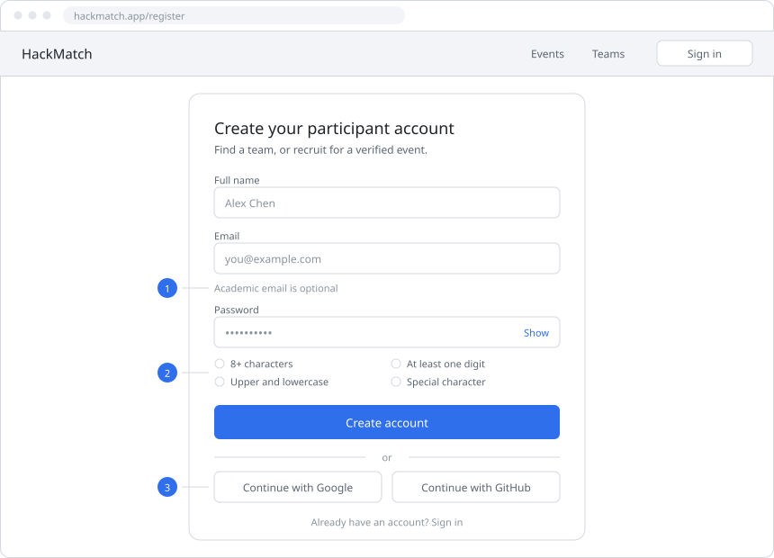
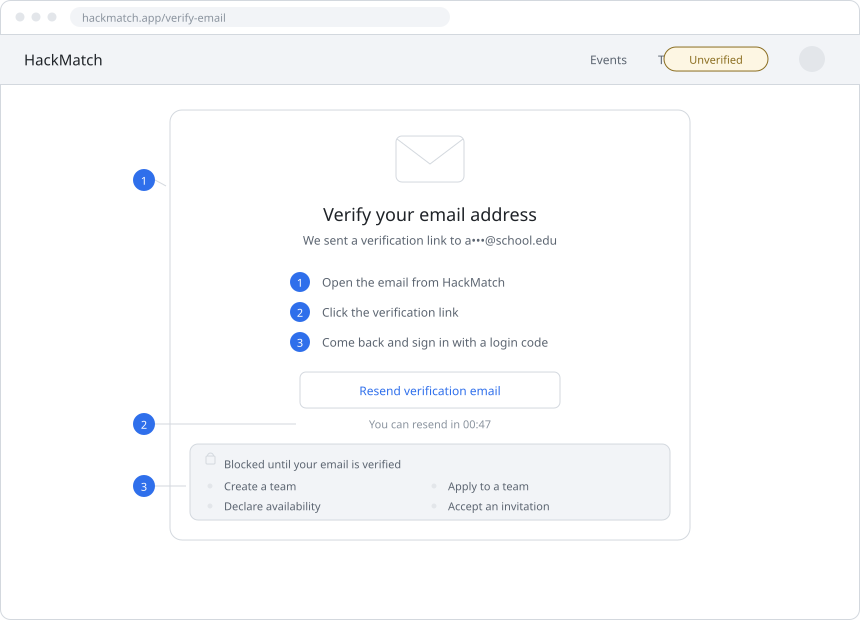
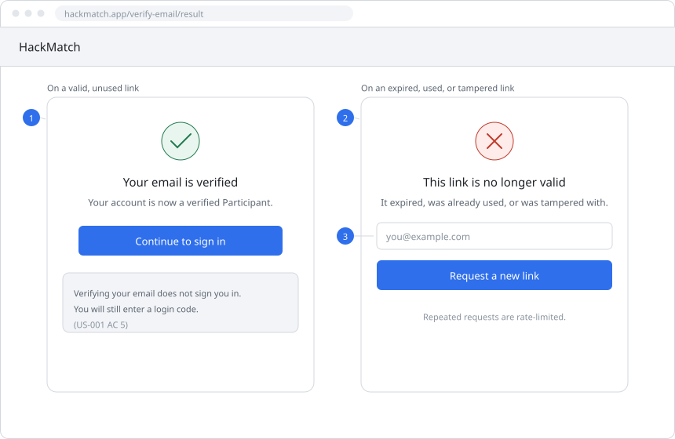
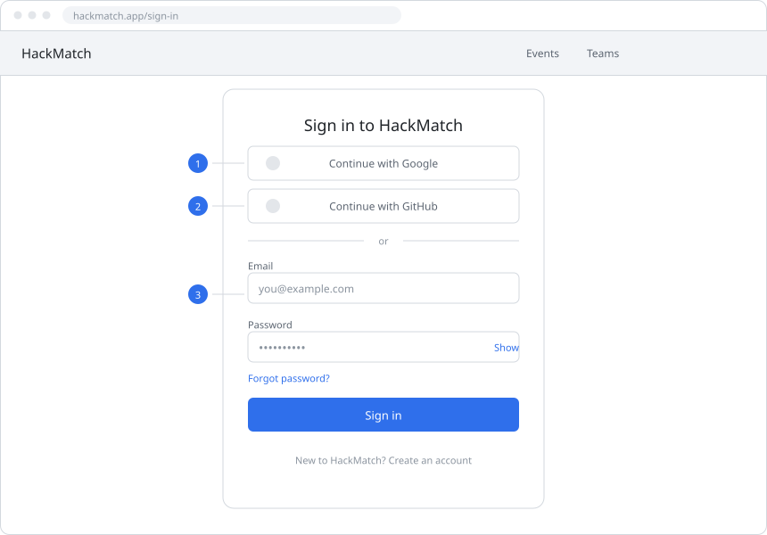
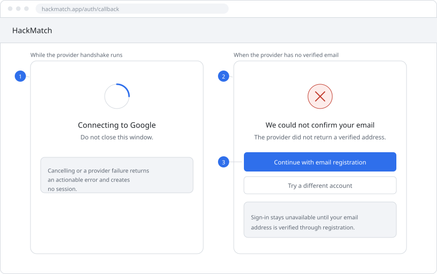
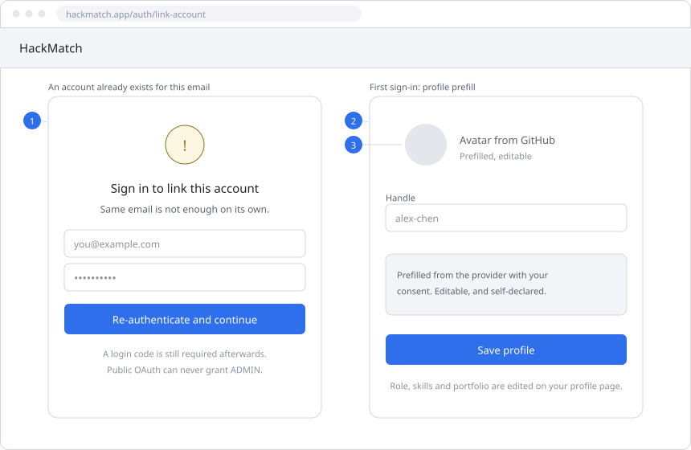
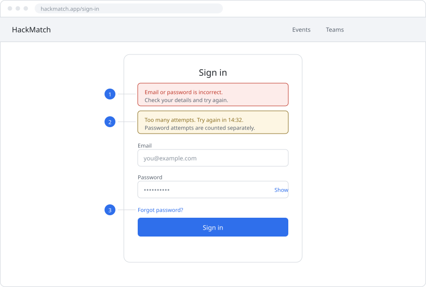
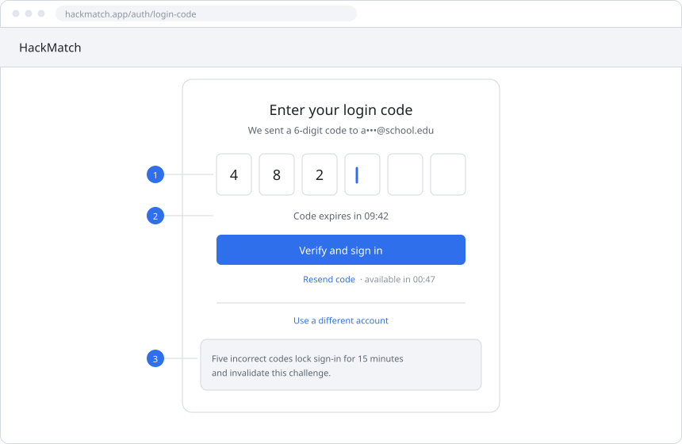
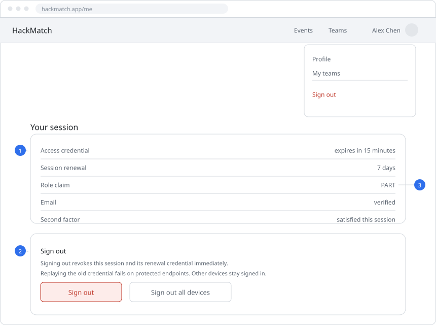

# HackMatch User Manual

| Item             | Detail                                                                                                  |
| ---------------- | ------------------------------------------------------------------------------------------------------- |
| Scope            | US-001, US-002, US-003, US-004                                                                          |
| Delivery         | Must-Have — MVP                                                                                         |
| Visuals          | Wireframes for US-001–003; **screenshot placeholders** for US-004 (replace with captures when ready)    |
| Sources of truth | `docs/02_user_stories/user_stories.md`, `docs/04_requirements/functional_nonfunctional_requirements.md` |
| Version          | v1.1 · Sprint 1 (US-004 added)                                                                          |
| Chinese version  | [`user_manual_us-001_003.html`](user_manual_us-001_003.html)                                            |
| HTML version     | [`user_manual_us-001_003_en.html`](user_manual_us-001_003_en.html)                                      |

## Contents

1. [Scope and exclusions](#1-scope-and-exclusions)
2. [Roles and terminology](#2-roles-and-terminology)
3. [Three ground rules](#3-three-ground-rules)
4. [US-001 Participant registration and email verification (3 wireframes)](#4-us-001-participant-registration-and-email-verification)
5. [US-002 Federated (OAuth) registration and sign-in (3 wireframes)](#5-us-002-federated-oauth-registration-and-sign-in)
6. [US-003 Sign-in and session management (3 wireframes)](#6-us-003-sign-in-and-session-management)
7. [US-004 Email-based login two-factor authentication (OTP)](#7-us-004-email-based-login-two-factor-authentication-otp)
8. [Appendix A Requirement mapping](#appendix-a-requirement-mapping)
9. [Appendix B Documentation conflicts awaiting a team decision](#appendix-b-documentation-conflicts-awaiting-a-team-decision)
10. [Appendix C How to read the wireframes](#appendix-c-how-to-read-the-wireframes)

## 1. Scope and exclusions

This manual describes what a user can see, do, and be told by the system. It is not an implementation specification. Every threshold and rule below comes from the authoritative documents in this repository; no new constraints are introduced here.

| Topic              | Description                                                                                                                                                                                                                     |
| ------------------ | ------------------------------------------------------------------------------------------------------------------------------------------------------------------------------------------------------------------------------- |
| In scope           | Email registration, email ownership verification, Google / GitHub federated registration and sign-in, primary credential validation, session establishment, sign-out, and **email login one-time code (US-004 OTP / 2FA)**.     |
| Out of scope       | The complete password recovery flow (US-005), authenticator-based factors (US-029, May-Have), and everything from US-006 onward — participant profile management (role, skills, portfolio URL) and team formation features.     |
| Interface language | Wireframe and UI labels are in English, matching the implementation. All explanatory prose in this version is in English as well.                                                                                               |
| Screenshots        | US-004 figures use **placeholders**. Replace each `assets/us-004-screenshots/…` path with a real capture when available; do not invent UI that the product does not show.                                                        |

## 2. Roles and terminology

| Identifier | Meaning                 | What it does in this manual                                                                                          |
| ---------- | ----------------------- | -------------------------------------------------------------------------------------------------------------------- |
| `VISITOR`  | Unauthenticated visitor | Can open the registration page and start an OAuth handshake; cannot reach anything that requires a session.          |
| `PART`     | Participant account     | The registration target. Public registration can only ever produce this role.                                        |
| `LEAD`     | Team owner context      | Not a separate global role. It is a per-event team ownership context and is out of scope here.                       |
| `ADMIN`    | Platform administrator  | Set only by an authorized deployment operator through a Firebase custom claim. No public entry point can produce it. |

Two state terms matter throughout:

- **Unverified** — the account exists, but mailbox ownership has not been proven. There is no usable session and most interactive features are gated.
- **Pre-authentication** — the primary credential has been validated, but the login code has not been entered. There is still no usable session.

## 3. Three ground rules

> **Rule one: verifying an email is not signing in**
>
> Email ownership verification only flips a state flag. It does not create a full login session. US-001 AC 5 requires a further email one-time code (US-004).

> **Rule two: every sign-in passes through a login code**
>
> Once the primary credential succeeds, email / password, Google and GitHub all continue to the login code step. A provider's own MFA is not an exemption, and no team action is possible before the code is accepted.

> **Rule three: no public entry point ever yields an administrator**
>
> Public registration offers no role selector, and public OAuth can neither create, link, nor promote an `ADMIN` account. Administrators are provisioned only by a deployment operator setting a custom claim.

## 4. US-001 Participant registration and email verification

**Delivery** Must-Have / MVP · **Priority** High · **Effort** Medium · **Role** `VISITOR`

> As an unauthenticated visitor, I want to create an account with my email and password and verify my email address, so that I can establish a verified Participant profile.

### 4.1 What the user does

1. Open the registration page from the navigation bar and fill in **full name**, **email** and **password**.
2. The password must satisfy all four rules at once: at least 8 characters, mixed case, at least one digit, at least one special character. The checklist under the field updates as you type.
3. The email does not need to be a school domain. Any mailbox works.
4. On submit, the system sends a verification link to that address and the page moves into a waiting state.
5. Open the email and click the link. A valid, unused link marks the email as verified and the account as Verified.
6. Return to the site and sign in normally, including the login code. Verifying your email does not sign you in.

### 4.2 Wireframes

#### Figure 1.1 Registration form page

**Figure 1.1** Registration form page — the only entry point that creates a new account.

1. **Email field** — format and uniqueness are validated here; an **academic domain is not required**, any mailbox passes.
2. **Password rules checklist** — 8+ characters, mixed case, a digit and a special character, prompted live as you type.
3. **Federated entry points** — Google and GitHub sit on the same page as email registration and lead into the US-002 flow.

Note: there is **no role selector anywhere on this page** — public registration can only create a participant account.

#### Figure 1.2 Verification gate

**Figure 1.2** Verification gate — the account exists, but no interactive feature is usable yet.

1. **Unverified state** — the account exists and an Unverified chip is shown, but there is **no usable session**, so the user stays on this page.
2. **Resend** — another email can be requested, but it is rate-limited; the button stays disabled until the countdown ends.
3. **Blocked feature list** — until verified, the user cannot create a team, declare availability, apply, or accept an invitation.

#### Figure 1.3 Verification outcomes

**Figure 1.3** Verification outcomes — success only changes state, failure offers a new link.

1. **Success branch** — the email and account are marked verified, but **no session is created**; sign-in and the login code still follow.
2. **Failure branch** — expired, already used, or tampered links are refused and reveal no account information.
3. **Replacement link** — a new verification email can be requested, subject to rate limiting.

### 4.3 Errors and prompts

| Scenario                                    | What the user sees                                                        |
| ------------------------------------------- | ------------------------------------------------------------------------- |
| Malformed or already-registered email       | Field-level error; no navigation and no account created.                  |
| Password fails one of the four rules        | The corresponding checklist item is flagged and submit stays inactive.    |
| Verification link expired, used or tampered | "This link is no longer valid", with an entry point to request a new one. |
| Resend clicked repeatedly                   | Button disabled with a countdown; no duplicate mail is sent.              |
| Team action attempted while unverified      | Blocked by the gate and routed back to the verification page.             |

### 4.4 Acceptance checklist

- **AC 1** — full name, email and password can be submitted; the password meets 8+ characters, mixed case, a digit and a special character; an academic domain is **not** required.
- **AC 2** — email format and uniqueness are validated by the authentication service, which sends a verification link valid for **24 hours**; a replacement may be requested. See Appendix B, C3 for the source disagreement behind this number.
- **AC 3** — a valid unused link marks the email and the account as Verified; expired, consumed or tampered links fail without granting access; a replacement may be requested.
- **AC 4** — unverified accounts cannot declare availability, create teams, apply, or accept invitations; public registration grants no administrator role.
- **AC 5** — email ownership verification does **not** create a full login session; the email one-time code must succeed first.

## 5. US-002 Federated (OAuth) registration and sign-in

**Delivery** Must-Have / MVP · **Priority** High · **Effort** Medium · **Role** `VISITOR` / `PART`

> As a visitor or Participant, I want to register and sign in using my Google or GitHub account, so that I can access the platform quickly without creating separate credentials.

### 5.1 What the user does

1. On the entry page, choose **Continue with Google** or **Continue with GitHub**.
2. Complete consent on the provider's page. You may cancel at any time.
3. If the provider returns a **verified email**, the system provisions a participant account only, then continues to the login code step.
4. If the provider returns no verified email, the page routes you to email registration / verification instead of creating an account.
5. On first sign-in, and only with your consent, the provider handle and avatar may be prefilled. These are labelled self-declared and are not proof of skill or portfolio authorship.
6. If the email already has an account, **matching email text alone is not enough to link**: you must re-authenticate to that account and then pass a login code.

### 5.2 Wireframes

#### Figure 2.1 Sign-in and registration entry page

**Figure 2.1** Sign-in / registration entry page — three authentication paths converge here.

1. **Google entry** — after consent, a verified email is available and a participant account can be provisioned.
2. **GitHub entry** — if the user's email is private or unverified, they are routed to email registration.
3. **Email and password entry** — the US-003 sign-in chain, with uniformly generic failure messages.

#### Figure 2.2 Authorization callback branches

**Figure 2.2** Authorization callback branches — failure creates no session, a missing email creates no account.

1. **Handshake in progress** — if the user cancels or the provider errors, an actionable message appears and **no session is created**.
2. **No verified email** — the reason is stated explicitly and the user is routed to email registration / verification rather than failing silently.
3. **No account on this branch** — this path neither provisions a participant account nor attempts to link an existing one.

#### Figure 2.3 Account linking and profile prefill

**Figure 2.3** Account linking and profile prefill — linking requires re-authentication; prefill is convenience, not verification.

1. **Linking an existing account** — re-authentication to that account plus a successful login code is required; matching email text alone is insufficient.
2. **Handle field** — prefilled from the provider with your consent and fully editable; it is self-declared, not verified.
3. **Avatar prefill** — also provider-sourced and consent-based. Neither the handle nor the avatar is evidence of skill or portfolio authorship.

Scope note: **role, skills and portfolio URL are not part of this story.** They belong to participant profile management (US-006) and are outside this manual's scope; the figure only points the user to where they are edited.

### 5.3 Errors and prompts

| Scenario                           | What the user sees                                                                             |
| ---------------------------------- | ---------------------------------------------------------------------------------------------- |
| Consent popup cancelled            | Returns to the entry page with an actionable message; no session is created.                   |
| Provider error or invalid response | An error message; no session is created.                                                       |
| Provider returns no verified email | The reason is explained and the user is routed to email registration / verification.           |
| The email already has an account   | Re-authentication to that account is required; matching email text is not accepted on its own. |
| Public OAuth used to obtain ADMIN  | Never succeeds; a public entry point cannot create, link or promote an administrator.          |

### 5.4 Acceptance checklist

- **AC 1** — Google or GitHub can be chosen; cancellation, invalid provider responses and provider failure all produce an actionable error and no session.
- **AC 2** — only a validated provider identity with a verified email provisions a Verified participant account; otherwise the user is routed to email registration / verification.
- **AC 3** — with consent, the provider handle and avatar may be prefilled; portfolio claims remain self-declared.
- **AC 4** — linking an existing account requires re-authentication plus a successful login code; public OAuth cannot create, link to, or promote an administrator.
- **AC 5** — every provider sign-in proceeds to the email code step; no full session or team action is possible before it succeeds.

## 6. US-003 Sign-in and session management

**Delivery** Must-Have / MVP · **Priority** High · **Effort** Medium · **Role** `PART` / `ADMIN`

> As a Participant or Administrator, I want to sign in, maintain an authorized session, and sign out, so that I can safely use my authorized functions.

### 6.1 What the user does

1. Enter email and password and submit.
2. Correct credentials do **not** drop you into the app. The UI asks for the 6-digit email code first.
3. Only a correct, unexpired code establishes the session and unlocks protected features.
4. While the session is live, every protected request is checked against the signed ID token and the role claim.
5. Sign out when done: the current session and its renewal credential are revoked immediately, and replaying the old credential fails.

### 6.2 Wireframes

#### Figure 3.1 Sign-in page with failure and lockout banners

**Figure 3.1** Sign-in page — generic failures and a separately counted password throttle.

1. **Uniform generic failure** — "account does not exist" and "wrong password" are indistinguishable, preventing account enumeration.
2. **Password throttling** — counted separately from login code attempts; changing IP, browser or sign-in method does not bypass the account-level lock.
3. **Password reset entry** — resetting does **not** clear the password throttle and does **not** bypass the login code.

#### Figure 3.2 Login code page

**Figure 3.2** Login code page — the mandatory gate for every sign-in method.

The full OTP behaviour (entry, resend, expiry, lockout, delivery failure) is documented in [§7 US-004](#7-us-004-email-based-login-two-factor-authentication-otp). Summary for sign-in context:

1. **Single-use code** — bound to the account and to this challenge, invalidated on use; concurrent submissions yield at most one success.
2. **Expiry** — 10 minutes. After that, request a new code (or sign in again); the challenge cannot be extended in place.
3. **Attempt exhaustion** — five incorrect codes lock sign-in for 15 minutes and invalidate outstanding challenges; resending, changing IP or changing browser does not reset the counter.

#### Figure 3.3 Session state and sign-out

**Figure 3.3** Session state and sign-out — lifetimes, role claim and revocation are all user-visible.

1. **Credential lifetimes** — access credential 15 minutes, renewal credential 7 days; tokens travel over HTTPS only and the browser side must be protected against XSS.
2. **Sign out** — revokes the current session and its renewal credential immediately; replaying the old credential fails on protected endpoints. Other devices stay signed in unless a global revocation is used.
3. **Protected requests** — each one verifies the signed ID token and the role custom claim; suspended or deleted accounts can neither start nor renew a session.

### 6.3 Errors and prompts

| Scenario                                   | What the user sees                                                                           |
| ------------------------------------------ | -------------------------------------------------------------------------------------------- |
| Wrong password                             | "Email or password is incorrect." — it does not reveal whether the account exists.           |
| Repeated wrong passwords in a short window | Remaining wait time and retry guidance; the account-level lock is unaffected by changing IP. |
| Suspended or deleted account               | Cannot start or renew a session.                                                             |
| Wrong login code                           | Retry is allowed, with the remaining attempts shown.                                         |
| Expired login code                         | The user is told to sign in again and obtain a new code.                                     |
| Old credential replayed after sign-out     | Protected endpoints reject it outright.                                                      |

### 6.4 Acceptance checklist

- **AC 1** — primary credentials are validated by the authentication service; the UI shows uniform generic failure messages that do not reveal whether an account exists.
- **AC 2** — valid primary authentication grants no usable session until the login code succeeds; the backend rejects any token without a second-factor claim; suspended accounts cannot start or renew sessions.
- **AC 3** — repeated incorrect passwords are throttled and the UI shows retry guidance; this throttling is separate from login code attempt throttling.
- **AC 4** — every protected request verifies the ID token; tokens are sent over HTTPS only; XSS protection is mandatory on the browser side, and any cookie-based session is HttpOnly, Secure and protected against request forgery.
- **AC 5** — sign-out revokes refresh tokens and replaying the old credential fails; expired or revoked sessions cannot invoke protected endpoints.

## 7. US-004 Email-based login two-factor authentication (OTP)

**Delivery** Must-Have / MVP · **Priority** High · **Effort** Medium · **Role** `PART` / `ADMIN`

> As a Participant or Platform Administrator, I want to verify my identity via a one-time code sent to my email during login, so that a compromised password alone does not grant account access.

Email / password, Google, and GitHub sign-in all stop at this step. A provider’s own MFA does **not** replace the HackMatch email code. No usable account session is created until the correct code is accepted.

### 7.1 What the user does

1. Complete primary sign-in (email and password, or Google / GitHub). The password or provider consent alone is **not** enough.
2. The system emails a **cryptographically random 6-digit code** to the verified address for this sign-in challenge.
3. On the **Enter verification code** screen, type the code from the email and choose **Verify code**.
4. A correct, unused, unexpired code unlocks the account for this sign-in. The code cannot be reused.
5. If the email has not arrived, use **Resend code** (subject to a short cooldown and hourly limits). Requesting a new code **invalidates** the previous one; the failure counter is **not** reset by resend.
6. After five incorrect codes, the account is locked for **15 minutes**. During the lock, verify and new codes are refused; changing browser, IP, or provider does not bypass it. Existing sessions already in use are not forced out solely by this lock.
7. If the email cannot be sent, the UI shows a safe message and **Try sending again**. No session is created. Failed sends do not count against the resend cooldown the same way a successful send does, so a controlled retry is allowed.

### 7.2 Screenshots (placeholders)

> Replace each placeholder image under `docs/assets/us-004-screenshots/` with a real product screenshot. Keep the figure numbers and captions.

#### Figure 4.1 Enter verification code

> **[Screenshot placeholder]** OTP entry after successful primary sign-in: heading, masked email, 6-digit field, **Verify code**, **Resend code**, **Sign out**, and expiry countdown.

**Figure 4.1** Enter verification code — mandatory gate after password or OAuth.

1. **Masked destination** — the UI shows where the code was sent without exposing the full address unnecessarily.
2. **6-digit field** — digits only; empty or incomplete values show a clear validation message before the server is called.
3. **Expiry countdown** — the code is valid for **10 minutes** from issuance; when time runs out, verify is disabled until a new code is requested.

#### Figure 4.2 Resend and predecessor invalidation

> **[Screenshot placeholder]** Resend in progress or cooldown (`Resend code (Ns)`), plus optional note that a new email was sent.

**Figure 4.2** Resend — issues a new challenge and retires the old one.

1. **Cooldown** — rapid repeated resends are limited (about one successful send per minute, and a small number per hour).
2. **Predecessor invalid** — after a successful resend, the previous code never authenticates, even if it has not yet expired.
3. **Failure counter unchanged** — resend does not wipe incorrect-attempt history for this lockout cycle.

#### Figure 4.3 Incorrect, expired, or already-used code

> **[Screenshot placeholder]** Error alert for wrong code, expired code, or already-used code; input may be cleared for wrong / expired / consumed cases.

**Figure 4.3** Failure states that do not grant access.

1. **Incorrect code** — retry is allowed until the five-attempt limit; the message does not reveal account internals.
2. **Expired or invalidated** — user is told to request a new code; the old challenge cannot be extended in place.
3. **Already used** — a consumed code cannot complete login again.

#### Figure 4.4 Five-attempt lockout (15 minutes)

> **[Screenshot placeholder]** Lock banner with remaining wait time; Verify and Resend disabled.

**Figure 4.4** Account temporarily locked after five incorrect OTP attempts.

1. **15-minute lock** — sign-in completion and new session start stay blocked until the wait ends.
2. **Outstanding codes cleared** — challenges issued before the lock stop working.
3. **After unlock** — the user must complete primary authentication again and enter a **fresh** code; the failure cycle resets for the new cycle.

#### Figure 4.5 Email delivery failure and retry

> **[Screenshot placeholder]** Delivery-failure alert and **Try sending again** (no session created).

**Figure 4.5** Safe feedback when the verification email cannot be sent.

1. **No session** — a send failure never verifies the login or creates an account session.
2. **Retry** — the user can try sending again; entered nonsensitive context (such as email on the sign-in form) is retained where applicable.
3. **No secrets in the message** — the UI never displays the OTP itself; only the email message contains the code.

### 7.3 Errors and prompts

| Scenario                                      | What the user sees                                                                                          |
| --------------------------------------------- | ----------------------------------------------------------------------------------------------------------- |
| Empty or non–6-digit code                     | Field validation: enter the 6-digit verification code; submit stays blocked or is rejected client-side.     |
| Incorrect code                                | Clear error; retry allowed until five failures in the current cycle.                                        |
| Expired, invalidated, or already-used code    | Told the code is no longer valid; request a new one.                                                        |
| Resend too quickly / too often                | Button disabled with wait time (rate limit guidance).                                                       |
| Five incorrect codes                          | Account locked for about 15 minutes; verify and resend unavailable until the countdown ends.                |
| Email send failure                            | Safe retry message; **Try sending again**; no session created.                                              |
| Not signed in / unauthorized                  | Prompted to sign in again before a code can be sent or checked.                                             |
| Suspended account                             | Cannot complete OTP or start a session.                                                                     |

### 7.4 Acceptance checklist

- **AC 1** — after successful primary authentication, a cryptographically random 6-digit OTP is sent to the verified email, bound to the account and challenge, and expires **10 minutes** after issuance; at or after expiry it is rejected.
- **AC 2** — only the matching current unused OTP completes authentication; it is consumed so it cannot be reused; a successful verify resets the OTP failure cycle for the next login.
- **AC 3** — the fifth incorrect OTP attempt locks the account for **15 minutes** and invalidates outstanding challenges; login completion and session renewal stay blocked during the lock; changing browser, IP, provider, or requesting another code does not reset the counter or bypass the lock.
- **AC 4** — after lock expiry, primary authentication and a fresh OTP are required; the failure counter resets for the new cycle; existing sessions are not revoked solely by the OTP lockout.
- **AC 5** — reissuing a code invalidates its predecessor without resetting failures; expired or consumed codes never authenticate; resend and email failure behaviour follow FR-081 and FR-084.
- **AC 6** — OAuth and password recovery do not exempt an account from email OTP; provider MFA is not an alternative in the MVP.

## Appendix A Requirement mapping

| Requirement | Stories                  | The rule the user experiences                                                                                                                                                                                                                                                                               |
| ----------- | ------------------------ | ----------------------------------------------------------------------------------------------------------------------------------------------------------------------------------------------------------------------------------------------------------------------------------------------------------- |
| `FR-001`    | US-001                   | Email registration: validate email uniqueness and the password policy (8+ characters, mixed case, a digit, a special character); an academic domain is optional; send a verification link valid for 24 hours; public registration grants no administrator role.                                             |
| `FR-002`    | US-001                   | Activate email ownership: reject expired, tampered or consumed tokens; mark the account Verified but do **not** create a full session; block team creation, availability, applications and invitation acceptance while unverified; allow a replacement verification request.                                |
| `FR-003`    | US-002 / US-004          | Google sign-in: validate the provider response and verified email; provision participants only; every sign-in proceeds to the email code; cancellation or failure creates no session; linking an existing account needs re-authentication plus a login code; public OAuth must never link an administrator. |
| `FR-004`    | US-002 / US-004 / US-006 | GitHub sign-in: require a verified email or redirect to email registration / verification; with consent populate handle and avatar; portfolio achievements remain self-declared.                                                                                                                            |
| `FR-005`    | US-003                   | Validate primary credentials: salted adaptive password hash; generic invalid-credential responses; suspended or deleted accounts cannot start or renew a session; a valid credential only reaches pre-authentication.                                                                                       |
| `FR-006`    | US-003                   | Throttling: five consecutive incorrect passwords lock primary authentication for 15 minutes; changing IP or sign-in method does not bypass the lock; the counter resets on success or lock expiry; it is separate from the login code counter.                                                              |
| `FR-007`    | US-003 / US-004          | Session issuance: usable only after primary authentication and the email code; access credential 15 minutes, renewal credential 7 days; expired credentials and client-supplied privilege changes are rejected.                                                                                             |
| `FR-008`    | US-003                   | Sign-out revokes the current session and its renewal credential; replaying the old credential fails on protected operations; other sessions remain unless a global revocation applies.                                                                                                                      |
| `NR-007`    | US-003 / US-004          | Session storage and request security: browser-side secrets are not script-readable and travel over HTTPS only; a cookie-based session requires HttpOnly, Secure, an appropriate SameSite policy and request-forgery protection; lockout and revocation cannot be bypassed via renewal.                      |
| `FR-009`    | US-004                   | Issue email login OTP: after valid primary authentication (including OAuth), generate a cryptographically random 6-digit code for the verified email; bind it to account/challenge; expire after 10 minutes; never grant a full session merely because email was sent or a provider used MFA.             |
| `FR-010`    | US-004                   | Verify OTPs and lockouts: only a current matching unused code authenticates and is consumed; reject at/after 10 minutes; five incorrect attempts lock login and session renewal for 15 minutes and invalidate challenges; resend/IP/provider changes do not reset attempts; success or lock expiry resets the counter. |
| `FR-081`    | US-001 / US-004 / US-005 | Authentication email rate limits: controlled resend (for example cooldown between sends and a rolling hourly cap) with clear retry guidance.                                                                                                                                                              |
| `FR-084`    | US-001 / US-004 / US-005 | Authentication email delivery failure: a send failure never verifies an account or creates a session; show safe retry/help feedback; retain nonsensitive form data; allow controlled retry under FR-081; never expose OTP/reset tokens in diagnostics.                                                   |
| `NR-008`    | US-004                   | Email login 2FA security: random single-use 6-digit OTP, 10-minute rejection, 15-minute lock after 5 incorrect attempts; counters persist across resend, IP, browser and OAuth; no full session before OTP; concurrent replay yields at most one success.                                                |

---

HackMatch · COMP 313 Project 2 · Team 1 — User manual (US-001 to US-004).

Content is derived from `docs/02_user_stories/user_stories.md` and `docs/04_requirements/functional_nonfunctional_requirements.md`. Where this manual and a source document disagree, the source document wins.
